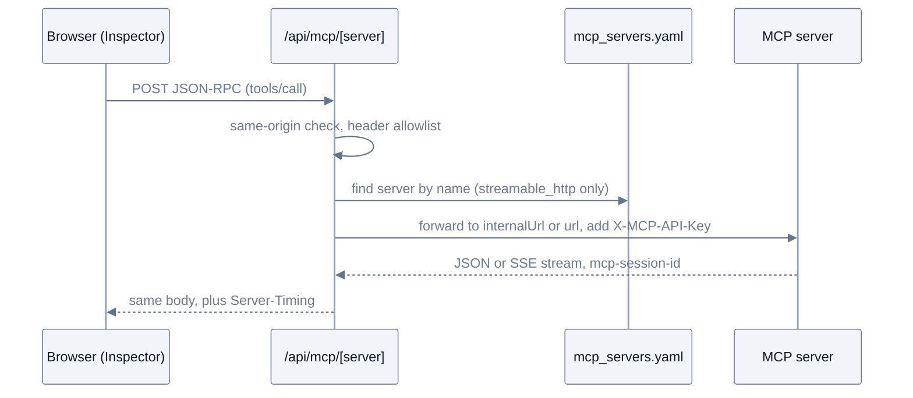
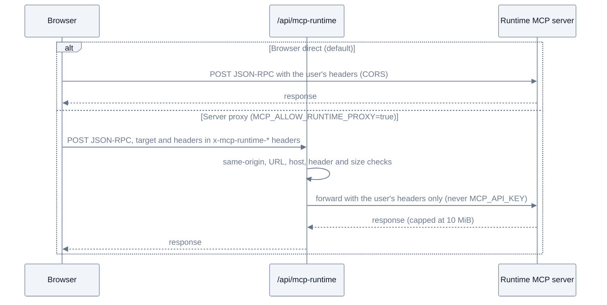
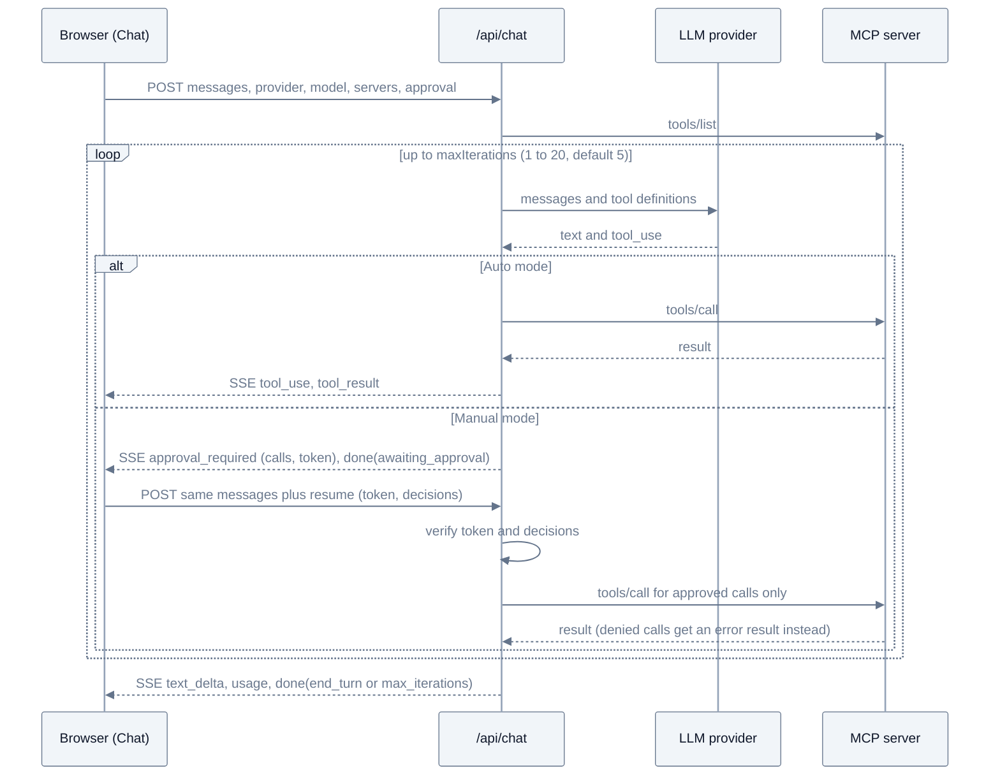
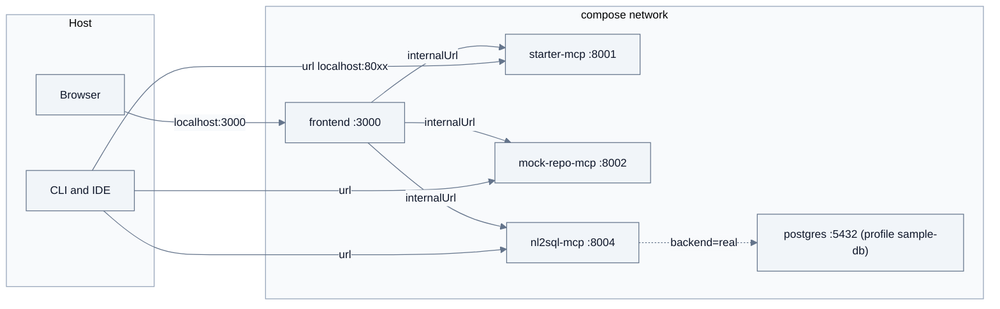

# Architecture

MCP Connectors has four parts: two Claude Code skills that write and build servers, the MCP servers themselves (Python, FastMCP) on a shared `_common` package, a registry file, and two clients that read that registry (a CLI and a Next.js Frontend). This page describes each part, how requests travel, and where the security boundaries are.

<picture><source media="(prefers-color-scheme: dark)" srcset="assets/diagrams/architecture-dark.svg"></picture>

## Contents

- [Components](#components)
- [Request paths](#request-paths)
- [Transports](#transports)
- [Docker topology](#docker-topology)
- [Security boundaries](#security-boundaries)

## Components

### Skills

| Skill | Input | Output |
|---|---|---|
| `/mcp-spec-writer` (`.claude/skills/mcp-spec-writer/`) | A conversation about the system to connect | A spec at `docs/mcp-spec/<server-name>_v0.X.md` (sections 0 to 10, English or Korean) |
| `/mcp-server-builder` (`.claude/skills/mcp-server-builder/`) | A spec | A server package, tests, a scenario YAML, registry entries, Makefile targets |

The skills are optional. [writing-a-server.md](writing-a-server.md) also covers the manual path.

### MCP servers

Each server is a package under `src/mcp-servers/` with one entry point, `python -m <package>.server --transport stdio|http`.

| Package | Registry names | Role |
|---|---|---|
| `starter_mcp` | `starter-mcp` (stdio), `starter-mcp-http` (:8001) | Canonical starter and regression baseline: 4 tools, 4 resources, 2 prompts, no backend |
| `mock_repo_mcp` | `mock-repo-mcp` (:8002) | Code repository tools behind a swappable backend client (fixtures by default, REST when configured) |
| `nl2sql_mcp` | `nl2sql-mcp` (stdio), `nl2sql-mcp-http` (:8004) | Schema discovery and read-only SQL behind a guardrail pipeline (PostgreSQL by default, Oracle optional) |

### `_common`

Shared modules in `src/mcp-servers/_common/`. Servers import them as `from _common.<module> import ...`. The dependency is one way: nothing in `_common` imports a server.

| Module | Purpose |
|---|---|
| `auth.py` | ASGI middleware that checks `X-MCP-API-Key` against `MCP_API_KEY` (constant time, off when the key is empty). `build_http_middleware()` returns CORS plus auth in the right order |
| `cors.py` | Starlette CORS middleware for direct browser connections, origins from `MCP_CORS_ORIGINS`, exposes `mcp-session-id` |
| `env.py` | `env_files(__file__)`: absolute paths to the root `.env` and an optional package `.env`, so settings load the same way from any working directory |
| `errors.py` | `ToolError` subclasses: `InvalidInputError`, `NotFoundError`, `AccessDeniedError`, `BackendUnavailableError`, `ResponseTooLargeError` |
| `logging.py` | JSON logs to stderr (stdout is reserved for stdio JSON-RPC) and `hash_params()` to log a hash instead of raw arguments |
| `masking.py` | `mask_pii()` with regex rules for card numbers, resident registration numbers, long digit runs, emails, phone numbers, account numbers |
| `retry.py` | `with_backoff()`: tenacity exponential backoff for transient backend errors |
| `trust.py` | `wrap_untrusted(metadata, untrusted_content)`: separates server facts from external text in tool responses |

[guardrails.md](guardrails.md) shows how to use them in a new server.

### Registry

`configs/mcp_servers.yaml` is the single list of servers. The CLI (`scripts/mcp_cli.py`) and the Frontend (`frontend/src/lib/mcp/registry.ts`, server side only) both read it. The Frontend reads it on every request, so edits apply without a rebuild.

| Field | Transport | Meaning |
|---|---|---|
| `name` | both | Unique name used by the CLI (`--server`), the proxy path, and the UI |
| `transport` | both | `stdio` or `streamable_http` |
| `command` | stdio | Command list, run from `src/mcp-servers/` by the CLI |
| `url` | HTTP | Address reachable from the host. Used by the CLI and by a Frontend running on the host |
| `internalUrl` | HTTP, optional | Address inside the compose network. Used by the Frontend when `MCP_USE_INTERNAL_URL=true` |
| `headers` | HTTP, optional | Extra request headers. `${VAR}` is replaced from the environment, and `MCP_API_KEY` is added as `X-MCP-API-Key` when that header is absent |
| `description`, `description_ko` | both | English text (CLI and UI) and optional Korean text (UI in Korean) |

### CLI

`scripts/mcp_cli.py` (typer) has `list-servers`, `list-tools`, `call`, `list-resources`, `read-resource`, `list-prompts`, `get-prompt`, and `test`. It starts stdio servers as child processes and connects to HTTP servers by `url`. `test` runs scenario YAML files ([scenario-format.md](scenario-format.md)) with optional JUnit output.

### Frontend

Next.js 16 App Router in `frontend/`. Browser state lives in the browser (settings and keys in `localStorage`, conversations in IndexedDB, runtime servers in `sessionStorage`). The server side holds secrets and talks to MCP servers and LLM providers.

| Page | Purpose |
|---|---|
| `/` Dashboard | Health, latency, and status of every registered and runtime server, client config copy, Getting started checklist |
| `/inspector` | Call tools, read resources, get prompts. JSON-RPC log, call history with scenario export, server info |
| `/chat` | LLM tool-use loop over the exposed servers, trace waterfall, approval mode, token usage, saved conversations |
| `/settings` | LLM provider, models, keys, system prompt, defaults, local data reset |

| API route | Methods | Purpose |
|---|---|---|
| `/api/registry` | GET | Browser-safe registry: HTTP servers with the proxy path as `url`, no `internalUrl` or `headers`. Also used by the container health check |
| `/api/mcp/[server]` | GET, POST, DELETE | Streamable HTTP proxy to a registered server. Adds the API key on the server side |
| `/api/mcp-runtime` | GET, POST, DELETE | Optional proxy to a runtime server. Returns 403 unless `MCP_ALLOW_RUNTIME_PROXY=true` |
| `/api/chat` | POST | Runs the LLM tool-use loop and streams events as SSE |

## Request paths

The diagrams below use the Docker setup. On the host the only difference is the upstream address (`url` instead of `internalUrl`).

### Registered servers

The browser never connects to a registered server. It sends JSON-RPC to the same-origin proxy, which looks the server up in the registry, adds `X-MCP-API-Key`, and streams the response back unchanged (including SSE).

The proxy forwards only `accept`, `content-type`, `mcp-session-id`, `mcp-protocol-version`, and `last-event-id`, does not follow redirects, and refuses stdio entries (400) and unknown names (404). The `Server-Timing` header feeds the Inspector's Timing view.

### Runtime servers

**Add server** connects to an MCP server that is not in the registry, for the current tab only (`sessionStorage`). There are two connection modes.

| Mode | Path | Needs | Usable in Chat |
|---|---|---|---|
| Browser direct (default) | Browser to target | CORS on the target that allows the Frontend origin and exposes `mcp-session-id` | No |
| Server proxy (opt in) | Browser to `/api/mcp-runtime` to target | `MCP_ALLOW_RUNTIME_PROXY=true` on the Frontend | Yes |

### Chat

`/api/chat` runs the whole loop on the server. It connects to each exposed server with `resolveUpstream()` (the same address and key rules as the proxy, not through the proxy), lists the tools, renders `configs/prompts/chat_system.md`, and calls the LLM. Events go back to the browser as SSE: `run_start`, `iteration`, `text_delta`, `tool_use`, `tool_result`, `usage`, `approval_required`, and `done`. When more than one server is exposed, tool names get a `server__` prefix.

In **Auto** mode tool calls run as soon as the model asks for them. In **Manual** mode the server stays stateless: it ends the turn with `approval_required` (the pending calls and a signed token) and `done(awaiting_approval)`, and the browser sends the conversation back with the user's decisions.

The LLM key comes from the request (the browser's Settings) or, only when `CHAT_ALLOW_SERVER_KEYS=true`, from the server environment. Runtime servers can be exposed only in server proxy mode, and their tool results are truncated at 256 Ki characters.

## Transports

| | stdio | Streamable HTTP |
|---|---|---|
| Start | The client spawns `python -m <pkg>.server --transport stdio` | You run the server (`make run-*-http`, Docker) and clients connect to `/mcp` |
| Used by | IDEs, Claude Desktop, the CLI | The Frontend, the CLI, remote clients |
| Auth and CORS | None (no HTTP layer) | `build_http_middleware()`: CORS outside, `X-MCP-API-Key` inside |
| Sessions | One process per client | `mcp-session-id` header, SSE for streamed responses |
| In the Frontend | Listed on the Dashboard, not callable from a browser | Inspector, Chat, health checks |

Logs always go to stderr, because stdout carries JSON-RPC in stdio mode. In HTTP mode the servers listen on `0.0.0.0`.

## Docker topology

`docker compose up` starts `starter-mcp`, `mock-repo-mcp`, `nl2sql-mcp`, and `frontend` on the default compose network. The `postgres` sample database belongs to the `sample-db` profile and starts only through `make sample-db-up` or `make nl2sql-sample-db`.

- The `frontend` container sets `MCP_USE_INTERNAL_URL=true`, so server-side calls use `internalUrl` such as `http://starter-mcp:8001/mcp`. The same name would not resolve from the host, which is why the CLI and a host-run Frontend use `url` (`http://localhost:8001/mcp`).
- The MCP ports are published for the CLI and IDEs. The browser only needs port 3000.
- `.env` is not copied into images. Compose reads the root `.env` to fill `${VAR}` in `docker-compose.yaml` and passes values as container environment variables.
- The registry and the Chat prompt are copied into the Frontend image (`/app/configs`). Rebuild the image (`docker compose up -d --build`) after editing them, or run the Frontend on the host.
- `nl2sql-mcp` picks its backend from the compose variable `NL2SQL_CONTAINER_BACKEND` (`mock` by default), switched by `make nl2sql-sample-db` and `make nl2sql-mock`. Its audit log is on the `nl2sql-var` volume.
- The Python images run as uid 10001 and the Frontend as the `node` user.

## Security boundaries

MCP Connectors is a local development and verification tool. The full security model and the reporting process are in [SECURITY.md](../SECURITY.md). This section explains the two boundaries that matter most when you configure the Frontend.

### What stays on the server

- `MCP_API_KEY` is attached by `/api/mcp/[server]` and `/api/chat` on the server side. `/api/registry` never returns `internalUrl` or `headers`, and the proxy drops any `X-MCP-API-Key` or cookie the browser sends.
- Server LLM keys are used only with `CHAT_ALLOW_SERVER_KEYS=true`. The browser learns only whether a key exists.
- `/api/mcp/*`, `/api/mcp-runtime`, and `/api/chat` reject requests whose `Origin` host differs from the request host. `/api/chat` also rejects `Sec-Fetch-Site: cross-site` and requires `Content-Type: application/json`, so another site cannot trigger tool calls with a form post.

### Runtime server boundary

A runtime server is any URL a user types into **Add server**. The design keeps that input away from server secrets.

- **Storage**: the URL and header values live in `sessionStorage` for the tab. They are not written to `localStorage`, logs, call history, scenario or conversation exports, or the page URL. Saved conversations keep only the server name.
- **Direct mode (default)**: the Frontend server is not involved. The target sees the user's browser and headers, and the browser's CORS rules apply.
- **Proxy mode** (`MCP_ALLOW_RUNTIME_PROXY=true`): the Frontend server makes requests to user-supplied URLs, so the proxy is off by default and returns 403 without contacting anything. When on, it accepts only `http` and `https` URLs without credentials, rejects link-local and cloud metadata hosts, does not follow redirects, caps the wait for the first response at 60 s and the response at 10 MiB (both configurable) and the request at 2 MiB, forwards at most 20 user headers, refuses reserved headers such as `Host`, and **never attaches `MCP_API_KEY`**. Chat applies the same checks to runtime servers and rejects names that collide with registry servers.
- **Not blocked**: loopback and private ranges (`127.0.0.1`, `10/8`, `172.16/12`, `192.168/16`), because local and internal MCP servers are the main use case. The host check reads the URL text and does not resolve DNS. With the proxy on, anyone who can reach the Frontend can make it send requests into its network. Turn it on only where every user is trusted.

### Approval tokens

Manual approval must make sure that what runs is exactly what the user approved, even though the server keeps no state between the two requests. The token and its checks are in `frontend/src/lib/chat/approval-token.ts` and `frontend/src/lib/chat/resume.ts`.

- The token is `<issuedAt>.<iterationsUsed>.<nonce>.<signature>`, where the signature is HMAC-SHA256 over the pending calls (id, name, input), the iterations used, the issue time, and a random nonce. Changing the SQL shown on screen or lowering the iteration count breaks the signature.
- On resume the server checks, in order: the conversation ends with the assistant message that holds the pending calls, the client did not supply results for them, the signature matches, the token is at most **30 minutes** old (60 s clock skew allowed), the nonce was not used before, and there is exactly one decision per pending call. Results come only from calls the server executes. Denied calls get an error result that tells the model the call did not run.

Operating conditions:

| Condition | Why | What to do |
|---|---|---|
| Signing key | The key is `CHAT_APPROVAL_SECRET` when it has **16 or more characters**. Otherwise (unset or shorter) each process generates a random key, so a pending approval fails after a restart or on another instance | Set the same `CHAT_APPROVAL_SECRET` on every Frontend instance if approvals must survive restarts or load balancing |
| Expiry | Tokens older than 30 minutes are rejected. Conversations saved while waiting do not keep the token, so reopening them marks the calls as cancelled | Ask the model again |
| One-time use | Used nonces are kept **in process memory** until they expire. Each instance has its own list, and the list is cleared on restart | Behind a load balancer, use sticky sessions so a resend reaches the same instance, or accept that a token can be replayed once per other instance (or after a restart) within its 30 minutes |

A replay can only repeat calls the user already approved with the same arguments, so the limitation affects duplicate execution, not what can run.

### Data returned to the model

`wrap_untrusted` marks external text in tool responses and `mask_pii` hides common PII patterns. Neither sanitizes content: telling the model not to follow instructions found in `untrusted_content` is the job of the agent's system prompt. See [guardrails.md](guardrails.md).
