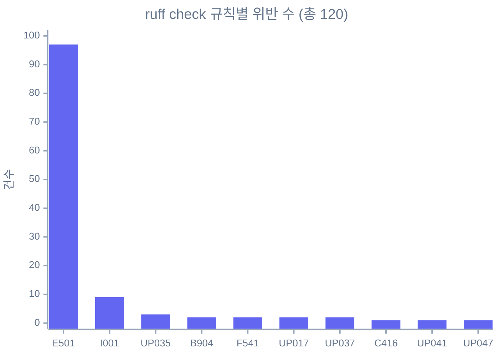

# 개편 전 기준선 (Baseline)

> 작업 계획서 [update-plan.md](../update-plan.md)의 **0-5. 기준선 기록** 산출물입니다.
> 개편을 시작하기 전 저장소가 어떤 상태였는지 남겨 두고, 이후 Phase에서 회귀 여부를 판단하는 기준으로 씁니다.
> 이 문서는 스냅샷입니다. 측정 중 발견한 문제는 고치지 않고 기록만 했습니다.

## 요약

| 영역 | 명령 | 결과 | 비고 |
|---|---|---|---|
| Python 테스트 | `make test-simple-mcp-server` | ✅ 11 passed | 0.20s |
| Python 테스트 | `make test-echo-mcp` | ✅ 10 passed | 0.11s |
| Python 테스트 | `make test-mock-repo-mcp` | ✅ 16 passed | 0.05s |
| Python 테스트 | `make test-oracle-nl2sql-mcp` | ✅ 38 passed | 0.08s, 전부 `MockOracleBackend` 사용 (실 DB 미접속) |
| Python 테스트 | `uv run pytest -q` (전체) | ✅ 75 passed | 0.78s, skip 0, error 0 |
| Python 린트 | `uv run ruff check src/ scripts/` | ❌ 120 errors | 대부분 NL2SQL 서버, 19개 자동 수정 가능 |
| Python 포맷 | `uv run ruff format --check src/ scripts/` | ❌ 16 files | 16개 파일 재포맷 필요, 38개 정상 |
| Frontend 의존성 | `npm ci` | ⚠️ 설치 성공 | `npm audit` 기준 취약점 31건 보고 |
| Frontend 테스트 | `npm run test` (vitest) | ✅ 118 passed | 12 files, 약 1s |
| Frontend 린트 | `npm run lint` (eslint) | ✅ 0 problems | 약 3s |
| Frontend 빌드 | `npm run build` (next build) | ✅ 성공 | 약 17s, 6개 라우트 |
| E2E | `make test-e2e` (Playwright) | ✅ 1 passed | 테스트 18.8s, 브라우저 다운로드 포함 총 101s |

한 줄로 정리하면, **테스트와 빌드는 모두 통과하지만 Python 린트 게이트(`make lint-py`)는 현재 실패 상태**입니다. 계획서 Phase 2 완료 기준인 "전체 테스트와 lint 통과"를 만족하려면 이 부분을 먼저 정리해야 해요.

## 측정 환경

| 항목 | 값 |
|---|---|
| 측정일 | 2026-10-21 |
| 커밋 | `33df13d` (`33df13dc83ff8f8f3cdbb2ee87f795e4e8380ee0`, main) |
| 작업 트리 | 추적 파일 변경 없음 (미추적 `.gitleaks.toml` 1개, 다른 작업에서 추가 중) |
| OS | macOS 26.5.2 (Build 25F84), arm64 |
| Python | 3.12.12 (`uv run python`) |
| uv | 0.11.32 |
| ruff | 0.15.13 (pre-commit 훅은 v0.15.8로 고정) |
| Node.js | v24.18.0 |
| npm | 11.16.0 |
| vitest | 4.1.7 |
| Playwright | 1.60.0 (chromium) |
| Next.js | 16.2.6 (Turbopack) |

사전 조건은 다음과 같습니다.

- Python 의존성은 `uv sync --all-extras --dev`로 미리 동기화했습니다.
- `frontend/node_modules`가 없어서 `npm ci`로 새로 설치했습니다.
- 루트 `.env`는 없으며 실 DB 접속 정보와 LLM API 키도 쓰지 않았습니다. 외부 자격 증명이 필요한 명령은 실행하지 않았습니다.

## Python 테스트

`Makefile`에서 `^test-`로 시작하는 타깃은 5개입니다. 이 중 Python 대상 4개는 아래와 같고, `test-e2e`는 [E2E](#e2e-playwright) 절에서 따로 다룹니다.

| 타깃 | 테스트 경로 | passed | failed | skipped | 소요 |
|---|---|---|---|---|---|
| `test-simple-mcp-server` | `tests/simple_mcp_server/` | 11 | 0 | 0 | 0.20s |
| `test-echo-mcp` | `tests/echo_mcp/` | 10 | 0 | 0 | 0.11s |
| `test-mock-repo-mcp` | `tests/mock_repo_mcp/` | 16 | 0 | 0 | 0.05s |
| `test-oracle-nl2sql-mcp` | `tests/oracle_nl2sql_mcp/` | 38 | 0 | 0 | 0.08s |
| **합계 (`uv run pytest -q`)** | `tests/` | **75** | 0 | 0 | 0.78s |

- 타깃별 합(11 + 10 + 16 + 38 = 75)과 전체 실행 결과가 일치합니다. `tests/test_health.py`는 수집되는 테스트가 0개입니다.
- `CLAUDE.md`와 `Makefile` 주석에 적힌 케이스 수(10, 16, 11, 38)도 현재 결과와 같습니다.
- **NL2SQL 테스트와 실 DB의 관계**: 38개 모두 `tests/oracle_nl2sql_mcp/conftest.py`에서 `MockOracleBackend`를 주입하거나 `oracle_mock_mode=True`로 lifespan을 띄워 실행됩니다. 따라서 DB가 없는 환경에서도 전부 통과하며, 실 Oracle 연결 경로(`db/connector.py`)는 이 테스트로 검증되지 않습니다. 실 DB가 필요한 YAML 시나리오 러너(`scripts/run_mcp_tests.py`)는 이번 기준선 범위에서 제외했고, 계획서 0-6에서 별도로 기록합니다.

## Python 린트와 포맷

`make lint-py`가 실행하는 두 명령을 각각 돌렸습니다. 둘 다 종료 코드 1로 실패합니다.

### `ruff check` 결과: 120 errors



| 규칙 | 건수 | 자동 수정 | 의미 |
|---|---|---|---|
| E501 | 97 | 불가 | line-too-long (105자 초과) |
| I001 | 9 | 가능 | unsorted-imports |
| UP035 | 3 | 가능 | `typing` 대신 `collections.abc` 사용 |
| B904 | 2 | 불가 | `except` 안의 `raise`에 `from` 누락 |
| F541 | 2 | 가능 | placeholder 없는 f-string |
| UP017 | 2 | 가능 | `datetime.UTC` 별칭 사용 |
| UP037 | 2 | 가능 | 따옴표로 감싼 타입 주석 |
| C416 | 1 | 불가 | 불필요한 set comprehension |
| UP041 | 1 | 가능 | `asyncio.TimeoutError` 대신 `TimeoutError` |
| UP047 | 1 | 불가 | PEP 695 제네릭 문법 미사용 |

파일별로 보면 위반이 거의 한 곳에 몰려 있습니다.

| 파일 | 건수 |
|---|---|
| `src/mcp-servers/oracle_nl2sql_mcp/db/mock_backend.py` | 85 |
| `src/mcp-servers/oracle_nl2sql_mcp/guardrails/audit_log.py` | 5 |
| `src/mcp-servers/oracle_nl2sql_mcp/db/connector.py` | 5 |
| `src/mcp-servers/oracle_nl2sql_mcp/tools/run_sql_query.py` | 4 |
| `src/mcp-servers/oracle_nl2sql_mcp/guardrails/enforce_timeout.py` | 4 |
| `src/mcp-servers/oracle_nl2sql_mcp/tools/get_table_schema.py` | 3 |
| `scripts/run_mcp_tests.py` | 3 |
| 그 밖의 NL2SQL 파일 8개 | 각 1~2 |

- 120건 중 117건이 `oracle_nl2sql_mcp`, 3건이 `scripts/run_mcp_tests.py`입니다. `_common`, `simple_mcp_server`, `echo_mcp`, `mock_repo_mcp`, `scripts/mcp_cli.py`는 `ruff check` 위반이 없습니다.
- E501 대부분은 `mock_backend.py`의 목업 데이터 리터럴(긴 문자열 행)에서 나옵니다.
- I001 9건은 NL2SQL 모듈의 import 정렬 문제로, `pyproject.toml`의 isort `known-first-party`에 NL2SQL 패키지가 빠져 있는 것과 관련이 있어 보입니다.

### `ruff format --check` 결과: 16 files

재포맷이 필요한 파일은 다음 16개입니다. 나머지 38개는 이미 포맷이 맞습니다.

- `scripts/mcp_cli.py`, `scripts/run_mcp_tests.py`
- `src/mcp-servers/oracle_nl2sql_mcp/` 아래 14개: `config.py`, `models.py`, `db/__init__.py`, `db/mock_backend.py`, `guardrails/__init__.py`, `guardrails/enforce_date_range.py`, `guardrails/enforce_pii_control.py`, `guardrails/enforce_row_limit.py`, `guardrails/enforce_select_only.py`, `tools/get_table_schema.py`, `tools/get_tables_schema.py`, `tools/run_sql_query.py`, `tools/search_columns.py`, `tools/search_tables_schema.py`

pre-commit에 `ruff --fix`와 `ruff-format` 훅이 있는데도 이런 상태라는 건, NL2SQL 관련 커밋이 훅을 거치지 않았거나 훅 설치 전에 들어왔다는 뜻으로 보입니다.

## Frontend

모든 명령은 `frontend/`에서 실행했습니다.

### `npm ci`

- 775개 패키지 설치, 약 20s 소요, 종료 코드 0.
- `npm audit` 요약: **취약점 31건** (critical 2, high 21, moderate 6, low 2). 세부 패키지는 이번에 확인하지 않았습니다.
- `fsevents`, `sharp`, `unrs-resolver`의 install script가 npm `allow-scripts` 정책으로 보류되었다는 경고가 나옵니다. 그래도 이후 테스트, 빌드, E2E는 정상 동작했습니다.

### `npm run test` (vitest)

| Test Files | Tests | failed | 소요 |
|---|---|---|---|
| 12 passed | 118 passed | 0 | 약 1s (972ms) |

### `npm run lint` (eslint)

경고와 오류 없이 종료 코드 0으로 끝났습니다 (약 3s).

### `npm run build` (next build)

Turbopack 컴파일, TypeScript 검사, 정적 페이지 생성까지 경고 없이 성공했습니다 (약 17s).

| 라우트 | 종류 |
|---|---|
| `/` | Static |
| `/_not-found` | Static |
| `/settings` | Static |
| `/chat` | Dynamic |
| `/inspector` | Dynamic |
| `/api/chat` | Dynamic |

## E2E (Playwright)

`make test-e2e`는 `npx playwright install chromium` 뒤에 `npm run test:e2e`를 실행합니다. `globalSetup`이 `mock-repo-mcp`(:8002)를 직접 띄우고 `webServer`가 `npm run dev`(:3000)를 기동하므로 외부 자격 증명 없이 돌릴 수 있었습니다. 실행 전 3000, 8002 포트는 비어 있었고 종료 후에도 남은 프로세스는 없었습니다.

| 테스트 | 결과 | 소요 |
|---|---|---|
| `tests/e2e/inspector.spec.ts` › Inspector → mock-repo-mcp.list_repositories happy path | ✅ passed | 5.9s |
| **합계** | 1 passed | 18.8s (Playwright 기준) |

- 캐시에 다른 리비전(1234, 1243)만 있어서, 설치된 Playwright 1.60.0이 요구하는 chromium 1223과 headless shell을 새로 내려받았습니다. 전체 101s 중 대부분이 이 다운로드 시간입니다.
- E2E 시나리오는 Inspector happy path 1개뿐입니다. Chat, Settings, Dashboard는 E2E로 덮이지 않아요.

## 관찰된 문제

이번 측정에서 드러난 문제와, 이를 다룰 계획서 Phase를 연결해 둡니다.

1. **Python 린트 게이트 실패** (`ruff check` 120건, `ruff format` 16파일). `make lint-py`와 `make lint-all`이 현재 실패합니다. 대부분 NL2SQL 서버와 `scripts/run_mcp_tests.py`에 몰려 있습니다. [Phase 2](../update-plan.md#phase-2-버그-수정과-코드-품질-개선) 완료 기준("전체 테스트와 lint 통과")에 직접 걸리는 항목입니다.
2. **isort 설정 누락 의심** (I001 9건). `pyproject.toml`의 `known-first-party`에 NL2SQL을 추가하는 작업은 Phase 2-A에 이미 들어 있습니다.
3. **pre-commit 훅 우회 흔적**. ruff 훅이 있는데도 포맷되지 않은 파일이 커밋되어 있습니다. 또 pre-commit의 ruff 버전(v0.15.8)과 로컬 ruff(0.15.13)가 다릅니다. Phase 0-4(pre-commit에 gitleaks 추가) 작업 때 훅 설치 여부와 버전 정렬을 함께 점검하는 게 좋겠습니다.
4. **NL2SQL 실 DB 경로 미검증**. 단위 테스트 38개는 모두 Mock 백엔드를 쓰기 때문에 `db/connector.py`는 테스트되지 않습니다. 실 DB 시나리오 통과율은 Phase 0-6과 Phase 2-C(YAML 시나리오 재실행)에서 다룹니다.
5. **`_common`과 HTTP transport 테스트 부재**. 현재 Python 테스트는 도구 단위(in-memory)뿐이고 `_common` 모듈 단위 테스트나 Streamable HTTP 통합 테스트는 없습니다. Phase 2-C 항목과 일치합니다.
6. **Frontend 의존성 취약점 31건** (critical 2, high 21). 계획서에 명시된 항목은 아직 없습니다. Phase 2-B나 [Phase 7](../update-plan.md#phase-7-공개-준비와-릴리스) 공개 준비 단계에서 `npm audit` 점검을 추가하는 것을 제안합니다.
7. **E2E 범위가 좁음**. Inspector happy path 1건뿐이며, Phase 4와 Phase 5에서 화면을 개편할 때 회귀를 잡기에는 부족합니다.
8. **Makefile 정리 필요**. `.PHONY`에 `test-simple-mcp-server`, `test-echo-mcp`, `test-mock-repo-mcp` 등이 빠져 있고 통합 `make test` 타깃이 없습니다. 이번 기준선도 타깃을 하나씩 실행해야 했어요. Phase 2-A의 Makefile 항목에서 다룹니다.

## 재현 방법

```bash
uv sync --all-extras --dev
make test-simple-mcp-server test-echo-mcp test-mock-repo-mcp test-oracle-nl2sql-mcp
uv run pytest -q
uv run ruff check src/ scripts/ --statistics
uv run ruff format --check src/ scripts/
cd frontend && npm ci && npm run test && npm run lint && npm run build
cd .. && make test-e2e
```

원본 로그는 저장소에 남기지 않았습니다. `ruff check` 로그가 80KB를 넘고, 나머지 로그에도 로컬 절대 경로가 섞여 있어 Phase 1 비식별화 방향과 맞지 않기 때문입니다. 필요하면 위 명령으로 다시 만들 수 있습니다.
