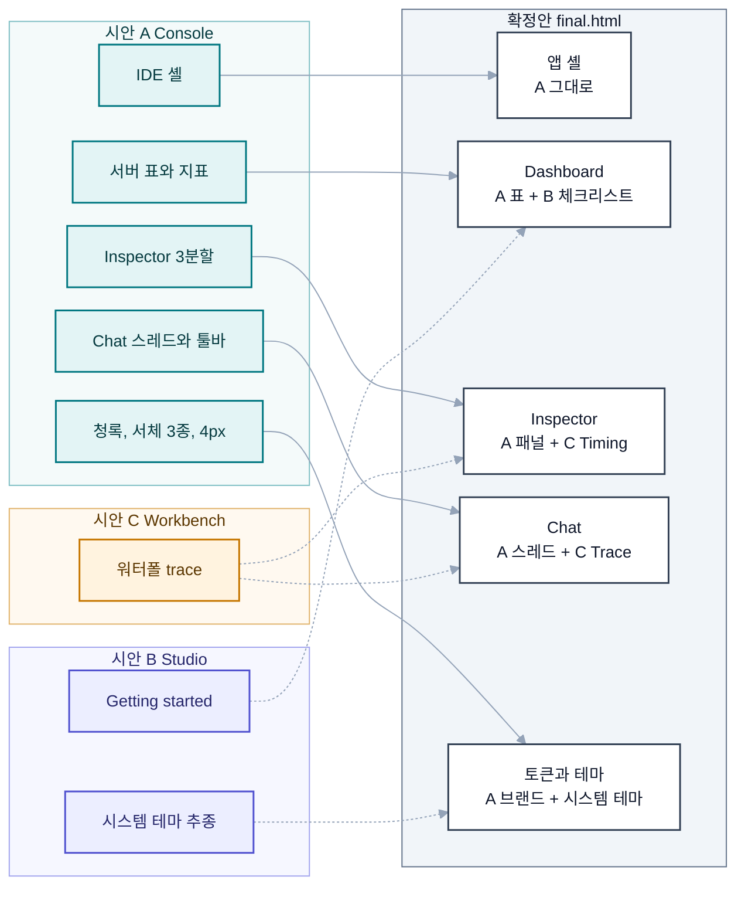

# MCP Connectors 디자인 결정 기록 (Phase 3)

> 작성일: 2026-10-22
> 상태: Phase 3 3-8 확정 기록. Phase 4(Frontend 개편)와 Phase 5(신규 기능)의 디자인 기준 문서입니다.
> 정본: 값은 [design/tokens.css](design/tokens.css), 화면은 [design/final.html](design/final.html)이 정본입니다. 이 문서는 둘을 풀어 쓴 설명이고, 충돌하면 두 파일을 따릅니다.

## 1. 결정 요약

### 1.1 무엇을 골랐나

사용자가 2026-10-22에 비교 페이지([design/comparison.html](design/comparison.html))의 추천 조합을 그대로 확정했습니다. 세 시안을 하나로 합친 확정 시안이 [design/final.html](design/final.html)입니다.

| 결정 항목 | 확정 내용 |
|---|---|
| 앱 셸 | 시안 A "Console"의 IDE형 셸(타이틀바, 활동 바, 서버 사이드바, 청록 상태바, 명령 팔레트, 모바일 하단 탭바) |
| Dashboard | A Dashboard(지표 4칸, 서버 표, 스파크라인) 위에 B의 Getting started 4단계 체크리스트를 A 시각 언어로 다시 그려 얹음 |
| Inspector | A Inspector(도구 목록, 요청, 응답 3분할과 하단 도킹 패널). 응답의 Timing 탭은 C 워터폴로 교체 |
| Chat | A 셸 안의 A 스레드와 툴바, 오른쪽 추적 패널은 C 워터폴 trace |
| 브랜드 | A 청록(`--brand` 라이트 `#007781`, 다크 `#37d6dd`) |
| 서체 | JetBrains Mono(제목, 코드), IBM Plex Sans(본문), 한국어 IBM Plex Sans KR |
| 라운드 | `--radius` 4px |
| 기본 테마 | 시스템 설정 추종, 수동 토글(Light, Dark, System) 제공. A 시안의 다크 강제는 쓰지 않음 |
| 언어 | 영어 기본, 한국어 전환(EN/KO) |

### 1.2 왜 이 조합인가

결정의 근거는 [update-plan.md](../update-plan.md)의 두 문장입니다.

1. **0.2 목표 2, "MCP 서버 개발자가 매일 켜 두는 도구".** 서버 개발자가 하루에 가장 많이 하는 일은 도구를 고치고 다시 호출하는 일입니다. 비교 매트릭스의 "반복 디버깅 속도"에서 A가 5/5로 가장 유리했고(B 2/5, C 3/5), 정보 밀도(A 5, B 2, C 3)와 Phase 5 기능 수용력(A 5, B 3, C 4)도 A가 앞섰습니다. 그래서 셸과 Inspector는 A에서 가져왔습니다.
2. **7.1 차별점 3, "Inspector + Chat 일체형".** 공식 MCP Inspector에 없는 것이 LLM 도구 사용 루프이고, 그 루프를 가장 잘 보여 주는 것이 C의 워터폴입니다(LLM과 도구 흐름 가시성 A 3, B 2, C 5). 같은 워터폴 컴포넌트를 Chat trace와 Inspector Timing 탭에 함께 쓰면 두 화면이 한 어휘로 말하게 되고, "일체형"이라는 주장이 화면으로 증명됩니다.

A의 가장 큰 약점인 첫인상과 온보딩(2/5)은 컴포넌트로 메웠습니다. B의 Getting started는 셸에 묶이지 않는 독립 카드라 A Dashboard 위에 얹을 수 있고, 실제 동작(Inspector 호출, Chat 도구 호출, 설정 복사)에 맞춰 스스로 체크되며 숨길 수 있어 매일 쓰는 사람에게 방해가 되지 않습니다. 기본 테마는 오픈소스 사용자 환경이 제각각이라 시스템 추종으로 정했어요. A의 다크 값은 그대로 두고, 처음 열 때 다크를 강제하지만 않습니다.

### 1.3 검토한 대안과 버린 이유

| 대안 | 구성 | 장점 | 버린 이유 |
|---|---|---|---|
| B 셸 중심안 (비교 페이지가 제시한 차선) | B Dashboard, B Inspector, Chat 오른쪽에 C 워터폴 패널 | 첫인상 5/5, Phase 4 비용 최저(shadcn과 기존 Geist에 거의 1:1), 모바일 4/5 | 넓은 여백 탓에 Inspector 응답이 접힘 아래로 내려가 반복 디버깅이 느림(2/5). 정보 밀도가 셋 중 가장 낮아 "매일 켜 두는 도구" 목표와 어긋남 |
| A 단독 | A 그대로 | 반복 디버깅, 밀도, 다크 품질, 브랜드 존재감 모두 5/5 | 온보딩 2/5. Chat 추적이 텍스트라 시간 비중이 보이지 않음(3/5). 처음 열면 다크 강제 |
| B 단독 | B 그대로 | 온보딩과 구현 비용 | 반복 디버깅 2/5, LLM과 도구 흐름 가시성 2/5. 차별점(일체형)이 화면에서 드러나지 않음 |
| C 단독 | C 그대로 | 흐름 가시성 5/5, 라이트와 다크 완성도 균형 | 1024~1280px에서 3열이 빡빡함(2/5), Phase 4 비용 2/5, 앰버가 라이트 면에서 약함(브랜드 2/5, 라이트 버튼 면 대비 1.82) |

매트릭스 점수는 시안 제작자 자기 평가와 update-plan 3.2 완료 기록을 근거로 한 상대 판단이고 측정값이 아닙니다. 항목 합계도 내지 않았습니다.

## 2. 구성: 어떤 요소를 어디서 가져왔나

### 2.1 구성 다이어그램

실선은 A에서 그대로 가져온 요소, 점선은 다른 시안에서 옮겨 심은 요소입니다.



노드와 묶음이 각자 면 색을 가지고 있어 페이지 배경이 라이트든 다크든 글자가 자기 면 위에서 읽힙니다. 연결선(`#94A3B8`)은 두 배경 모두에서 보이는 중간 명도입니다.

### 2.2 화면별 출처

| 화면 / 요소 | 출처 | 확정안에서 바꾼 점 |
|---|---|---|
| 앱 셸 (타이틀바, 활동 바, 사이드바, 상태바, 팔레트, 모바일 탭바와 드로어) | A | 다크 강제 제거. 1080px 이하 사이드바 200px, 서버 수 숨김 |
| Dashboard 지표, 서버 표, 오프라인 경고, Runtime 섹션, 최근 점검 로그 | A | 없음 |
| Getting started 체크리스트 | B | A의 패널 문법(1px 선, 4px 라운드, mono 헤더)으로 다시 그림. 실제 동작에 맞춰 자동 체크, 숨김/다시 보기 |
| Inspector 도구 목록, 요청 폼, 응답 탭, 하단 도킹(JSON-RPC 로그, 기록, 서버 정보) | A | 응답 Timing 탭을 C 워터폴로 교체 |
| Chat 툴바(모델, 최대 반복, 승인, 토큰), 스레드, 도구 카드, Composer, 대화 목록 사이드바 | A | 도구 카드에 "Show in trace" 연결, 카드와 스팬 상호 강조 |
| Chat 추적 패널 | C | 터미널형 텍스트 추적을 워터폴로 교체. 범례, 스팬 상세, 실행 요약 포함 |
| 트레이스 스팬 색 | 신규 | C의 도구 스팬 청록이 A 브랜드와 겹쳐 `--span-*` 토큰과 `--chart-6` 추가 |
| 브랜드, 서체, 라운드 | A | 없음 |
| 기본 테마 | B, C | 시스템 추종 |

## 3. 확정 토큰 (`data-concept="a"` 기준)

아래 값은 [design/tokens.css](design/tokens.css)의 공통 블록과 시안 A 블록을 캐스케이드대로 풀어 쓴 결과입니다. oklch는 tokens.css 원문이고, hex는 `python3 docs/revamp/design/scripts/check_contrast.py --hex`가 시안 A 기준으로 계산한 sRGB 근사값입니다. tokens.css 공통 블록의 hex 주석은 중립 색조 250 기준이라 아래 값과 다를 수 있습니다.

### 3.1 시안 훅

| 토큰 | 값 |
|---|---|
| `--neutral-hue` | 215 |
| `--brand-hue` | 200 |
| 의미 색 색조 | success 150, warning 62, danger 25, info 245 (A는 조정 없음) |

### 3.2 브랜드

| 토큰 | 라이트 oklch | 라이트 hex | 다크 oklch | 다크 hex |
|---|---|---|---|---|
| `--brand` | `oklch(0.52 0.095 205)` | `#007781` | `oklch(0.80 0.125 200)` | `#37d6dd` |
| `--brand-hover` | `oklch(0.47 0.090 205)` | `#006770` | `oklch(0.86 0.110 200)` | `#6ce7ed` |
| `--brand-fg` | `var(--n-0)` | `#fcfefe` | `var(--n-1000)` | `#070c0e` |
| `--brand-subtle` | `oklch(0.955 0.025 205)` | `#def5f8` | `oklch(0.30 0.050 210)` | `#03343c` |
| `--brand-text` | `oklch(0.48 0.090 205)` | `#006b74` | `oklch(0.82 0.115 200)` | `#55dae1` |
| `--brand-border` | `oklch(0.70 0.090 205)` | `#50afb9` | `oklch(0.55 0.090 205)` | `#13808a` |
| `--focus-ring` | `oklch(0.56 0.110 205)` | `#00848f` | `oklch(0.78 0.125 200)` | `#2ccfd7` |
| `--selection` | `oklch(0.90 0.050 205)` | `#b8e8ee` | `oklch(0.38 0.070 205)` | `#004c53` |

### 3.3 중립색 단계 (H 215)

L과 C는 고정이고 H만 `--neutral-hue`를 따릅니다. 단계 값은 테마와 무관합니다.

| 단계 | oklch | hex | 단계 | oklch | hex |
|---|---|---|---|---|---|
| `--n-0` | `oklch(0.995 0.002 215)` | `#fcfefe` | `--n-500` | `oklch(0.560 0.016 215)` | `#6a777a` |
| `--n-25` | `oklch(0.985 0.003 215)` | `#f8fbfb` | `--n-600` | `oklch(0.470 0.016 215)` | `#515d60` |
| `--n-50` | `oklch(0.972 0.004 215)` | `#f3f6f7` | `--n-700` | `oklch(0.380 0.015 215)` | `#3a4547` |
| `--n-100` | `oklch(0.952 0.006 215)` | `#ebf0f2` | `--n-750` | `oklch(0.320 0.014 215)` | `#2b3537` |
| `--n-150` | `oklch(0.928 0.007 215)` | `#e2e8ea` | `--n-800` | `oklch(0.275 0.013 215)` | `#21292c` |
| `--n-200` | `oklch(0.900 0.009 215)` | `#d8e0e2` | `--n-850` | `oklch(0.240 0.012 215)` | `#192123` |
| `--n-300` | `oklch(0.840 0.011 215)` | `#c3cccf` | `--n-900` | `oklch(0.210 0.011 215)` | `#131a1b` |
| `--n-400` | `oklch(0.720 0.014 215)` | `#9ba7aa` | `--n-950` | `oklch(0.180 0.010 215)` | `#0d1314` |
| `--n-450` | `oklch(0.640 0.015 215)` | `#828f92` | `--n-1000` | `oklch(0.150 0.009 215)` | `#070c0e` |

### 3.4 면, 선, 텍스트

| 역할 | 라이트 | 라이트 hex | 다크 | 다크 hex | 용도 |
|---|---|---|---|---|---|
| `--bg` | n-25 | `#f8fbfb` | n-950 | `#0d1314` | 페이지 |
| `--bg-subtle` | n-50 | `#f3f6f7` | n-1000 | `#070c0e` | 사이드바, 표 머리 |
| `--surface` | n-0 | `#fcfefe` | n-900 | `#131a1b` | 카드, 패널 |
| `--surface-raised` | n-0 | `#fcfefe` | n-850 | `#192123` | 팝오버, 다이얼로그 |
| `--surface-sunken` | n-50 | `#f3f6f7` | n-1000 | `#070c0e` | 코드, JSON, 로그 |
| `--surface-hover` | n-100 | `#ebf0f2` | n-800 | `#21292c` | hover |
| `--surface-active` | n-150 | `#e2e8ea` | n-750 | `#2b3537` | 눌림, 선택 행 |
| `--line` | n-150 | `#e2e8ea` | n-800 | `#21292c` | 장식용 구분선 |
| `--line-strong` | n-450 | `#828f92` | n-500 | `#6a777a` | 입력 경계(3:1) |
| `--fg` | n-1000 | `#070c0e` | n-25 | `#f8fbfb` | 본문 |
| `--fg-muted` | n-600 | `#515d60` | n-400 | `#9ba7aa` | 보조 텍스트, placeholder |
| `--fg-subtle` | n-450 | `#828f92` | n-500 | `#6a777a` | 아이콘, 큰 텍스트 전용 |
| `--inverse` | n-900 | `#131a1b` | n-100 | `#ebf0f2` | 툴팁, 토스트 면 |
| `--fg-on-inverse` | n-0 | `#fcfefe` | n-1000 | `#070c0e` | 툴팁, 토스트 글자 |
| `--overlay` | `oklch(0.2 0.01 215 / 0.45)` | | `oklch(0 0 0 / 0.6)` | | 모달 뒤 막 |

### 3.5 의미 색

`solid-fg`는 solid 위 글자입니다. 라이트에서 warning만 검정이고, 다크는 모두 n-1000입니다.

| 토큰 | 라이트 oklch | 라이트 hex | 다크 oklch | 다크 hex |
|---|---|---|---|---|
| `--success-fg` | `oklch(0.46 0.12 150)` | `#0f6a31` | `oklch(0.80 0.13 150)` | `#7cd591` |
| `--success-bg` | `oklch(0.962 0.030 150)` | `#e5f9e8` | `oklch(0.27 0.045 150)` | `#152d1a` |
| `--success-border` | `oklch(0.62 0.13 150)` | `#429c5a` | `oklch(0.55 0.11 150)` | `#3b834e` |
| `--success-solid` | `oklch(0.54 0.14 150)` | `#17843f` | `oklch(0.72 0.15 150)` | `#53be70` |
| `--success-solid-fg` | n-0 | `#fcfefe` | n-1000 | `#070c0e` |
| `--warning-fg` | `oklch(0.49 0.12 54)` | `#934a06` | `oklch(0.83 0.12 70)` | `#f9b96c` |
| `--warning-bg` | `oklch(0.967 0.040 80)` | `#fff2de` | `oklch(0.28 0.045 62)` | `#392310` |
| `--warning-border` | `oklch(0.64 0.14 62)` | `#c77618` | `oklch(0.58 0.11 62)` | `#a86a2c` |
| `--warning-solid` | `oklch(0.66 0.15 62)` | `#d27908` | `oklch(0.78 0.14 62)` | `#f6a14f` |
| `--warning-solid-fg` | n-1000 | `#070c0e` | n-1000 | `#070c0e` |
| `--danger-fg` | `oklch(0.50 0.17 25)` | `#b02a2d` | `oklch(0.78 0.13 25)` | `#ff958d` |
| `--danger-bg` | `oklch(0.962 0.025 25)` | `#ffeeec` | `oklch(0.27 0.055 25)` | `#3d1b18` |
| `--danger-border` | `oklch(0.62 0.18 25)` | `#de4e4b` | `oklch(0.58 0.15 25)` | `#c34f4b` |
| `--danger-solid` | `oklch(0.55 0.19 25)` | `#c92f33` | `oklch(0.68 0.17 25)` | `#ef6661` |
| `--danger-solid-fg` | n-0 | `#fcfefe` | n-1000 | `#070c0e` |
| `--info-fg` | `oklch(0.48 0.13 245)` | `#00629d` | `oklch(0.80 0.10 245)` | `#86c5fa` |
| `--info-bg` | `oklch(0.962 0.025 245)` | `#e8f4ff` | `oklch(0.27 0.045 245)` | `#12283b` |
| `--info-border` | `oklch(0.62 0.13 245)` | `#348dcf` | `oklch(0.56 0.11 245)` | `#337ab0` |
| `--info-solid` | `oklch(0.53 0.14 245)` | `#0071b3` | `oklch(0.72 0.12 245)` | `#5eaceb` |
| `--info-solid-fg` | n-0 | `#fcfefe` | n-1000 | `#070c0e` |

warning의 fg와 bg는 tokens.css에서 `calc(var(--warning-hue) - 8)`, `+ 18`, `+ 8`처럼 색조를 옮겨 계산합니다. 위 표의 54, 80, 70은 그 계산 결과입니다.

### 3.6 JSON 구문과 로그

| 토큰 | 라이트 oklch | 라이트 hex | 다크 oklch | 다크 hex |
|---|---|---|---|---|
| `--syntax-key` | `oklch(0.48 0.13 255)` | `#215da5` | `oklch(0.80 0.10 240)` | `#80c7f8` |
| `--syntax-string` | `oklch(0.49 0.12 150)` | `#1d7339` | `oklch(0.80 0.13 148)` | `#80d58d` |
| `--syntax-number` | `oklch(0.52 0.15 45)` | `#ab4500` | `oklch(0.80 0.12 60)` | `#f6ab6b` |
| `--syntax-boolean` | `oklch(0.49 0.17 330)` | `#92318d` | `oklch(0.78 0.13 330)` | `#e698df` |
| `--syntax-null` | `oklch(0.52 0.012 215)` | `#626b6d` | `oklch(0.68 0.012 215)` | `#909a9d` |
| `--syntax-punct` | `var(--fg-muted)` | `#515d60` | `var(--fg-muted)` | `#9ba7aa` |
| `--log-debug` | `var(--fg-muted)` | `#515d60` | | `#9ba7aa` |
| `--log-info` | `var(--info-fg)` | `#00629d` | | `#86c5fa` |
| `--log-warn` | `var(--warning-fg)` | `#934a06` | | `#f9b96c` |
| `--log-error` | `var(--danger-fg)` | `#b02a2d` | | `#ff958d` |
| `--log-request` | `var(--brand-text)` | `#006b74` | | `#55dae1` |
| `--log-response` | `var(--success-fg)` | `#0f6a31` | | `#7cd591` |

### 3.7 차트와 트레이스 스팬

| 토큰 | 라이트 oklch | 라이트 hex | 다크 oklch | 다크 hex | 비고 |
|---|---|---|---|---|---|
| `--chart-1` | `var(--brand)` | `#007781` | `var(--brand)` | `#37d6dd` | 브랜드 |
| `--chart-2` | `oklch(0.58 0.12 165)` | `#0a9068` | `oklch(0.72 0.12 165)` | `#4dbc92` | 초록빛 청록 |
| `--chart-3` | `oklch(0.62 0.16 45)` | `#d16022` | `oklch(0.72 0.15 50)` | `#ee8545` | 주황 |
| `--chart-4` | `oklch(0.56 0.18 340)` | `#b53e95` | `oklch(0.70 0.16 340)` | `#de73bd` | 자홍 |
| `--chart-5` | `oklch(0.58 0.13 240)` | `#0c82bf` | `oklch(0.72 0.12 240)` | `#55aee8` | 파랑 |
| `--chart-6` | `oklch(0.55 0.15 295)` | `#795bbf` | `oklch(0.72 0.12 295)` | `#aa95e8` | 보라, 3-7 추가 |

| 스팬 토큰 | 참조 | 라이트 hex | 다크 hex | 쓰임 |
|---|---|---|---|---|
| `--span-llm` | `var(--chart-1)` | `#007781` | `#37d6dd` | LLM 호출 |
| `--span-tool` | `var(--chart-4)` | `#b53e95` | `#de73bd` | 도구 호출 |
| `--span-guard` | `var(--chart-6)` | `#795bbf` | `#aa95e8` | 가드레일 |
| `--span-proxy` | `var(--chart-5)` | `#0c82bf` | `#55aee8` | 프록시, 업스트림, DB |
| `--span-err` | `var(--danger-solid)` | `#c92f33` | `#ef6661` | 오류, 거부 |
| `--span-wait` | `var(--warning-border)` | `#c77618` | `#a86a2c` | 승인 대기(빗금) |

스팬 토큰은 bare `:root`에 한 번만 선언되고 모두 테마를 따라 바뀌는 토큰을 가리키므로, 다크 블록에 복사본이 없습니다.

### 3.8 서체

| 토큰 | 값 |
|---|---|
| `--font-display` | `"JetBrains Mono", "IBM Plex Sans KR", ui-monospace, monospace` |
| `--font-body` | `"IBM Plex Sans", "IBM Plex Sans KR", var(--font-kr-fallback)` |
| `--font-mono` | `"JetBrains Mono", "IBM Plex Sans KR", ui-monospace, "SFMono-Regular", Menlo, monospace` |
| `--font-kr-fallback` | `"Noto Sans KR", "Apple SD Gothic Neo", "Malgun Gothic", sans-serif` |
| Google Fonts | JetBrains Mono 400..700(가변), IBM Plex Sans 400/500/600/700, IBM Plex Sans KR 400/500/600/700 |

굵기는 `--weight-regular/medium/semibold/bold` = 400, 500, 600, 700입니다. 자간은 `--tracking-tight` -0.015em(제목), `--tracking-normal` 0, `--tracking-caps` 0.06em(대문자 레이블, 한국어는 final.html에서 0.02em)입니다. tokens.css 기본 블록이 `:lang(ko)`에 `word-break: keep-all`을 겁니다.

### 3.9 타입 스케일

| 토큰 | 크기 / 행간 | 주 용도 |
|---|---|---|
| `--text-4xl` / `--leading-4xl` | 36 / 44px | 페이지 제목(드물게) |
| `--text-3xl` / `--leading-3xl` | 30 / 38px | 화면 제목 |
| `--text-2xl` / `--leading-2xl` | 24 / 32px | 섹션 제목 |
| `--text-xl` / `--leading-xl` | 20 / 30px | 패널 제목, 모바일 지표 값 |
| `--text-lg` / `--leading-lg` | 18 / 28px | 카드 제목 |
| `--text-md` / `--leading-md` | 16 / 26px | 채팅 본문, 설명 |
| `--text-base` / `--leading-base` | 14 / 22px | 기본 UI 본문(tokens.css body) |
| `--text-sm` / `--leading-sm` | 13 / 20px | 표, 코드. final.html 셸 body 기본 |
| `--text-xs` / `--leading-xs` | 12 / 18px | 레이블, 로그, 버튼 |
| `--text-2xs` / `--leading-2xs` | 11 / 16px | 캡션, 단축키, 상태바 |

### 3.10 간격, 크기, 라운드

| 토큰 | 값 |
|---|---|
| `--space-0`, `--space-px` | 0, 1px |
| `--space-0-5` ~ `--space-16` | 2, 4(`-1`), 6(`-1-5`), 8(`-2`), 12(`-3`), 16(`-4`), 20(`-5`), 24(`-6`), 32(`-8`), 40(`-10`), 48(`-12`), 64(`-16`)px |
| `--control-h-sm/md/lg` | 28 / 32 / 40px |
| `--touch-min` | 44px |
| `--header-h`, `--sidebar-w`, `--content-max` | 48px, 248px, 1280px |
| `--gutter` | `max(16px, env(safe-area-inset-left, 0px))` |
| `--radius` | 4px |
| `--radius-xs/sm/md/lg/xl` | 2 / 3 / 4 / 6 / 8px (`--radius`의 0.5, 0.75, 1, 1.5, 2배) |
| `--radius-full` | 9999px |
| `--focus-width`, `--focus-offset` | 2px, 2px |

final.html은 `--space-2-5`(10px)를 `var(--space-2-5, 10px)` 폴백으로 씁니다. tokens.css에는 없는 단계라 Phase 4에서 추가할지 정해야 합니다.

### 3.11 그림자

| 토큰 | 라이트 | 다크 |
|---|---|---|
| `--shadow-color` | `oklch(0.25 0.02 215)` (`#162428`) | `oklch(0 0 0)` |
| `--shadow-xs` | `0 1px 2px` 색 6% | `0 1px 2px` 검정 30% |
| `--shadow-sm` | `0 1px 3px` 8%, `0 1px 2px` 4% | 36%, 24% |
| `--shadow-md` | `0 4px 12px -2px` 10%, `0 2px 4px -2px` 6% | 45%, 30% |
| `--shadow-lg` | `0 12px 32px -8px` 16%, `0 4px 8px -4px` 6% | 55%, 30% |
| `--shadow-xl` | `0 24px 64px -12px` 24%, `0 8px 16px -8px` 8% | 65%, 35% |

라이트 그림자는 `oklch(0.25 0.02 var(--neutral-hue) / α)` 형태입니다. 다크에서는 그림자가 잘 보이지 않으므로 면 단계(`--surface` < `--surface-raised`)로 높이를 표현합니다.

### 3.12 모션과 z-index

| 토큰 | 값 |
|---|---|
| `--duration-instant/fast/base/slow` | 80 / 140 / 200 / 320ms (`prefers-reduced-motion: reduce`이면 모두 0ms) |
| `--ease-standard` | `cubic-bezier(0.2, 0, 0, 1)` |
| `--ease-enter` / `--ease-exit` | `cubic-bezier(0, 0, 0.2, 1)` / `cubic-bezier(0.4, 0, 1, 1)` |
| `--ease-emphasized` | `cubic-bezier(0.3, 0, 0, 1.15)` |
| z-index | base 0, raised 10, sticky 100, sidebar 200, dropdown 1000, overlay 1100, modal 1200, popover 1300, toast 1400, tooltip 1500 |

### 3.13 대비 검사 결과

`check_contrast.py`로 시안 3종의 라이트/다크 필수 630쌍을 검사해 미달 0건입니다(2026-10-22, 3-7에서 `--chart-6`과 스팬 150쌍 추가). 시안 A의 결과만 옮기면 다음과 같습니다.

| 테마 | 필수 검사 | 미달 | 본문 기준(4.5) 최소 | UI 기준(3.0) 최소 |
|---|---:|---:|---|---|
| A 라이트 | 105 | 0 | 4.68 (`--success-solid-fg` / `--success-solid`) | 3.09 (`--line-strong` / `--surface-sunken`) |
| A 다크 | 105 | 0 | 5.98 (`--fg-muted` / `--surface-hover`) | 3.82 (`--fg-subtle` / `--surface`) |

그룹별 최솟값(A 라이트 / A 다크)은 본문 15.93 / 12.10, 보조 텍스트 5.91 / 5.98, 브랜드 5.16 / 8.01, 차트 3.82 / 6.12, 트레이스 스팬 3.22 / 4.01, JSON 구문 5.06 / 6.16입니다. 라이트 `--line-strong`(3.09)과 의미 색 border(3.10)는 3:1을 겨우 넘기므로 이보다 옅게 덮어쓰면 안 됩니다. 계산 방법과 전체 표는 [design/tokens.md](design/tokens.md) 7절에 있습니다.

## 4. Phase 4 반영 가이드

### 4.1 옮기는 범위

Phase 4는 시안 A 값만 옮깁니다. `data-concept` 선택자는 쓰지 않고, 시안 A 블록의 값을 공통 블록에 접어 넣어 `:root`(라이트)와 `.dark`(다크) 두 블록으로 만듭니다. tokens.css의 B, C 블록은 시안 HTML 재현용으로 저장소에 남아 있지만 globals.css로는 가져가지 않습니다.

### 4.2 shadcn 변수 매핑

현재 [frontend/src/styles/globals.css](../../frontend/src/styles/globals.css)는 shadcn `base-nova` 스타일의 무채색 기본값입니다. 각 변수에 아래 토큰을 대입합니다. 대입은 `:root`에 한 벌만 두면 되고, 토큰 쪽이 `.dark`에서 값을 바꿉니다.

| shadcn 변수 | 대입 | 라이트 hex | 다크 hex | 비고 |
|---|---|---|---|---|
| `--background` | `var(--bg)` | `#f8fbfb` | `#0d1314` | final.html 셸 바깥은 `--bg-subtle` |
| `--foreground` | `var(--fg)` | `#070c0e` | `#f8fbfb` | |
| `--card` / `--card-foreground` | `var(--surface)` / `var(--fg)` | `#fcfefe` | `#131a1b` | |
| `--popover` / `--popover-foreground` | `var(--surface-raised)` / `var(--fg)` | `#fcfefe` | `#192123` | |
| `--primary` / `--primary-foreground` | `var(--brand)` / `var(--brand-fg)` | `#007781` | `#37d6dd` | |
| `--secondary` / `--secondary-foreground` | `var(--surface-hover)` / `var(--fg)` | `#ebf0f2` | `#21292c` | |
| `--muted` / `--muted-foreground` | `var(--bg-subtle)` / `var(--fg-muted)` | `#f3f6f7` | `#070c0e` | |
| `--accent` / `--accent-foreground` | `var(--surface-hover)` / `var(--fg)` | `#ebf0f2` | `#21292c` | shadcn의 accent는 hover 면입니다. 브랜드가 아닙니다 |
| `--destructive` | `var(--danger-solid)` | `#c92f33` | `#ef6661` | 위 글자는 `--danger-solid-fg` |
| `--border` | `var(--line)` | `#e2e8ea` | `#21292c` | 장식용 |
| `--input` | `var(--line-strong)` | `#828f92` | `#6a777a` | 입력 경계 3:1 |
| `--ring` | `var(--focus-ring)` | `#00848f` | `#2ccfd7` | |
| `--chart-1` ~ `--chart-5` | tokens.css 값 그대로 | 3.7절 | 3.7절 | 이름이 같아 대입 불필요 |
| `--sidebar` / `--sidebar-foreground` | `var(--bg-subtle)` / `var(--fg)` | `#f3f6f7` | `#070c0e` | final.html 사이드바 면은 `--bg` |
| `--sidebar-primary` / `--sidebar-primary-foreground` | `var(--brand)` / `var(--brand-fg)` | `#007781` | `#37d6dd` | |
| `--sidebar-accent` / `--sidebar-accent-foreground` | `var(--surface-hover)` / `var(--fg)` | `#ebf0f2` | `#21292c` | |
| `--sidebar-border` / `--sidebar-ring` | `var(--line)` / `var(--focus-ring)` | `#e2e8ea` | `#21292c` | |
| `--radius` | 4px | | | 4.4절의 라운드 주의점 참고 |

`--chart-6`은 shadcn 기본 목록에 없으므로 `@theme inline`에 `--color-chart-6: var(--chart-6);`를 더합니다.

### 4.3 추가할 커스텀 변수

shadcn 변수로 표현되지 않는 토큰은 그대로 옮기고, Tailwind 유틸리티로 쓰려면 `@theme inline`에 `--color-*`로 노출합니다.

| 묶음 | 토큰 | `@theme inline` 노출 예 |
|---|---|---|
| 브랜드 | `--brand`, `--brand-hover`, `--brand-fg`, `--brand-subtle`, `--brand-text`, `--brand-border`, `--selection` | `--color-brand: var(--brand);` `--color-brand-text: var(--brand-text);` |
| 면과 선 | `--surface-raised`, `--surface-sunken`, `--surface-hover`, `--surface-active`, `--line`, `--line-strong`, `--fg-muted`, `--fg-subtle`, `--inverse`, `--fg-on-inverse`, `--overlay` | `--color-surface-sunken: var(--surface-sunken);` |
| 의미 색 | `--success-*`, `--warning-*`, `--danger-*`, `--info-*` (각 fg, bg, border, solid, solid-fg) | `--color-success-fg: var(--success-fg);` |
| 스팬 | `--span-llm`, `--span-tool`, `--span-guard`, `--span-proxy`, `--span-err`, `--span-wait` | `--color-span-tool: var(--span-tool);` |
| 구문과 로그 | `--syntax-key/string/number/boolean/null/punct`, `--log-debug/info/warn/error/request/response` | JSON 뷰어 CSS에서 `var()`로 직접 참조 권장 |
| 차트 | `--chart-6` | `--color-chart-6: var(--chart-6);` |
| 구조 | `--space-*`, `--control-h-*`, `--duration-*`, `--ease-*`, `--z-*`, `--focus-*` | 노출 없이 `var()`로 참조 |

스팬 색은 워터폴 컴포넌트가 반드시 `--span-*`만 참조해야 합니다. `--chart-*`나 브랜드를 직접 쓰면 스팬 의미와 색이 다시 얽힙니다.

### 4.4 이름 충돌 주의점 (Tailwind v4 테마 네임스페이스)

tokens.md 6절의 주의점 세 가지에 더해, 현재 globals.css와 대조하면서 아래 충돌을 확인했습니다. 옮기기 전에 반드시 하나씩 정해야 합니다.

1. **`--font-mono` 자기 참조.** tokens.css는 `--font-mono`를 토큰으로 선언하고, globals.css의 `@theme inline`도 `--font-mono`를 정의합니다. `@theme inline { --font-mono: var(--font-mono); }`처럼 연결하면 update-plan 0.1이 지적한 "폰트 변수 자기참조 버그"가 다시 생깁니다. 토큰 쪽 이름을 `--font-code`로 바꿔 옮기고 `--font-mono: var(--font-code)`로 연결하길 권합니다. `--font-sans: var(--font-body)`, `--font-heading: var(--font-display)`는 이름이 달라 그대로 됩니다.
2. **라운드 단계.** tokens.css의 `--radius-sm/md/lg/xl`(0.75, 1, 1.5, 2배)과 globals.css `@theme inline`의 `--radius-sm/md/lg/xl`(0.6, 0.8, 1, 1.4배)이 이름은 같고 비율이 다릅니다. shadcn `button.tsx`는 `rounded-lg` 유틸리티와 `var(--radius-md)` 직접 참조를 함께 쓰므로, 두 정의가 공존하면 같은 컴포넌트 안에서 반경이 섞입니다. `@theme inline`의 식을 토큰 비율로 바꾸고(`--radius-xs` 추가) tokens.css의 단계 선언은 옮기지 않는 쪽을 권합니다. 바꾼 뒤 shadcn 컴포넌트가 4px 기준에서 시안과 맞는지 눈으로 확인해 주세요.
3. **타입 스케일.** Tailwind v4는 `--text-*`와 `--text-*--line-height`를 폰트 크기 유틸리티에 씁니다. tokens.css의 `--text-sm`(13px)이 Tailwind 기본 `--text-sm`(14px)을 덮어쓰지만 행간은 Tailwind 값이 남습니다. `@theme`에 `--text-sm: 13px; --text-sm--line-height: 20px;`처럼 크기와 행간을 함께 등록하고, Tailwind에 없는 `--text-2xs`, `--text-md`도 같은 방식으로 추가합니다. `--leading-*` 토큰은 이 등록으로 대체됩니다.
4. **그림자.** tokens.css의 `--shadow-xs` ~ `--shadow-xl`은 Tailwind 기본 그림자 변수와 이름이 같아 그대로 덮어씁니다. 의도한 동작이지만, `shadow-2xl` 등 토큰에 없는 단계는 Tailwind 기본값이 남는다는 점을 알아 두세요.
5. **`--chart-*`, `--radius`**는 shadcn 변수와 이름이 같으므로 대입하지 않고 tokens.css 값을 씁니다(tokens.md 6절 3번).

### 4.5 테마: `.dark` 클래스와 next-themes

next-themes를 `attribute="class"`로 쓰고 다크 선택자를 `.dark`로 통일합니다. 현재 globals.css의 `@custom-variant dark (&:is(.dark *));`를 그대로 쓸 수 있어 변경이 가장 적습니다. 이 방식은 tokens.md 6절 1번이 제시한 두 선택지 중 "다크 블록 선택자를 `.dark`로 바꾸는" 쪽입니다.

| tokens.css | globals.css |
|---|---|
| `:root { ... }` + `:root[data-concept="a"] { ... }` | `:root { color-scheme: light; ... }` 하나로 합침 |
| `:root[data-theme="dark"]` + `:root[data-concept="a"][data-theme="dark"]` | `.dark { color-scheme: dark; ... }` 하나로 합침 |
| `@media (prefers-color-scheme: dark) { :root:not([data-theme="light"]) ... }` | 뺌. next-themes가 시스템 설정을 읽어 `.dark`를 붙입니다 |
| `@media (prefers-reduced-motion: reduce)` | 그대로 둠 |

next-themes는 아직 `frontend/package.json`에 없으므로 Phase 4-A에서 설치합니다. 적용 예시는 다음과 같습니다.

```tsx
// src/components/theme-provider.tsx
"use client";
import { ThemeProvider as NextThemesProvider } from "next-themes";

export function ThemeProvider({ children }: { children: React.ReactNode }) {
  return (
    <NextThemesProvider
      attribute="class"
      defaultTheme="system"
      enableSystem
      disableTransitionOnChange
      storageKey="mcpc-theme"
    >
      {children}
    </NextThemesProvider>
  );
}
```

```tsx
// src/app/layout.tsx (요지)
<html lang="en" suppressHydrationWarning className={`${jetbrainsMono.variable} ${plexSans.variable} ${plexSansKr.variable}`}>
  <body>
    <ThemeProvider>{children}</ThemeProvider>
  </body>
</html>
```

- `suppressHydrationWarning`은 next-themes가 하이드레이션 전에 `<html>` 클래스를 바꾸기 때문에 필요합니다.
- 테마 토글은 final.html처럼 Light, Dark, System 세 버튼입니다. `useTheme()`의 `theme`(선택값)으로 눌림 상태를 그리고, 마운트 전에는 눌림 표시를 하지 않아야 하이드레이션 불일치가 생기지 않아요.
- `storageKey`는 선택 사항입니다. final.html과 같은 키(`mcpc-theme`)를 쓰면 시안과 앱의 저장 값이 같은 이름을 갖습니다.
- 현재 `layout.tsx`는 `lang="ko"`입니다. 영어 기본 결정에 맞춰 `lang="en"`으로 두고, 언어 전환 시 `lang`을 함께 바꿔야 `:lang(ko)`의 `keep-all`과 자간 조정이 작동합니다.

### 4.6 서체: `next/font/google`

Google Fonts `<link>` 대신 `next/font/google`로 같은 패밀리를 불러오고, 토큰이 그 CSS 변수를 참조하게 합니다.

```tsx
import { JetBrains_Mono, IBM_Plex_Sans, IBM_Plex_Sans_KR } from "next/font/google";

const jetbrainsMono = JetBrains_Mono({ subsets: ["latin"], variable: "--font-jetbrains-mono", display: "swap" });
const plexSans = IBM_Plex_Sans({ subsets: ["latin"], weight: ["400", "500", "600", "700"], variable: "--font-plex-sans", display: "swap" });
const plexSansKr = IBM_Plex_Sans_KR({ weight: ["400", "500", "600", "700"], variable: "--font-plex-sans-kr", display: "swap", preload: false });
```

```css
:root {
  --font-kr-fallback: var(--font-plex-sans-kr), "Noto Sans KR", "Apple SD Gothic Neo", "Malgun Gothic", sans-serif;
  --font-display: var(--font-jetbrains-mono), var(--font-plex-sans-kr), ui-monospace, monospace;
  --font-body: var(--font-plex-sans), var(--font-kr-fallback);
  --font-code: var(--font-jetbrains-mono), var(--font-plex-sans-kr), ui-monospace, "SFMono-Regular", Menlo, monospace;
}
@theme inline {
  --font-sans: var(--font-body);
  --font-heading: var(--font-display);
  --font-mono: var(--font-code);
}
```

- 한국어 서체는 글리프가 커서 `preload: false`로 두고 필요한 글자 구간만 받게 합니다. IBM Plex Sans KR의 `subsets` 지원 범위는 Phase 4에서 next/font 빌드 결과로 확인해 주세요.
- 한국어 폴백 순서는 IBM Plex Sans KR, Noto Sans KR, Apple SD Gothic Neo, Malgun Gothic입니다. 고정폭 문맥의 한국어 간격 문제는 7절에 따로 적었습니다.
- 기존 Geist 로드(`--font-geist-sans`, `--font-geist-mono`)는 제거합니다.

### 4.7 tokens.md에서 이어받는 규칙

- 컴포넌트는 역할 토큰만 씁니다. `--n-*` 단계를 직접 쓰지 않습니다.
- 리터럴 색 대신 `color-mix(in oklch, var(--brand) 14%, transparent)`처럼 토큰에서 만듭니다. final.html의 `--brand-wash`, `--brand-wash-strong`, `--sel-row`가 이 방식이고, Phase 4에서도 페이지 변수로 옮깁니다.
- 본문 크기 텍스트에 `--fg-subtle`을 쓰지 않고, placeholder는 `--fg-muted`입니다.
- 포커스는 `:focus-visible`에 `--focus-ring` 2px 실선, 간격 2px입니다.
- 숫자 열에는 `tabular-nums`, 상태는 색과 함께 아이콘이나 글자로 전달합니다.

## 5. 확정 시안의 화면 구성과 컴포넌트 인벤토리

범위 열은 update-plan 기준입니다. 4-A는 기반(토큰, 테마, 셸, i18n, shadcn 추가), 4-B는 화면별 개편, 5-A는 Inspector 확장, 5-B는 서버 연결 관리, 5-C는 Chat 개선입니다. 5-x로 표시한 요소도 Phase 4에서 자리(레이아웃 영역)는 잡아 두고 내용만 비워 두는 편이 재배치 비용이 적어요.

### 5.1 앱 셸

| 요소 | final.html 구성 | 범위 | shadcn 후보 |
|---|---|---|---|
| 건너뛰기 링크 | "Skip to content", 포커스 시 표시 | 4-A | 직접 구현 |
| 타이틀바 (40px, 모바일 48px) | 메뉴 버튼(모바일), 브랜드, 브레드크럼(화면 / 서버명, 대화명, `configs/mcp_servers.yaml`), ⌘K 팔레트 버튼, EN/KO 세그먼트, Light/Dark/System 세그먼트 | 4-A | breadcrumb, toggle-group, kbd |
| 활동 바 (44px) | Dashboard, Inspector, Chat 아이콘 버튼(`aria-current`), 오프라인 수 배지, 팔레트 버튼 | 4-A | tooltip, badge |
| 사이드바 (248px) | Inspector와 Dashboard에서는 서버 탐색기: 새로 고침, 서버 추가, 필터, Registry 그룹(`mcp_servers.yaml`), Runtime 그룹, 하단 프록시 안내 | Registry 4-A, Runtime 5-B | scroll-area, input-group |
| 사이드바 (Chat) | 대화 목록(제목, 시간, 모델, 토큰, 승인 대기 칩), "Tools exposed to the model" 서버 체크박스, IndexedDB 저장 안내 | 대화 목록 5-C, 노출 서버 4-B | checkbox, scroll-area |
| 상태바 (24px, 브랜드 면) | 현재 서버와 연결 상태, `MCP 2025-06-18`, p50, 마지막 호출 ms, 세션 토큰, Sample data 태그. Chat에서는 모델명 | 4-A (토큰 표시는 5-C) | 직접 구현 |
| 명령 팔레트 (⌘K) | Go to, Actions(선택 도구 실행, 서버 추가, 설정 복사, JSON-RPC 패널 토글), Servers, Tools on 서버, Preferences(테마, 언어). 모바일에서는 하단 시트 | 4-A | **command** + dialog |
| 단축키 | ⌘K 팔레트, ⌘↵ 실행/전송, Esc 취소/중지/닫기, ⌘J 도킹 패널, / 도구 필터 | 4-A | kbd |
| 모바일 하단 탭바 (900px 이하, 56px) | Dashboard, Inspector, Chat, 활성 탭 상단 브랜드 막대 | 4-A | 직접 구현 |
| 모바일 드로어 | 사이드바를 `min(320px, 86vw)` 드로어로, 스크림, Esc 닫기, 닫힘 시 `visibility: hidden` | 4-A | sheet (side="left") |
| 토스트 | 복사, 서버 복구, 서버 추가, 로그 지움, Getting started 진행. 모바일에서는 탭바 위 | 4-A | sonner |
| 다이얼로그 공통 | 포커스 가둠, Esc 닫기, 닫으면 이전 포커스 복귀. 900px 이하에서 하단 시트 형태 | 4-A | dialog, (모바일) sheet side="bottom" 또는 drawer |

### 5.2 Dashboard

| 요소 | final.html 구성 | 범위 | shadcn 후보 |
|---|---|---|---|
| 페이지 머리 | "Servers" 제목, 등록 수와 30초 점검 안내, Refresh all, Add server(브랜드), 숨긴 Getting started 다시 보기 | 4-B (Add server 5-B) | button |
| Getting started | 로켓 마크, 4칸 진행 막대(`role=progressbar`), "n of 4 done", 숨김 버튼. 4단계: 서버 시작(명령 복사), 첫 호출(Inspector 열기), Chat에서 도구 사용(Chat 열기), 클라이언트 설정 복사. 실제 동작으로 자동 체크, 완료 단계는 접힘 | 4-B (4단계는 5-B 설정 복사와 연결) | progress, item |
| 지표 4칸 | HTTP reachable(on/total), stdio on demand, Tools 합계, p50 latency(HTTP, 최근 2시간) | 4-B | 직접 구현 (card 대신 1px 구획) |
| 서버 표 | 상태(점과 글자), 서버명과 설명, 전송 방식 배지와 주소, 도구 수, p50 스파크라인(0~120ms 같은 스케일), 마지막 점검, 작업(Copy config, Inspect) | 4-B (Copy config 5-B) | table 또는 grid 직접 구현 |
| 오프라인 경고 행 | `Connection refused at <url>`, 원인 설명, `docker compose up -d mock-repo-mcp`와 `make run-mock-repo-mcp` 복사, Retry, Inspector | 4-B | alert |
| Runtime servers | 세션 한정 안내, 빈 상태(설명과 Add server) 또는 서버 행 | 5-B | empty |
| Recent checks | 헬스 점검 로그(시각, 수준, 서버, 메시지), 키보드 스크롤 가능 | 4-B | scroll-area |

### 5.3 Inspector

| 요소 | final.html 구성 | 범위 | shadcn 후보 |
|---|---|---|---|
| 3분할 패널과 분할 핸들 | 도구 목록(264px), 요청, 응답(1fr : 1fr). 끌기와 방향키로 조절, `aria-valuenow` 갱신 | 4-B | **resizable** |
| 도구 목록 탭 | Tools / Resources / Prompts와 개수, capability 미선언 시 빈 상태 | Tools 4-B, Resources/Prompts 5-A | tabs |
| 도구 필터 | 검색 입력, `/` 단축키, 일치 부분 강조, 결과 없음 상태 | 4-B | input-group, kbd, empty |
| 도구 항목 | 이름, `read-only` 칩, 설명. 리소스는 아이콘과 MIME | 4-B | item |
| 오프라인 캐시 안내 | "Showing tools cached at 14:06" | 4-B | alert |
| stdio 안내 | 브라우저는 HTTP만 호출 가능 설명, `mcp_cli.py call` 명령과 `make cli-list-tools-starter` 복사, `-http` 쌍둥이 서버 열기 | 4-B | empty |
| 요청 머리 | 메서드 칩(`tools/call`, `resources/read`, `prompts/get`), 도구명, Form/JSON 전환, 설명, 서버 칩, `readOnlyHint`, `POST /api/mcp/<name>` | 4-B | toggle-group, badge |
| 스키마 기반 폼 | 필드명, 타입 칩, required/optional, 기본값 도움말, 정수 검증, 배열은 줄 단위, SQL은 여러 줄 입력 | 4-B | field, input, textarea |
| SQL 예시 칩 | WHERE 없음(차단), 2005년 7월 상위 영화, PII 컬럼, 쓰기 시도 | 4-B | button |
| 원본 JSON 입력 | `arguments` textarea, JSON 오류 표시, inputSchema required 안내 | 4-B | textarea |
| 실행 바 | Run(⌘↵), Cancel(Esc), Reset, 경과 시간(`aria-live`) | 4-B | button, kbd, spinner |
| 응답 탭 | Content / JSON-RPC / Timing, 상태 배지(OK, isError, Cancelled, Transport error), 메서드, id, 시간, 크기, JSON 복사 | Content 4-B, JSON-RPC 5-A, Timing 4-B(총 소요) | tabs, badge |
| 응답 콘텐츠 블록 | `content[i]` 머리(타입 칩, 크기, 복사), text는 JSON이면 구문 강조, image 미리보기, resource(uri, mime), structuredContent | 5-A (text 기본 렌더링은 4-B) | 직접 구현 |
| 오류 표현 | isError 경고와 `[MASS_SCAN_BLOCKED]` 같은 코드 태그, 원인별 힌트, 전송 오류는 Dashboard로 안내 | 4-B | alert |
| 취소 상태 | `notifications/cancelled` 전송 안내 | 4-B | alert |
| Timing 워터폴 | browser, proxy, upstream, 도구 handler, 가드레일과 postgres 하위 스팬, stream. 범례와 "Chat trace와 같은 워터폴" 안내 | 4-B 골격, 세부 구간 5-A (7절 참고) | 직접 구현 |
| 하단 도킹 패널 (216px, 모바일 40vh) | 탭: JSON-RPC 로그(시각, 방향 화살표, 메서드, id, 상세, ms, 크기, 펼치면 JSON), History(시각, 서버, 도구, 인자, 상태, ms, Load, Rerun), Server info(serverInfo, protocolVersion, transport, endpoint, Mcp-Session-Id, auth, capabilities, instructions, initialize 원문). 지우기, 접기(⌘J) | 자리 4-B, 내용 5-A | tabs, resizable, collapsible, scroll-area |
| 모바일 | Tools / Request / Response 세그먼트 탭, 도킹 패널은 아래 40vh | 4-B | tabs |

### 5.4 Chat

| 요소 | final.html 구성 | 범위 | shadcn 후보 |
|---|---|---|---|
| 툴바 | 모델 선택(Anthropic `claude-sonnet-4-6`, OpenAI `gpt-4o`, OpenRouter 자유 입력), Max iterations, Approval Auto/Manual, 토큰(in, out, 컨텍스트 200,000 대비 미터, session) | 모델과 반복 5-C, 승인 5-C, 토큰 5-C | select, toggle-group, input, progress |
| 스레드 | 사용자와 어시스턴트 메시지, 메시지 복사, 빈 대화 시 Pagila 질문 제안 칩 | 4-B | 직접 구현 (message 계열은 검토 후보) |
| 도구 카드 | 서버 / 도구명, 상태 칩(done, running, approval, denied, isError, cancelled), 펼침, 입력(SQL이면 SQL 블록), 결과, "Show in trace" | 4-B | collapsible, badge |
| 승인 카드 | "Waiting for your approval", 대기 타이머, Approve / Deny | 5-C | button |
| 반복 한도와 중지 안내 | "Stopped after n iterations", "Stopped by you" | 4-B (반복 값 변경 UI는 5-C) | alert |
| Composer | 2줄 입력, 노출 서버 칩, ⌘↵ 힌트, Send / Stop 전환 | 4-B | textarea, button |
| Trace 열 (420px, 1280px 이하 340px) | 머리(run 번호 칩), 범례 6종, 턴별 워터폴(질문, 총 시간, Replay), 스팬 상세(모델, 토큰, 소요, stop reason, 입력과 출력, 승인 결정), 실행 요약(반복, 도구 호출, 경과, 토큰) | 도구 스팬과 상세 4-B, LLM 반복별 토큰과 승인 대기 스팬 5-C | resizable, scroll-area |
| 카드와 스팬 연동 | 도구 카드 hover 시 스팬 강조, 스팬 선택 시 카드 강조, 선택 스팬으로 스크롤 | 4-B | 직접 구현 |
| 모바일 | Thread / Trace 세그먼트, 툴바 2줄(모델+승인, 반복+토큰) | 4-B | tabs |

### 5.5 다이얼로그

| 요소 | final.html 구성 | 범위 | shadcn 후보 |
|---|---|---|---|
| 서버 추가 | 이름(소문자, 숫자, 대시 검증, 중복 검사), Transport, URL(http/https 검증), 헤더 행(이름, 값 가리기/보기, 삭제, 추가), initialize 연결 상태, 세션 한정 안내 | 5-B | dialog, field, input-group, select |
| 클라이언트 설정 복사 | Claude Desktop / Cursor / VS Code 탭, 붙여 넣을 파일 경로, 설정 JSON, stdio는 `uv --directory`, HTTP는 키를 환경 변수 자리표시자로 | 5-B | dialog, tabs |

### 5.6 shadcn 컴포넌트 대조

update-plan 4-A의 추가 목록(tabs, dialog, tooltip, sonner, skeleton, scroll-area, separator, dropdown-menu, sheet)은 모두 필요합니다. 확정 시안을 구현하려면 아래 컴포넌트를 더하길 제안합니다. 모두 현재 `@shadcn` 레지스트리에 있는 항목입니다(2026-10-22 shadcn MCP로 목록 확인).

| 추가 제안 | 쓰는 곳 | 우선순위 |
|---|---|---|
| command | ⌘K 명령 팔레트 | 4-A 필수 |
| resizable | Inspector 3분할과 도킹 패널, Chat의 Trace 열 | 4-B 필수 |
| toggle-group | 테마, 언어, Form/JSON, 승인 Auto/Manual, 모바일 세그먼트 | 4-A 필수 |
| kbd | 단축키 표시(⌘K, ⌘↵, Esc, /) | 4-A |
| collapsible | 도구 카드 펼침, JSON-RPC 로그 행 펼침, Getting started 완료 단계 | 4-B |
| alert | 오프라인, isError, 취소, 캐시 안내 | 4-B |
| empty | 응답 대기, 필터 결과 없음, Runtime 없음, stdio 안내 | 4-B |
| progress | Getting started 진행, 컨텍스트 토큰 미터, 실행 중 표시 | 4-B |
| input-group | 아이콘과 kbd가 붙은 검색 입력, 값 보기 버튼이 붙은 헤더 입력 | 4-B |
| field | 스키마 폼과 서버 추가 폼의 레이블, 도움말, 오류 묶음 | 4-B |
| spinner | Run과 Retry의 진행 표시 | 4-B |
| breadcrumb | 타이틀바 위치 표시 | 4-A (선택) |
| item | 도구 목록, Getting started 단계 | 4-B (선택) |

shadcn `sidebar` 컴포넌트는 활동 바와 탐색기가 붙은 A 셸 구조와 맞지 않아 쓰지 않길 권합니다. 대신 `--sidebar-*` 변수는 매핑해 두어 이후 도입 여지를 남깁니다. 워터폴, 스파크라인, 지표 구획, 상태바, 하단 탭바는 shadcn에 대응 컴포넌트가 없으므로 직접 구현합니다. 현재 프로젝트는 `base-nova` 스타일(`@base-ui/react`)이라 각 컴포넌트의 base 변형이 제공되는지 추가 시점에 확인해 주세요.

## 6. 반응형 기준

final.html의 미디어 쿼리 값과 레이아웃 변수입니다. QA는 390, 768, 1024, 1280, 1440px에서 돌렸습니다.

### 6.1 레이아웃 변수 기본값

| 변수 | 기본 | 1280px 이하 | 1080px 이하 | 900px 이하 |
|---|---|---|---|---|
| `--tb-h` (타이틀바) | 40px | | | 48px |
| `--sb-h` (상태바) | 24px | | | 24px |
| `--act-w` (활동 바) | 44px | | | 숨김 |
| `--side-w` (사이드바) | 248px | 220px | 200px | 드로어 `min(320px, 86vw)` |
| `--c1` (도구 목록) | 264px | 250px | 250px | 세그먼트 탭 |
| `--rq` / `--rs` (요청 / 응답) | 1fr / 1fr | | 1.06fr / 0.94fr | 세그먼트 탭 |
| `--dock-h` (도킹 패널) | 216px | | | 40vh (접으면 37px) |
| `--trace-w` (Chat Trace 열) | 420px | 340px | 340px | 세그먼트 탭 |

### 6.2 폭별 변화

| 구간 | 쿼리 | 변화 |
|---|---|---|
| 넓은 데스크톱 (1281px 이상) | 기본 | 활동 바 + 사이드바 + 본문 프레임. Inspector 3분할과 도킹, Chat 스레드 + Trace 2열. Getting started 4열 |
| 1280px 이하 | `max-width: 1280px` | 사이드바 220px, 도구 목록 250px, Trace 340px. 서버 표 트랙 축소, 작업 버튼은 아이콘만 |
| 901~1280px | `min-width: 901px and max-width: 1280px` | Getting started 2열 x 2행 |
| 1080px 이하 | `max-width: 1080px` | 사이드바 200px, 요청/응답 1.06 : 0.94. 서버 표에서 마지막 점검 열 숨김, 스파크라인 92px. 지표 2열 x 2행, 대시보드 보조 열 1열. 요청 머리의 메서드 칩을 메타 줄로 옮김, 단축키 힌트 숨김. 로그와 기록의 크기, 상태 열 숨김. 서버 정보 1열 |
| 901~1080px | `min-width: 901px and max-width: 1080px` | Cancel과 Reset은 아이콘 전용(aria-label 유지), 사이드바 서버 도구 수 숨김(서버 이름 보존) |
| 900px 이하 (모바일, 태블릿 세로) | `max-width: 900px` | 활동 바 숨김, 사이드바는 드로어와 스크림. 하단 탭바 56px. 타이틀바는 메뉴 버튼, 화면 제목, 아이콘 팔레트 버튼. 서버 표는 카드형 그리드(이름+상태, 전송+도구 수, 지연+점검, 작업 버튼 전체 폭). Inspector는 Tools / Request / Response 탭, 도킹 40vh. Chat은 Thread / Trace 탭, 툴바 2줄. Getting started 1열, 완료 단계는 한 줄로 접힘. 다이얼로그와 팔레트는 하단 시트. 토스트는 탭바 위 |
| 901px 이상 | `min-width: 901px` | 타이틀바 화면 제목 숨김(브레드크럼 사용) |
| 420px 이하 | `max-width: 420px` | 타이틀바 브랜드 숨김 |

390px에서 가로 넘침은 0건이고, 바깥 래퍼는 `max(16px, env(safe-area-inset-*))` 거터를 씁니다. 표, 코드, JSON만 자체 가로 스크롤을 가집니다.

## 7. Phase 4/5로 넘기는 주의점과 남은 이슈

final.html 제작자 보고와 [design/qa-report.md](design/qa-report.md) 4절 남은 이슈를 합쳤습니다.

### 7.1 구현 설계가 필요한 것

| 주제 | 내용 | 넘길 곳 |
|---|---|---|
| 워터폴 단계적 도입 | Phase 4는 도구 호출 스팬(도구, 가드레일, 프록시/DB 하위 스팬)만 그립니다. 반복별 LLM 스팬과 토큰, 승인 대기 스팬은 5-C에서 붙입니다 | 4-B, 5-C |
| SSE 이벤트를 스팬으로 바꾸는 계층 | 현재 Chat SSE 이벤트에는 시작/종료 시각이 없습니다. 이벤트를 `{id, kind, start, dur, status, parent}` 형태의 스팬으로 바꾸는 변환 계층(서버 측 시각 기록 또는 클라이언트 수신 시각 기준)이 필요합니다. 비교 매트릭스가 C의 가장 큰 비용으로 꼽은 부분입니다 | 4-B 설계, 5-C 완성 |
| 승인 대기 티커 | final.html은 100ms `setInterval`로 대기 스팬과 타이머를 키우고 매번 눈금을 다시 계산합니다. 실제 구현은 `requestAnimationFrame`으로 바꾸고, 탭이 보이지 않을 때(`document.visibilityState`)는 멈추며, 눈금 재계산은 도메인이 바뀔 때만 하길 권합니다 | 5-C |
| 분할 비율 저장 | 1080px 이하 사이드바 200px, 요청/응답 1.06 : 0.94는 기본값입니다. 시안은 끌어서 바꾼 값을 저장하지 않습니다. 폭 구간별로 저장할지, 저장 위치(localStorage)와 초기화 방법을 정해야 합니다. 분할 핸들 `aria-valuenow`는 드래그와 방향키에 맞춰 갱신해야 합니다 | 4-B |
| 스팬 색 참조 | 워터폴은 `--span-*`만 참조합니다. 브랜드나 `--chart-*`를 직접 쓰지 않습니다 | 4-B |
| Inspector Timing 구간 | final.html의 browser, proxy, upstream, handler, stream 비율은 총 소요 시간에서 나눈 샘플 추정치입니다. 실제 값을 쓰려면 프록시(`route.ts`)가 업스트림 시작/종료를 기록하고 응답 헤더(예: `Server-Timing`)로 넘기는 등 타이밍 소스가 필요합니다. 그전까지 Phase 4는 총 소요 시간 막대만 그리는 편이 정직합니다 | 4-B, 5-A |
| Getting started 1단계 | 시안은 첫 화면에서 1단계("서버 시작")와 2단계("첫 호출")를 샘플 상태로 체크해 둡니다. 실제로는 1단계를 Dashboard health 결과(HTTP 서버 1개 이상 online)와 연결해야 합니다. 2~4단계는 Inspector 호출, Chat 도구 호출, 설정 복사 이벤트와 연결합니다. 시안은 숨김 여부만 localStorage(`mcpc-final-gs`)에 저장하므로, 단계 진행 상태를 어디에 저장할지도 정해야 합니다 | 4-B |
| Claude Desktop HTTP 설정 | 설정 복사의 Claude Desktop HTTP 항목은 `npx -y mcp-remote <url> --header X-MCP-API-Key:${MCP_API_KEY}` 브리지를 가정했습니다. 5-B 착수 전에 Claude Desktop의 실제 원격 서버 설정 형식을 확인해야 합니다. Cursor(`url`, `headers`)와 VS Code(`servers`, `inputs`) 형식도 같은 시점에 확인합니다 | 5-B |
| `--space-2-5` | final.html이 폴백으로 쓰는 10px 단계를 토큰에 추가할지 정합니다 | 4-A |

### 7.2 남은 시각, 접근성 이슈

| 심각도 | 내용 | 메모 |
|---|---|---|
| 낮음 | 한국어 mono 문맥의 글자 간격 | 고정폭 서체의 공백 폭(약 0.6em)과 한국어 폴백 글리프가 섞이면 문장이 성기게 보입니다. QA는 C(Atkinson Mono)에서 지적했고, A의 JetBrains Mono + IBM Plex Sans KR 조합도 로그와 코드 속 한국어에서 같은 경향이 있는지 Phase 4에서 확인해 주세요. Nanum Gothic Coding 같은 한국어 고정폭 폴백과 비교해 보길 권합니다 |
| 낮음 | 1024px 밀도 | A 계열은 결함을 해소했지만 여전히 빽빽합니다. 확정안은 1080px 이하 축소 규칙으로 보완했습니다 |
| 낮음 | 390px Inspector 여백 | 입력 폼이 짧은 도구에서 폼과 실행 바 사이 빈 영역이 큽니다. 결함은 아닙니다 |
| 해소 | skip link, 분할 핸들 `aria-valuenow`, 1024px 표 잘림 | 3-7 확정안에서 해결했습니다. Phase 4 구현에서도 유지해야 합니다 |

### 7.3 산출물 자체의 남은 일

- [design/tokens.html](design/tokens.html) 미리보기에는 3-7에서 추가한 `--chart-6`과 `--span-*` 견본이 아직 없습니다. 값은 tokens.css에 있고 대비 검사도 통과했지만 시각 견본은 비어 있어요.
- tokens.md 3.6절 표의 info solid 라이트 hex는 7.4절에서 L을 0.53으로 고치기 전 값(`#0077bc`)이 남아 있어 Phase 3 마무리 때 현재 값 `#0071b3`으로 바로잡았습니다.
- tokens.md 8절이 적은 "쓰지 않는 시안 블록 정리"는 시안 HTML 재현성을 위해 하지 않았습니다. Phase 4는 4.1절대로 A 값만 globals.css로 옮깁니다.
- 샘플 데이터는 실측이 아닙니다. Pagila 질의 결과 수치, 지연 시간과 스파크라인, 토큰 수, 점검 시각(14:06 등)은 화면 밀도와 레이아웃 검증용 값입니다. 서버 이름, 도구 이름과 시그니처, 가드레일 코드, 레지스트리 경로는 실제 저장소 값을 따랐습니다.

## 8. 산출물 목록과 재현 명령

### 8.1 파일

| 파일 | 역할 | 정본 여부 |
|---|---|---|
| [design/final.html](design/final.html) | 확정 시안(A + B + C) | 화면 정본 |
| [design/tokens.css](design/tokens.css) | 디자인 토큰 | 값 정본 |
| [design/tokens.md](design/tokens.md) | 토큰 설명, 원칙, 대비 근거 | 설명 |
| [design/tokens.html](design/tokens.html) | 토큰 미리보기 | 참고 |
| [design/comparison.html](design/comparison.html) | 시안 비교, 매트릭스, 추천안, 선택기 | 결정 근거 |
| [design/concept-a-console.html](design/concept-a-console.html), [concept-b-studio.html](design/concept-b-studio.html), [concept-c-workbench.html](design/concept-c-workbench.html) | 시안 3종 원본 | 기록 |
| [design/qa-report.md](design/qa-report.md) | 3-5 교차 QA 보고서 | 기록 |
| [design/scripts/](design/scripts/) | 대비 검사, 토큰 인라인, QA 스크립트 | 도구 |
| [design/README.md](design/README.md) | 디렉터리 안내 | 안내 |

### 8.2 Artifact 링크 (비공개)

claude.ai 비공개 Artifact라 소유자 계정으로 로그인해야 열립니다. 링크 내용은 게시 시점의 사본이고, 저장소의 HTML 원본이 정본입니다. 링크 뒤에 `#dashboard`, `#inspector`, `#chat`을 붙이면 해당 화면이 바로 열립니다.

| 대상 | 링크 |
|---|---|
| 확정 시안 | https://claude.ai/artifact/WzcGij7UahFnYxmZgaRsEj |
| 비교 페이지 | https://claude.ai/artifact/91omN7JkAvy5oq9XEhXyyF |
| 시안 A Console | https://claude.ai/artifact/AvReiikRfF9JWrUdTjgMVu |
| 시안 B Studio | https://claude.ai/artifact/DyKWeEBpLKih7NcjnWHMqY |
| 시안 C Workbench | https://claude.ai/artifact/5cvnogU3JEZdoDrxmAbM2u |
| 토큰 미리보기 | https://claude.ai/artifact/LbQjQA6a1w3awU4CsoPWRt |

### 8.3 재현 명령

저장소 루트에서 실행합니다.

```bash
# 토큰 대비 검사 (표준 라이브러리만 사용, 미달이 있으면 종료 코드 1)
python3 docs/revamp/design/scripts/check_contrast.py
python3 docs/revamp/design/scripts/check_contrast.py --hex        # 시안별, 테마별 hex 표
python3 docs/revamp/design/scripts/check_contrast.py --markdown   # 결과를 Markdown 표로

# tokens.css를 고친 뒤 HTML 안의 인라인 사본 갱신 (@tokens 표식 사이를 교체)
python3 docs/revamp/design/scripts/inline_tokens.py docs/revamp/design/tokens.html \
  docs/revamp/design/final.html docs/revamp/design/concept-a-console.html \
  docs/revamp/design/concept-b-studio.html docs/revamp/design/concept-c-workbench.html

# 시안 QA 매트릭스 (Playwright와 axe-core는 frontend/node_modules에서 불러옴, 출력은 저장소 밖으로)
node docs/revamp/design/scripts/qa_check.mjs --out "$TMPDIR/mcpc-qa"
node docs/revamp/design/scripts/qa_check.mjs --out "$TMPDIR/mcpc-qa" --files f --widths 390,1280 --no-shots
```

`qa_check.mjs`의 `--files`는 a(Console), b(Studio), c(Workbench), t(tokens), f(final) 중에서 고르고, `--widths`, `--themes light,dark,system-light,system-dark`, `--langs en,ko`, `--no-shots`, `--no-axe`, `--concurrency N`을 받습니다.
