# NL2SQL 시나리오 테스트 기준선 (Mock 실행)

> **이 기록은 Pagila 교체 전 카드 도메인 스키마 기준입니다.** Phase 1-C에서 시나리오와 Mock 백엔드를 Pagila로 바꿨으므로, 아래 케이스 내용과 테이블 이름은 지금 YAML과 다릅니다. 수치와 결론은 당시 측정 그대로 둡니다.
>
> 작업 계획서 [update-plan.md](../update-plan.md)의 **0-6. NL2SQL YAML 시나리오 재실행** 산출물입니다.
> 커밋 `91d766a`(테스트 결과 기반 NL2SQL 수정) 이후 코드로 280개 시나리오를 다시 돌린 결과를 남깁니다.
> 이 문서는 스냅샷입니다. 측정 중 발견한 문제는 고치지 않고 기록만 했습니다.

## 먼저 읽어 주세요: Mock 실행이라 32.7%와 직접 비교할 수 없습니다

- 이번 실행은 **Mock 백엔드**(`oracle_mock_mode=True`, 기본값)로 돌렸습니다. `.env`는 어디에도 없고 `ORACLE_*` 환경 변수도 설정하지 않았습니다.
- 기존 결과(`latest.json`, `result_20260618_150840.json`, 32.7%)는 **실 Oracle DB**에서 측정한 수정 전 결과입니다. 두 파일은 내용이 같아 Phase 1-A에서 중복본을 지우고 추적을 해제했어요. 커밋 `0fbc500`에서 `git show`로 볼 수 있습니다. 데이터, 스키마 소유자, 실행 시간이 모두 달라서 두 숫자를 1:1로 비교하면 안 됩니다.
- 원래의 실 Oracle DB 서버는 종료, 삭제되어 더 이상 존재하지 않습니다. 따라서 **현재 시나리오를 실 DB로 재실행하는 것은 불가능**합니다. 기존 32.7% 결과는 이력 기록으로만 보존합니다.
- 실 DB 검증은 계획서의 결정(NL2SQL을 DB 중립 `nl2sql_mcp`로 일반화, 기본 백엔드는 Docker로 띄우는 PostgreSQL + Pagila 샘플)에 따라 다시 구성합니다. 시나리오 YAML은 **Phase 1-C**에서 Pagila 스키마 기준으로 다시 쓰고, Postgres compose 서비스와 실 DB 통합 테스트는 **Phase 2-D**에서 만듭니다.

## 요약

| 항목 | 값 |
|---|---|
| 실행일 | 2026-10-21 |
| 코드 기준 | `main` HEAD `a8de900` (`91d766a` 포함) |
| 백엔드 | Mock (`MockOracleBackend`), 실 DB 미접속 |
| 실행 경로 | `uv run python scripts/run_mcp_tests.py` → `mcp_cli.py call --server oracle-nl2sql-mcp` (stdio, 케이스마다 서버 프로세스 기동) |
| 총 케이스 | 280 (direct 263, chat 17은 SKIP) |
| **러너 공식 결과** | **PASS 104, FAIL 159, ERROR 0, SKIP 17, 통과율 39.5%** (불합격, 기준 95%) |
| 에러 판정 보정 시 | PASS 172, FAIL 91, 통과율 65.4% (아래 "러너 판정 불일치" 참고) |
| 필수 PASS 25건 | 공식 결과로는 25건 모두 FAIL, 보정 시 25건 모두 PASS (G71-001~008, G76-001~005, G77-001~008, T14-007~012) |
| 결과 파일 | `docs/oracle-nl2sql-mcp-test-data/results/result_20261021_170701_mock.json` (약 100KB, 로컬 경로와 비밀 정보 없음). Phase 1-A에서 `results/`를 `.gitignore` 처리해 추적을 해제했으므로 `git show 0fbc500:docs/oracle-nl2sql-mcp-test-data/results/result_20261021_170701_mock.json`으로 꺼내 봅니다. |

한 줄로 정리하면, **공식 통과율 39.5%는 대부분 러너 문제가 만든 숫자**입니다. `91d766a`에서 `mcp_cli.py`가 도구 에러를 `{"error": {"code", "message"}}` 형태로 출력하도록 바뀌었는데, `run_mcp_tests.py`의 `_is_error()`는 여전히 `isError` 필드만 찾습니다. 그래서 서버가 정확한 코드로 차단한 68건이 "에러 기대했으나 성공 응답"으로 FAIL 처리됐어요. 이 판정만 고치면 65.4%가 됩니다.

> 참고: 기존 결과의 ERROR 100건은 수정 전 `mcp_cli.py`가 도구 에러 시 예외로 종료해 빈 출력을 냈기 때문입니다. 이번에는 ERROR가 0건으로 사라졌고, 그 대신 같은 케이스가 FAIL로 옮겨 갔습니다.

## 디렉터리별 결과

통과율은 SKIP을 뺀 실행 케이스 기준입니다.

| 디렉터리 | 실행 | 공식 PASS | 공식 통과율 | 보정 PASS | 보정 통과율 | 기존(실 DB, 수정 전) |
|---|---|---|---|---|---|---|
| `tools/` | 86 | 22 | 25.6% | 40 | 46.5% | 2.3% (PASS 2, ERROR 30) |
| `guardrails/` | 177 | 82 | 46.3% | 132 | 74.6% | 47.5% (PASS 84, ERROR 70) |
| **합계** | **263** | **104** | **39.5%** | **172** | **65.4%** | **32.7%** |

## 파일별 결과

| 파일 | 실행 | 공식 PASS / FAIL | 공식 | 보정 | 기존(실 DB) |
|---|---|---|---|---|---|
| T01 search_tables_schema | 17 | 9 / 8 | 52.9% | 76.5% | 5.9% |
| T02 search_columns | 17 | 10 / 7 | 58.8% | 76.5% | 5.9% |
| T03 get_table_schema | 17 | 1 / 16 | 5.9% | 23.5% | 0.0% |
| T04 get_tables_schema | 17 | 0 / 17 | 0.0% | 11.8% | 0.0% |
| T14 run_sql_query | 18 | 2 / 16 | 11.1% | 44.4% | 0.0% |
| G71 enforce_select_only | 20 | 6 / 14 | 30.0% | 90.0% | 35.0% |
| G72 enforce_date_range | 20 | 10 / 10 | 50.0% | 80.0% | 50.0% |
| G73 enforce_row_limit | 20 | 13 / 7 | 65.0% | 75.0% | 65.0% |
| G74 enforce_timeout | 20 | 15 / 5 | 75.0% | 80.0% | 75.0% |
| G75 block_forbidden_constructs | 20 | 6 / 14 | 30.0% | 65.0% | 30.0% |
| G76 enforce_pii_control | 18 | 8 / 10 | 44.4% | 83.3% | 50.0% |
| G77 block_mass_scan | 19 | 8 / 11 | 42.1% | 89.5% | 42.1% |
| G78 audit_log | 20 | 10 / 10 | 50.0% | 65.0% | 50.0% |
| G79 detect_risky_sql | 20 | 6 / 14 | 30.0% | 45.0% | 30.0% |

```mermaid
%%{init: {'theme':'base','themeVariables':{'fontFamily':'Pretendard, Inter, sans-serif','fontSize':'14px','primaryColor':'#EEF2FF','primaryTextColor':'#1E1B4B','primaryBorderColor':'#6366F1','lineColor':'#94A3B8','tertiaryColor':'#F8FAFC','xyChart':{'backgroundColor':'transparent','titleColor':'#64748B','xAxisLabelColor':'#64748B','yAxisLabelColor':'#64748B','xAxisTitleColor':'#64748B','yAxisTitleColor':'#64748B','xAxisLineColor':'#94A3B8','yAxisLineColor':'#94A3B8','xAxisTickColor':'#94A3B8','yAxisTickColor':'#94A3B8','plotColorPalette':'#94A3B8, #6366F1'}}}}%%
xychart-beta
    title "파일별 통과율 (회색: 러너 공식, 남색: 에러 판정 보정)"
    x-axis [T01, T02, T03, T04, T14, G71, G72, G73, G74, G75, G76, G77, G78, G79]
    y-axis "통과율 (%)" 0 --> 100
    bar [52.9, 58.8, 5.9, 0.0, 11.1, 30.0, 50.0, 65.0, 75.0, 30.0, 44.4, 42.1, 50.0, 30.0]
    bar [76.5, 76.5, 23.5, 11.8, 44.4, 90.0, 80.0, 75.0, 80.0, 65.0, 83.3, 89.5, 65.0, 45.0]
```



기존 실 DB 결과와 비교하면 `tools/`는 크게 올랐습니다(2.3% → 25.6%). `91d766a`에서 Mock 백엔드에 실 스키마와 비슷한 22개 테이블을 채워 넣은 영향이 커서, 코드 개선 효과로만 읽으면 안 됩니다. `guardrails/`는 공식 숫자가 거의 같지만(47.5% → 46.3%), 기존 ERROR 70건이 이번에는 대부분 판정 불일치 FAIL로 옮겨 간 결과입니다.

## 실패 원인 분류

러너 공식 FAIL 159건을 첫 번째 실패 원인 기준으로 나눴습니다. 분류에는 러너와 같은 판정 로직으로 raw 응답을 다시 수집해 대조했고, 공식 결과(PASS 104, FAIL 159)를 그대로 재현하는 것을 확인했습니다.

| 분류 | 건수 | 비중 |
|---|---|---|
| (c) 러너, 테스트 데이터 문제 | 139 | 87.4% |
| └ c-1. 러너의 에러 응답 판정 불일치 | 68 | |
| └ c-2. 러너가 지원하지 않는 연산자와 필드 경로 | 36 | |
| └ c-3. 시나리오 기대와 구현 정책 불일치 | 15 | |
| └ c-4. 가드레일 적용 순서와 기대 에러 코드 불일치 | 8 | |
| └ c-5. 서버 설정 변경이 필요한 토글 케이스 | 6 | |
| └ c-6. 잘못된 파라미터, 응답에 없는 필드 | 4 | |
| └ c-7. 스펙이 모호한 에러 기대 | 2 | |
| (b) 실제 코드 버그 | 12 | 7.5% |
| (a) Mock 데이터 한계 | 8 | 5.0% |
| **합계** | **159** | |

### (a) Mock 데이터 한계 (8건)

실 DB의 행, 스키마, 실행 시간에 묶인 기대값이라 Mock으로는 통과할 수 없는 케이스입니다.

| 원인 | 케이스 |
|---|---|
| Mock에 지연이 없어 `QUERY_TIMEOUT`이 나지 않음 (`guardrail_mock_delay_sec`이 연결되지 않음) | G74-013, G74-014, G78-017 |
| 스키마 소유자가 실 DB 값(원본 owner)이 아니라 Mock 값(Mock 전용 owner) | T03-004, T03-017 |
| Mock에 `MCC_CODE` 컬럼이 없음 | T02-016 |
| Mock 실행기가 컬럼 별칭(`COUNT(*) CNT`)과 다중 테이블 컬럼을 그대로 돌려주지 않음 | T14-003, T14-013 |

### (b) 실제 코드 버그 (12건)

| 버그 | 케이스 | 근거 |
|---|---|---|
| 하한만 있는 날짜 조건(`>= DATE '2022-01-01'`)은 범위 검사를 건너뜀. `enforce_date_range`가 날짜가 2개 이상일 때만 개월 수를 계산하고 `SYSDATE`를 상한으로 보지 않음 | G72-007, G72-020, G78-013 | 54개월, 16개월 조회가 그대로 통과 |
| `UNION` 쿼리를 7.1이 `WRITE_BLOCKED`("'Union' 구문은 허용되지 않습니다")로 차단. 정상적인 `UNION` 조회도 막히고, 7.9 인젝션 탐지까지 도달하지 못함 | G79-001, G79-002, G79-006, G79-007 | `enforce_select_only`가 sqlglot의 `Select`/`With`만 허용 |
| DBLINK 정규식 `@[\w$#]+`가 주석과 문자열 리터럴 안의 `@`까지 잡음 (오탐) | G75-016, G76-017 | `/* @not_a_dblink */`, `'test@test.com'`이 `FORBIDDEN_SQL_BLOCKED` |
| `SYSTEM.` 스키마 참조를 막지 않음 (`SYS.`만 검사) | G75-017 | `SELECT ID FROM SYSTEM.CUSTOMERS ...` 성공 |
| 문자열 리터럴 안의 `'UNION SELECT'`를 인젝션으로 오탐 | G79-016 | `RISKY_SQL_BLOCKED` |
| 공백만 있는 SQL을 `INVALID_INPUT`이 아니라 `WRITE_BLOCKED`로 응답 | G71-019 | 코드 의미가 맞지 않음 |

공식 FAIL 외에 **통과 케이스 안에 숨은 버그**도 하나 있습니다. `TOO_MANY_TABLES`, `TOO_MANY_COLUMNS`, `get_tables_schema`의 `INVALID_INPUT` 메시지에 `[CODE]` 태그가 빠져 있어 CLI가 코드를 `TOOL_ERROR`로 표시합니다. 러너는 "에러 응답이나 error_code 미식별"을 PASS로 관대하게 처리하므로 보정 결과에서 7건(T01-007, T01-008, T02-007, T02-009, T02-017, T04-007, T04-008)이 이 경로로 통과했어요. 스펙의 에러 코드 계약을 지키지 못하는 상태입니다.

### (c) 러너, 테스트 데이터 문제 (139건)

| 하위 분류 | 건수 | 대표 케이스 | 내용 |
|---|---|---|---|
| c-1. 에러 응답 판정 불일치 | 68 | G71-001~008, G76-001~005, G77-001~008, T14-007~012, T03-007 | 서버는 기대한 코드로 정확히 차단했지만 러너가 `{"error": {...}}`를 에러로 인식하지 못함 |
| c-2. 미지원 연산자, 경로 | 36 | T04-001~006, T03-001, T01-015, T14-014~017, T03-015 | YAML이 `length_eq`, `length_gte`, `exists`, `not_contains`, `note`, `in`, `tables \| length`, `columns[0].x`, `columns[?name=='X']`를 쓰지만 러너는 11개 연산자와 `a.b`, `a[*].b` 경로만 지원. 미지원 연산자는 무조건 FAIL |
| c-3. 시나리오와 정책 불일치 | 15 | G72-011, G73-004, T14-004, T14-018, G71-010, T14-006, G73-010, G76-008 | WHERE 없는 소형 테이블 조회를 성공으로 기대하지만 7.7이 차단(스펙 7.7과는 일치). `SELECT *`는 CTE나 비PII 테이블이어도 7.6이 일괄 차단. 테스트 SQL에 PII 컬럼(`EMAIL`, 카탈로그에 있는 `ANNUAL_INCOME`)이 섞여 있음 |
| c-4. 적용 순서와 기대 코드 | 8 | G75-004, G75-007, G79-004, G72-002 | 다중 문장과 `EXECUTE IMMEDIATE`는 7.1이 먼저 `WRITE_BLOCKED`로 차단, `DBMS_`는 7.5가 먼저 `FORBIDDEN_SQL_BLOCKED`로 차단. 차단 자체는 올바르지만 YAML의 기대 코드가 파이프라인 순서와 다름 |
| c-5. 설정 토글 케이스 | 6 | G75-014, G75-015, G77-017, G77-018, G79-014, G79-015 | `*_ENABLED=false`, `require_where=False` 같은 서버 설정을 전제로 하지만 러너는 설정을 바꾸지 못함. 이 중 `require_where`, `block_tautology`는 실제로 읽히지도 않음(2-A 항목) |
| c-6. 잘못된 파라미터, 필드 | 4 | G78-002, G78-003, G78-004, G78-020 | `search_columns`에 `column_pattern` 대신 `pattern`을 넘김. 응답에 없는 `column_count`, `table_count`를 검사 |
| c-7. 모호한 에러 기대 | 2 | T01-017, T02-010 | 빈 패턴과 `limit=201`에 에러를 기대하지만 구현은 빈 결과와 200으로 클램핑. 스펙도 에러인지 클램핑인지 명시하지 않음 |

Phase 2-A에 적힌 러너 정규식 중복(`RISKY_SQL_BLOCKED`가 `_ERROR_CODE_RE`에 두 번 들어 있음)은 매칭 결과에 영향이 없어서 이번 실패 원인에는 포함되지 않았습니다. 대신 같은 정규식에 `TOO_MANY_*` 외 새 코드가 생기면 놓치는 구조라, c-1을 고칠 때 응답의 `error.code`를 직접 읽도록 바꾸는 편이 낫습니다.

## Oracle 전용 SQL 의존도

Phase 2-D에서 dialect 어댑터를 넣고 Phase 1-C에서 시나리오를 Pagila(PostgreSQL)로 다시 쓰려면, 지금 시나리오가 Oracle 문법에 얼마나 묶여 있는지 알아야 합니다. SQL을 넘기는 189개 케이스(`run_sql_query`)를 검사한 결과입니다.

| Oracle 전용 요소 | 케이스 수 | 공식 PASS / FAIL | PostgreSQL 대응 |
|---|---|---|---|
| `FETCH FIRST n ROWS ONLY` | 114 | 59 / 55 | 문법은 PostgreSQL도 지원. 다만 7.3 자동 주입 구문은 dialect별로 분리 필요 |
| `DATE 'YYYY-MM-DD'` 리터럴 | 54 | 37 / 17 | ANSI 문법이라 그대로 사용 가능 |
| `FROM DUAL` | 17 | 0 / 17 | PostgreSQL에 없음. `FROM` 생략으로 재작성 |
| `DBMS_*`, `UTL_*` 패키지 | 9 | 0 / 9 | Postgres 위험 함수(`pg_read_file`, `dblink()`, `COPY ... PROGRAM`)로 재정의 |
| `@dblink` | 4 | 0 / 4 | `dblink()`, `postgres_fdw` 기준으로 재정의 |
| 옵티마이저 힌트 `/*+ ... */` | 5 | 1 / 4 | PostgreSQL 기본에는 힌트가 없음. 7.5 항목에서 제외 검토 |
| `DBA_*`, `SYS.`, `SYSTEM.` | 3 | 0 / 3 | `pg_catalog`, `information_schema` 기준으로 재정의 |
| `EXECUTE IMMEDIATE` | 1 | 0 / 1 | PL/pgSQL `EXECUTE`, `DO` 블록으로 재정의 |
| `ROWNUM`, `TO_DATE` | 각 1 | 1 / 0 | `LIMIT`, `to_date()`/`::date` |

189건 중 144건(76%)에 Oracle 전용 요소가 하나 이상 들어 있습니다. 서버 코드 쪽에서는 가드레일 4개 파일이 `sqlglot.parse(..., dialect="oracle")`로 고정돼 있고, 7.2 자동 주입은 `ADD_MONTHS(SYSDATE, -N)`를 문자열로 만들며, `db/connector.py`의 카탈로그 조회는 `ALL_TABLES`, `ALL_TAB_COLUMNS`, `ALL_TAB_COMMENTS`, `ALL_CONSTRAINTS`, `ALL_CONS_COLUMNS`에 의존합니다. 스키마 도구(T01~T04) 시나리오는 SQL을 직접 쓰지 않지만 기대값이 카드 도메인 원본 테이블과 스키마 소유자에 묶여 있어, Pagila 전환 시 전부 다시 써야 해요.

## 권장 후속 작업

| 우선순위 | 작업 | 대상 Phase | 해소 예상 |
|---|---|---|---|
| 1 | 러너 `_is_error()`, 에러 코드 추출을 `mcp_cli.py`의 `{"error": {"code"}}` 형태에 맞추고 중복 정규식 정리 | 2-A (`run_mcp_tests.py` 중복 정규식 항목에 함께) | c-1 68건 |
| 2 | 러너에 `length_*`, `exists`, `not_contains`, `in`, 인덱스와 필터 경로 지원 추가, `note`는 수동 확인(SKIP)으로 처리 | 2-C | c-2 36건 |
| 3 | 날짜 하한만 있는 조건을 `SYSDATE`(dialect별 현재 시각) 기준으로 검사 | 2-A, 2-D | b 3건 |
| 4 | `UNION`을 7.1 허용 대상에 넣고 인젝션 판정은 7.9에 맡김 | 2-A | b 4건 |
| 5 | 7.5, 7.9 정규식이 주석과 문자열 리터럴을 제외하도록 수정, `SYSTEM.` 추가 | 2-A | b 4건 |
| 6 | `TOO_MANY_TABLES`, `TOO_MANY_COLUMNS`, `INVALID_INPUT` 메시지에 `[CODE]` 태그 추가, 공백 SQL은 `INVALID_INPUT` | 2-A | b 1건 + 숨은 7건 |
| 7 | `guardrail_mock_delay_sec`, `require_where`, `block_tautology` 연결 (이미 2-A 항목). 러너가 케이스별 env를 주입할 수 있게 확장 | 2-A, 2-C | a 3건, c-5 6건 |
| 8 | 시나리오 YAML을 Pagila 기준으로 재작성하면서 c-3, c-4, c-6, c-7 기대값을 현재 정책과 파이프라인 순서에 맞추고, `SELECT *` 일괄 차단과 소형 테이블 풀스캔 허용 여부를 스펙에서 먼저 결정 | 1-C | c-3~c-7 29건 |
| 9 | PostgreSQL + Pagila compose 서비스로 실 DB 시나리오 재측정, 이 문서를 새 기준선으로 갱신 | 2-D, 2-C | 실 DB 기준 통과율 확보 |

2-C의 "목표 통과율 확정" 항목에는 다음을 제안합니다. 1~2번을 끝내면 Mock 기준 통과율의 상한은 79.1%(208/263)이고, 남은 실패는 대부분 코드 버그와 시나리오 재작성 대상입니다. 따라서 목표는 **Pagila 실 DB 기준 95%(계획서 원래 기준) 유지, 필수 PASS 25건 100%**로 두는 것이 적절합니다.

## 재현 방법

```bash
# .env 없이 실행하면 oracle_mock_mode=True(기본값)로 동작합니다.
uv run python scripts/run_mcp_tests.py
```

- 러너는 레지스트리의 stdio 항목(`oracle-nl2sql-mcp`)을 쓰므로 HTTP 서버(:8004)를 따로 띄울 필요가 없습니다. 케이스마다 `src/mcp-servers`에서 서버 프로세스가 새로 뜹니다.
- 러너는 `results/latest.json`을 덮어씁니다. 이번에는 새 결과를 `_mock` 접미사로 이름을 바꾸고 `latest.json`은 `git checkout`으로 복원해 실 DB 이력 결과를 보존했습니다. Phase 1-A 이후 `results/`는 `.gitignore` 대상이라 러너 결과가 더는 커밋되지 않습니다.
- 전체 실행 시간은 약 4분 15초(263회 프로세스 기동)였습니다.
