# NL2SQL 시나리오 테스트 결과 (Pagila 교체 후, Mock 실행)

> 작업 계획서 [update-plan.md](../update-plan.md)의 **Phase 1-C 비식별화** 산출물입니다. 교체 전 기록은 [nl2sql-scenario-baseline.md](nl2sql-scenario-baseline.md), 테이블 대응 기준은 [nl2sql-pagila-mapping.md](nl2sql-pagila-mapping.md)에 있습니다.

## 요약

| 항목 | 값 |
|---|---|
| 실행일 | 2026-10-22 |
| 백엔드 | Mock (`MockOracleBackend`, Pagila 카탈로그 22개), 실 DB 미접속 |
| 실행 경로 | `uv run python scripts/run_mcp_tests.py` (stdio, 케이스마다 서버 프로세스 기동, 약 3분) |
| 케이스 | 280건 (실행 263, SKIP 17). 케이스 ID와 개수는 교체 전과 같습니다 |
| 러너 공식 결과 | PASS 118, FAIL 145, ERROR 0, 통과율 **44.9%** (기준선 39.5%) |
| 에러 판정 보정 시 | PASS 200, FAIL 63, 통과율 **76.0%** (기준선 65.4%) |
| 필수 PASS 케이스 | G71-001~008, G76-001~005, G77-001~008, T14-007~012 모두 보정 기준 PASS |

"보정"은 기준선 문서와 같은 방식입니다. 러너의 `_is_error()`가 `mcp_cli.py`의 `{"error": {...}}` 응답을 에러로 인식하지 못해 정상 차단이 FAIL로 집계되므로, 응답 에러 코드가 기대 코드와 같으면 PASS로 다시 셉니다. 러너 수정은 Phase 2-A 항목이에요.

## 디렉터리별 결과

| 디렉터리 | 실행 | 공식 PASS | 공식 통과율 | 보정 PASS | 보정 통과율 | 기준선 보정 |
|---|---|---|---|---|---|---|
| `tools/` | 86 | 32 | 37.2% | 50 | 58.1% | 46.5% |
| `guardrails/` | 177 | 86 | 48.6% | 150 | 84.7% | 74.6% |
| **합계** | **263** | **118** | **44.9%** | **200** | **76.0%** | **65.4%** |

## 파일별 결과

| 파일 | 실행 | 공식 | 보정 | 기준선 보정 | 변화 |
|---|---|---|---|---|---|
| T01 search_tables_schema | 17 | 58.8% | 82.4% | 76.5% | +5.9 |
| T02 search_columns | 17 | 70.6% | 88.2% | 76.5% | +11.7 |
| T03 get_table_schema | 17 | 5.9% | 23.5% | 23.5% | 0 |
| T04 get_tables_schema | 17 | 17.6% | 29.4% | 11.8% | +17.6 |
| T14 run_sql_query | 18 | 33.3% | 66.7% | 44.4% | +22.3 |
| G71 enforce_select_only | 20 | 30.0% | 95.0% | 90.0% | +5.0 |
| G72 enforce_date_range | 20 | 50.0% | 85.0% | 80.0% | +5.0 |
| G73 enforce_row_limit | 20 | 65.0% | 75.0% | 75.0% | 0 |
| G74 enforce_timeout | 20 | 75.0% | 80.0% | 80.0% | 0 |
| G75 block_forbidden_constructs | 20 | 30.0% | 80.0% | 65.0% | +15.0 |
| G76 enforce_pii_control | 18 | 55.6% | 94.4% | 83.3% | +11.1 |
| G77 block_mass_scan | 19 | 42.1% | 89.5% | 89.5% | 0 |
| G78 audit_log | 20 | 60.0% | 80.0% | 65.0% | +15.0 |
| G79 detect_risky_sql | 20 | 30.0% | 85.0% | 45.0% | +40.0 |

```mermaid
%%{init: {'theme':'base','themeVariables':{'fontFamily':'Pretendard, Inter, sans-serif','fontSize':'14px','primaryColor':'#EEF2FF','primaryTextColor':'#1E1B4B','primaryBorderColor':'#6366F1','lineColor':'#94A3B8','tertiaryColor':'#F8FAFC','xyChart':{'backgroundColor':'transparent','titleColor':'#64748B','xAxisLabelColor':'#64748B','yAxisLabelColor':'#64748B','xAxisTitleColor':'#64748B','yAxisTitleColor':'#64748B','xAxisLineColor':'#94A3B8','yAxisLineColor':'#94A3B8','xAxisTickColor':'#94A3B8','yAxisTickColor':'#94A3B8','plotColorPalette':'#CBD5E1, #6366F1'}}}}%%
xychart-beta
    title "파일별 보정 통과율 (회색: 교체 전 기준선, 남색: Pagila 교체 후)"
    x-axis [T01, T02, T03, T04, T14, G71, G72, G73, G74, G75, G76, G77, G78, G79]
    y-axis "통과율 (%)" 0 --> 100
    bar [76.5, 76.5, 23.5, 11.8, 44.4, 90.0, 80.0, 75.0, 80.0, 65.0, 83.3, 89.5, 65.0, 45.0]
    bar [82.4, 88.2, 23.5, 29.4, 66.7, 95.0, 85.0, 75.0, 80.0, 80.0, 94.4, 89.5, 80.0, 85.0]
```



## 어떻게 읽어야 하나요

통과율이 오른 것은 코드가 좋아져서가 아닙니다. 이번 단계에서 Python 코드는 Mock 백엔드와 상수만 바꿨고, 가드레일 로직은 그대로입니다. 오른 이유는 두 가지예요.

1. **기대값 정리**: 치환하면서 원래부터 현재 정책과 어긋나던 기대값(WHERE 없는 조회, `SELECT *`, 날짜가 하나뿐인 범위 조건 등)을 시나리오 의도에 맞게 고쳤습니다. 예를 들어 G78-013은 날짜 리터럴을 두 개로 바꿔 실제로 `DATE_RANGE_EXCEEDED`를 검증합니다.
2. **기대 수치 재산정**: T01, T02, T04의 match 수와 스키마 기대값을 Mock 카탈로그를 직접 조회해 정확한 값으로 맞췄습니다.

반대로 **가드레일 버그를 가리는 방향의 수정은 하지 않았습니다.** 현재 동작이 의도와 다른 케이스는 기대값을 그대로 두어 FAIL로 남겼습니다.

## 남은 실패 63건의 분류

| 분류 | 건수 | 내용 | 처리 Phase |
|---|---|---|---|
| 러너 미지원 연산자와 경로 | 36 | `tables \| length`(12건), `length_eq`, `length_lte`, `exists`, `note`(human_verify), 인덱스와 필터 경로 | 2-A 러너 보강 |
| 성공을 기대했는데 차단됨 | 21 | UNION을 쓰기 구문으로 오판(G79), 문자열 안의 `@` 오탐(G76-017), WHERE 없는 조회와 PII 컬럼이 남은 케이스(G73), 설정이 연결되지 않은 옵션(G77-017, 018) | 2-A NL2SQL 가드레일 수정 |
| 차단을 기대했는데 통과함 | 6 | 하한만 있는 날짜 조건(G72-007, 020), Mock 지연이 없어 타임아웃 미발생(G74-013, 014, G78-017), G75-017 | 2-A, 2-D |

T03과 T04는 실패 33건 중 24건이 러너 미지원 연산자 때문이라, 러너를 고치면 크게 오를 것으로 봅니다. 에러 코드 태그 누락(`TOO_MANY_TABLES` 등 7건)은 기대 코드가 비어 있어 이번 집계에서는 PASS로 잡혔지만, 응답 코드가 `TOOL_ERROR`로 나오는 문제는 그대로 남아 있어요.

## Phase 2로 넘기는 새 발견

교체 작업 중 기준선에 없던 문제가 새로 드러났습니다. [update-plan.md](../update-plan.md) Phase 2-A에 항목으로 추가했어요.

- `enforce_date_range`가 `FETCH FIRST` 뒤에 `AND` 조건을 붙여 잘못된 SQL을 만듭니다. Mock은 SQL을 평가하지 않아 통과하지만 실 DB에서는 문법 오류입니다.
- 날짜 컬럼이 두 개 이상이면 주입 대상이 `next(iter(set))`로 정해져 결과가 실행마다 달라질 수 있습니다.
- 감사 로그의 `result_status`가 `"ok"`라서 시나리오의 `'success'`와 다르고, 차단된 호출(ToolError)은 감사 로그에 남지 않습니다.
- `GUARDRAIL_MASS_SCAN_*` 환경 변수 이름이 설정 필드와 다르고, 파이프라인이 해당 설정을 `block_mass_scan`에 넘기지 않습니다.
- PII 판정이 컬럼 이름 기준이라 `actor`, `staff`의 이름 컬럼도 차단됩니다. 테이블을 구분하는 판정으로 바꿀지 정해야 합니다.

## 재현 방법

```bash
uv run python scripts/run_mcp_tests.py              # 전체 280건, 약 3분
uv run python scripts/run_mcp_tests.py --dir tools  # tools/ 만
```

결과 JSON은 `docs/oracle-nl2sql-mcp-test-data/results/`에 저장되며 `.gitignore` 대상입니다.
