# Phase 4 접근성과 완료 검증 (P4-9)

기준일은 2026-10-23이고 대상은 브랜치 `revamp/phase-4-frontend`의 Next.js 16.4 프론트엔드(`frontend/`)입니다. P4-1부터 P4-8까지 만든 화면을 만든 사람이 아닌 관점에서 다시 검사했고, 찾은 문제는 모두 고쳤습니다. 결론부터 적으면 완료 기준 세 가지(시안 일치, Lighthouse 접근성 90점 이상, 라이트/다크와 모바일)를 충족합니다.

## 1. 범위와 방법

| 영역 | 내용 |
|---|---|
| 대상 | `next build` 후 `next start`로 띄운 프로덕션 빌드(Chat은 `CHAT_MOCK_LLM=1`과 `CHAT_MOCK_LLM_ALLOW_PRODUCTION=1`), MCP 서버 3종(starter-http 8001, mock-repo 8002, nl2sql-http 8004 Mock 모드) |
| 자동 점검 | axe-core 4.11(wcag2a, wcag2aa, wcag21a, wcag21aa, wcag22aa, best-practice)과 Phase 3의 `qa_check.mjs` 사용자 정의 검사(가로 넘침, 잘림, 텍스트 대비 표본, 컨트롤 겹침, 타깃 크기 24px, 이름 없는 버튼)를 한 스크립트로 묶었습니다 |
| 수동 점검 | 키보드 35항목(skip link, 팔레트와 드로어의 포커스 가둠과 복귀, 단축키, 키보드 함정, reduced-motion, 아이콘 버튼 이름과 툴팁)을 스크립트로 고정했고, Tab 순회로 포커스 링 유무도 봅니다 |
| 대비 | `check_contrast.py` 630쌍 미달 0건. 새 색 조합(칩, 경고, 스팬 막대 글자)은 axe와 자체 표본, Lighthouse로 보고, 포커스 링은 실제 렌더 색으로 3:1 이상을 확인했습니다 |
| 폭과 테마 | 폭 5종(390, 768, 1024, 1280, 1440), 라이트/다크, EN/KO. 경계 폭 6종(900, 901, 1080, 1081, 1280, 1281)은 별도 스크립트로 봅니다 |
| 상태 | 팔레트 열림, 모바일 드로어, Inspector 응답과 isError(가드레일 차단)와 Timing, Chat 실행 완료(가짜 LLM, 모바일은 Trace 탭 포함), Settings 확인 대화상자, Dashboard 30초 재확인 이후 |
| Lighthouse | `lighthouse@12`를 Playwright의 Chrome for Testing로 실행. 접근성, 모범 사례, 성능을 desktop과 mobile 프리셋으로 측정했습니다 |

전후 비교의 "수정 전"은 P4-8 커밋(`5457551`)을 별도 worktree에서 빌드해 같은 스크립트로 돌린 값입니다.

## 2. 결과 요약

| 항목 | 수정 전 | 수정 후 |
|---|---|---|
| 자동 점검 상태 수 | 236 | 256 (재확인 상태 20개 추가) |
| 실패 상태 | 182 | 0 |
| axe 위반 노드 | 0 | 0 |
| 포커스 순회 문제 | 4건/16회 | 0건/16회 |
| 키보드 점검 | 23/31 통과(첫 실행 기준) | 35/35 통과 |
| 경계 폭 점검 | 구조상 900px에서 불일치 | 30/30 통과 |
| Lighthouse 접근성 | 97(Dashboard desktop), 나머지 100 | 8개 측정 모두 100 |

axe는 전후 모두 0건입니다. 이번에 찾은 문제는 axe가 보지 못하는 영역(포커스 링 유무, 타깃 크기, 단축키 정책, 실제 키보드 흐름, 시간이 지나야 생기는 상태, reduced-motion)이어서, axe 0건만으로 완료를 선언하면 안 된다는 점이 확인됐습니다.

## 3. 결과 매트릭스

### 3.1 화면 x 상태 (폭 5종, 라이트/다크, EN/KO 조합, 수정 전 실패 / 수정 후 실패)

| 화면과 상태 | 상태 수 | 수정 전 실패 | 수정 후 실패 |
|---|---|---|---|
| `/` Dashboard | 20 | 20 | 0 |
| `/` 팔레트 열림 | 20 | 20 | 0 |
| `/` 30초 재확인 이후 | 20 | (측정 안 함) | 0 |
| `/` 모바일 드로어 | 8 | 0 | 0 |
| `/inspector` 기본 | 20 | 16 | 0 |
| `/inspector` 응답(OK) | 20 | 18 | 0 |
| `/inspector` isError | 20 | 18 | 0 |
| `/inspector` Timing | 20 | 18 | 0 |
| `/chat` 기본 | 20 | 16 | 0 |
| `/chat` 실행 완료 | 20 | 16 | 0 |
| `/chat` 모바일 Trace 탭 | 8 | 4 | 0 |
| `/settings` 기본 | 20 | 20 | 0 |
| `/settings` 확인 대화상자 | 20 | 0 | 0 |
| 404 | 20 | 16 | 0 |
| 합계 | 256 | 182(236 중) | 0 |

### 3.2 폭별 (수정 전 실패 / 상태 수)

| 폭 | 390 | 768 | 1024 | 1280 | 1440 |
|---|---|---|---|---|---|
| 수정 전 | 18/52 | 44/52 | 40/44 | 40/44 | 40/44 |
| 수정 후 | 0/56 | 0/56 | 0/48 | 0/48 | 0/48 |

수정 전 실패의 원인은 세 가지입니다. 타깃 크기 24px 미만이 182개 상태(상단 브랜드 링크 22px가 모든 화면에 걸림), "ellipsis 없는 잘림"으로 잡힌 줄 수 제한 12개 상태(도구 설명 `line-clamp`로 의도된 말줄임이라 판정 기준에서 제외했습니다), 잘림 8개 상태(응답 블록 머리의 복사 버튼과 Settings 칩 줄)입니다. 칩 줄은 가로 스크롤이 의도라서 스크립트가 스크롤 조상 안의 넘침을 무시하도록 바꿨고, 응답 블록 머리는 실제 결함이라 고쳤습니다.

### 3.3 경계 폭 (30개 조합 모두 통과)

900, 901, 1080, 1081, 1280, 1281px에서 5개 화면을 열어 JS 모바일 판정, `--side-w`와 `--trace-w` 값, 하단 탭바 표시, Inspector와 Chat의 세그먼트 탭, 가로 넘침이 모두 기대와 같음을 확인했습니다.

## 4. 고친 문제

심각도는 사용자 영향 기준입니다.

### 높음

| 문제 | 원인과 수정 |
|---|---|
| Inspector의 한 글자 단축키 `/`가 어디서나 동작(WCAG 2.1.4, A) | 단축키 레지스트리에 `whenFocusWithin` 옵션을 추가해 `/`는 도구 목록 영역에 포커스가 있을 때만 켭니다. e2e도 이 정책에 맞췄습니다 |
| 키보드로 도구를 고른 뒤 `⌘↵`가 실행되지 않음 | 목록의 옵션 핸들러가 수정키를 가리지 않고 Enter를 `preventDefault`해서 전역 핸들러가 건너뛰었습니다. 수정키가 있으면 목록이 가로채지 않도록 했고 e2e 1건을 추가했습니다 |
| 포커스 링이 보이지 않는 곳 8군데 | Tailwind v4에서 `outline-none`과 `focus-visible:outline-2`를 함께 쓰면 `--tw-outline-style`이 `none`으로 남아 링이 그려지지 않습니다. 대상은 Recent checks 로그, 시작하기 완료 단계 토글, Inspector 탭 패널, 도구 목록 행, Waterfall 행, 본문 영역(`main`), 명령어 복사줄, 레지스트리 오류 코드 블록입니다. `outline-hidden`과 `focus-visible:outline-solid`로 바꿨습니다 |
| 프로덕션에서 가끔 React #418(하이드레이션 불일치) | 공용 스토어를 `getServerSnapshot`으로도 읽어서, Suspense 경계가 늦게 하이드레이션될 때 이미 바뀐 값을 서버 HTML과 비교했습니다. 스토어에 `getInitial()`을 두고 서버 스냅샷으로 씁니다. Lighthouse 첫 실행에서만 한 번 나타난 간헐 오류라 30회 반복에서는 재현되지 않았고, 원인은 코드 검토로 특정했습니다 |

### 중간

| 문제 | 수정 |
|---|---|
| 타깃 크기 24px 미만(WCAG 2.5.8): 상단 브랜드 링크, SQL 예시 칩 4개, 시작하기 토글, 팔레트 입력, Settings 외부 링크, 한국어 응답 탭 | 최소 높이와 너비를 24px로 올렸습니다 |
| Recent checks의 "background" 표기 글자 대비 3.07:1 | `fg-subtle`(3:1만 보장하는 토큰)을 본문 크기 글자에 쓴 것이었습니다. `fg-muted`로 바꿨습니다. 30초 재확인 뒤에야 생기는 행이라 Lighthouse가 먼저 잡았고, 같은 상태를 자동 점검에 추가했습니다 |
| reduced-motion이 일부만 적용(Tailwind 기본 150ms 전환, 진입 애니메이션이 남음) | 모션 줄이기에서는 모든 요소의 전환과 애니메이션을 사실상 0으로 만드는 전역 규칙을 추가했습니다 |
| 1024px에서 `structuredContent` 블록 머리의 복사 버튼이 잘림 | 머리의 이름만 줄어들고 칩, 크기, 버튼은 줄지 않게 했습니다 |
| stdio 서버의 "Inspect" 비활성 버튼에 툴팁이 뜨지 않음 | 공용 버튼의 `aria-disabled:pointer-events-none`이 hover를 막았습니다. 해당 버튼만 해제했습니다 |
| `/favicon.ico` 404가 모든 화면의 콘솔 오류 | `app/icon.svg`(브랜드 청록 플러그 마크)를 추가했습니다. 모범 사례 점수가 96에서 100이 됩니다 |

### 낮음

| 문제 | 수정 |
|---|---|
| 한국어가 고정폭 서체 안에 놓이면 띄어쓰기가 성김 | 6절 Part A 참고 |
| 900px 경계 불일치 | 6절 Part A 참고 |
| Recent checks `role="log"`가 30초마다 읽힘 | `aria-live="off"`로 낮췄습니다 |
| Inspector 도움말에 기본값 중복, 마침표 두 번 | 6절 Part A 참고 |

## 5. Lighthouse 접근성 (프로덕션 빌드)

측정 명령은 8절에 있습니다. 점수는 접근성 / 성능 / 모범 사례입니다.

| 화면 | desktop | mobile |
|---|---|---|
| Dashboard `/` | 100 / 99 / 100 | 100 / 76 / 100 |
| Inspector `/inspector?server=mock-repo-mcp` | 100 / 98 / 100 | 100 / 79 / 96 |
| Chat `/chat?server=mock-repo-mcp` | 100 / 92 / 100 | 100 / 79 / 100 |
| Settings `/settings` | 100 / 99 / 100 | 100 / 81 / 100 |

수정 전 첫 측정에서 접근성은 Dashboard desktop 97(Recent checks 대비), 나머지 7개는 100이었습니다. 모범 사례는 전 화면 96이었고(`favicon.ico` 404, Dashboard desktop은 여기에 #418이 더해짐), Inspector mobile은 93이었습니다.

```mermaid
%%{init: {'theme':'base','themeVariables':{'fontFamily':'Pretendard, Inter, sans-serif','xyChart':{'backgroundColor':'transparent','titleColor':'#69797e','xAxisLabelColor':'#69797e','xAxisTitleColor':'#69797e','xAxisTickColor':'#69797e','xAxisLineColor':'#69797e','yAxisLabelColor':'#69797e','yAxisTitleColor':'#69797e','yAxisTickColor':'#69797e','yAxisLineColor':'#69797e','plotColorPalette':'#007781, #9aa7ab, #c2410c'}}}}%%
xychart-beta
    title "Lighthouse 접근성 점수(청록)와 성능 점수(회색), 기준선 90(주황)"
    x-axis ["Dash D", "Dash M", "Insp D", "Insp M", "Chat D", "Chat M", "Set D", "Set M"]
    y-axis "점수" 60 --> 100
    bar [100, 100, 100, 100, 100, 100, 100, 100]
    bar [99, 76, 98, 79, 92, 79, 99, 81]
    line [90, 90, 90, 90, 90, 90, 90, 90]
```



접근성(청록 막대)은 8개 모두 100으로 기준선(주황선) 90을 넘습니다. 성능(회색 막대)은 desktop이 92 이상이고 mobile은 76에서 81로, 요구 기준은 아니지만 Phase 6의 번들 크기 점검 때 볼 여지로 남깁니다. D는 desktop, M은 mobile입니다.

## 6. Part A 이월 이슈 처리

| 항목 | 결과 |
|---|---|
| 한국어 mono 헤더가 성김 | 원인은 자간이 아니라 고정폭 서체의 공백 폭(0.6em)이 한국어 어절 사이에 그대로 쓰이는 것이었습니다. `:lang(ko)`에서 `.font-heading`, `.font-display`, `.font-mono`, `.uppercase` 요소의 `word-spacing`을 줄이는 규칙을 `globals.css`에 한 곳으로 두었습니다. 코드, 명령어, 입력창, `pre`와 `code`, `whitespace-pre`는 제외하고 예외가 필요하면 `mono-exact` 클래스를 씁니다(명령어 복사줄에 적용). Dashboard, Inspector, Chat, Settings의 KO 화면을 스크린샷으로 확인했습니다 |
| 900px 경계 불일치 | Tailwind v4의 `max-[900px]`는 `width < 900`이라 `(max-width: 900px)`(JS와 CSS 미디어 쿼리)와 900px 한 지점에서 어긋났습니다. 앱 전체에서 `max-[900px]`는 `max-[901px]`로, 1080과 1280, 420도 같은 규칙으로 바꿨습니다(약 180곳). 같은 실수를 막는 단위 테스트(`breakpoints.test.ts`)와 경계 폭 6종 스크립트를 추가했습니다 |
| Inspector 기본값 중복 | 서버 설명에 `default`나 `기본`이 이미 있으면 기본값 문구를 붙이지 않습니다(`descriptionMentionsDefault`와 테스트). 항목 사이 마침표도 한 번만 나옵니다 |
| 죽은 코드와 의존성 | `@uiw/react-json-view` 제거. `jsonSchemaToZod.ts`는 `extractType`만 쓰여서 `json-type.ts`로 줄이고 사용하지 않던 zod 변환기와 테스트 24건을 지웠습니다. 쓰지 않는 shadcn 컴포넌트 `badge`, `card`, `breadcrumb`과 `flattenToolUses` 함수도 삭제했습니다. 사전의 고아 키 `common.copy`, `common.reset` 2개를 지웠고, 고아 키를 찾는 테스트(`orphans.test.ts`)를 추가했습니다. 템플릿으로 조립하는 `settings.data*` 묶음은 테스트 안에 사유와 함께 허용 목록으로 적었습니다. `dropdown-menu`, `field`, `item`, `progress`는 현재 쓰이지 않지만 Phase 5(서버 추가 폼, 토큰 미터)에서 쓸 예정이라 남겼습니다 |
| `npm audit` | 11건(high 9, moderate 2)으로 Phase 2 기록과 같고, `--omit=dev`는 0건입니다. 남은 것은 모두 개발 도구(`eslint-config-next`, `shadcn` CLI, `@tailwindcss/typography`) 의존성이며 마이너/패치로 풀리는 수정이 없어 정책대로 두었습니다(`docs/revamp/npm-audit.md`와 동일) |
| `CHAT_MOCK_LLM` 안전장치 | 점검 결과 `docker-compose.yaml`은 `environment`에 명시한 값만 컨테이너로 넘기고 `env_file`이 없으며, Dockerfile도 `.env`를 복사하지 않아(`.dockerignore`) 이미 Docker로는 켜지지 않았습니다. 여기에 이중 잠금을 더했습니다. `NODE_ENV=production`에서는 `CHAT_MOCK_LLM=1`만으로 켜지지 않고 `CHAT_MOCK_LLM_ALLOW_PRODUCTION=1`도 있어야 합니다. 로컬 프로덕션 빌드로 e2e나 Lighthouse를 돌릴 때만 둘을 함께 줍니다. `.env.example`, README, 단위 테스트에 반영했습니다 |

## 7. 시안(final.html) 대조와 인벤토리

실제 앱과 `final.html`을 같은 폭(1440, 390)과 테마(라이트, 다크)로 찍어 좌우로 붙인 12장(Dashboard, Inspector 응답, Chat 실행 x 2폭 x 2테마)을 확인했습니다. 레이아웃, 밀도, 색, 서체, 모바일 전환이 시안과 같은 구조로 나옵니다. 이미지는 저장소 밖 scratchpad(`p4-9/compare/`)에 있습니다.

범례는 완료, Phase 5(의도적으로 숨김), 차이(사유 포함)입니다.

### 7.1 앱 셸

| 요소 | 상태 |
|---|---|
| skip link, 타이틀바(브레드크럼, 팔레트 버튼, EN/KO, 테마 3종), 활동 바(`aria-current`, 오프라인 배지), 상태바, 모바일 탭바와 드로어, 토스트, 다이얼로그 공통(포커스 가둠, 복귀, 하단 시트) | 완료 |
| 사이드바: Registry 그룹, 필터, 새로 고침, 프록시 안내 | 완료 |
| 사이드바: Runtime 그룹, Add server 버튼 | Phase 5 |
| 상태바: 서버 연결 상태, 프로토콜 버전(실제 협상값), p50, 마지막 호출 | 완료 |
| 상태바: 세션 토큰 | Phase 5 |
| 팔레트: Go to, Servers, Preferences | 완료 |
| 팔레트: Actions, 서버별 도구 목록 | Phase 5 (도구 목록 그룹은 시안에 있고 Phase 4 범위지만 구현되지 않았습니다. 4절에 넣지 않은 미해결 차이이며 아래 8.2에 적었습니다) |
| 단축키 ⌘K, ⌘↵, Esc, `/`(도구 목록 포커스 한정으로 차이), ⌘S | 완료 |
| 단축키 ⌘J(도킹 패널) | Phase 5 |

### 7.2 Dashboard

| 요소 | 상태 |
|---|---|
| 머리, 지표 4칸, 서버 표(스파크라인, 지연 스케일 안내), 오프라인 안내 행(복구 명령, 재시도), Recent checks, 빈 상태와 오류 상태 | 완료 |
| 시작하기: 3단계(서버, 첫 호출, Chat), 자동 체크, 숨김과 다시 보기 | 완료(차이: 시안은 4단계. 4단계 "클라이언트 설정 복사"는 Phase 5-B) |
| 머리의 Add server, 표의 Copy config, Runtime servers | Phase 5 |
| 샘플 값(지연, 점검 시각, 토큰) | 차이: 시안의 샘플 대신 이 세션의 실측만 보여 주고 "이 세션 기준"으로 표기 |

### 7.3 Inspector

| 요소 | 상태 |
|---|---|
| 3분할과 분할 핸들(방향키, `aria-valuenow`, 더블클릭 초기화), 도구 필터와 일치 강조, 도구 항목(`read-only` 칩), 오프라인 캐시 안내, stdio 안내 | 완료 |
| 요청 머리(메서드 칩, Form/JSON, 서버 칩, 경로), 스키마 폼(타입 칩, required, 기본값, 정수 검증, 배열, SQL 여러 줄), SQL 예시 칩 4종, 원본 JSON 입력 | 완료 |
| 실행 바(Run, Cancel, Reset, 경과 `aria-live`), 응답 탭 Content와 Timing, 상태 배지, isError와 취소 표현, 복사 | 완료 |
| Timing 워터폴(browser, proxy, upstream, stream) | 완료. 하위 스팬(handler, 가드레일, DB)은 실측 소스가 없어 Phase 5-A |
| Resources와 Prompts 탭, JSON-RPC 탭, 하단 도킹 패널(로그, History, Server info), 콘텐츠 블록 image와 resource 렌더링 | Phase 5 |

### 7.4 Chat

| 요소 | 상태 |
|---|---|
| 뷰포트 높이 레이아웃, 하단 고정 Composer(노출 서버 칩, 전송 힌트, Send/Stop), 스레드, 질문 제안 칩, 메시지 복사 | 완료 |
| 도구 카드(상태 칩, 펼침, SQL 블록, Show in trace), 반복 한도와 중지 안내, 카드와 스팬 연동 | 완료 |
| 툴바: 모델 선택과 OpenRouter 자유 입력, 대화 지우기 | 완료 |
| 툴바: Max iterations, Approval Auto/Manual, 토큰 미터 | Phase 5 |
| Trace 열: 실행 번호, 턴별 워터폴(실측 SSE 시각), 스팬 상세, 실행 요약 | 완료 |
| Trace 범례 | 차이: 시안은 6종 고정, 앱은 이번 실행에 나온 종류만 보여 줍니다(없는 종류를 범례에 두면 오해를 줘서) |
| Trace 턴 헤더의 Replay | 차이: 시안의 샘플 재생 연출이고 실측 기반이 아니라 넣지 않았습니다 |
| 사이드바 대화 목록, 승인 카드와 승인 대기 스팬 | Phase 5-C |
| 사이드바 "모델에 공개할 도구" 서버 선택 | 완료 |

### 7.5 다이얼로그

서버 추가와 클라이언트 설정 복사 다이얼로그는 Phase 5-B입니다. 확인 대화상자(Settings 초기화, Chat 지우기)는 완료입니다.

## 8. 남은 이슈

### 8.1 Phase 5, 6으로 넘기는 것

| 구분 | 내용 |
|---|---|
| Phase 5 | 7절의 "Phase 5" 항목 전체(Runtime servers, 설정 복사, Resources/Prompts, JSON-RPC 로그, 도킹 패널, 승인 모드, 토큰 미터, 대화 목록). Phase 5-A의 하위 스팬 실측 |
| Phase 6 | 모바일 성능 76에서 81(번들 크기, 폰트 로딩). Inspector 모바일의 Lighthouse "글자 크기" 지적(11px 보조 글자, 접근성 점수에는 영향 없음, 모범 사례 96). 실제 스크린 리더(VoiceOver, NVDA) 수동 점검은 이번에 하지 못했습니다. 자동 점검과 키보드 점검으로 대체했고, 도구가 잡지 못하는 읽기 순서와 안내 문구 품질은 사람이 들어 보는 점검이 남아 있습니다 |
| 문서 | 루트 `CLAUDE.md`의 shadcn 목록(`badge`, `card`)이 이번 삭제로 낡았습니다 |

### 8.2 닫기 전에 고르면 좋은 것

- 팔레트의 서버별 도구 목록 그룹(7.1)은 시안에 있고 Phase 4 범위지만 없습니다. 닫기 전에 넣거나 Phase 5로 명시적으로 넘기는 결정이 필요합니다.
- Dashboard를 처음 열면 시작하기 1단계가 자동 체크되며 "시작하기: 3단계 중 1단계 완료" 토스트가 뜹니다. 사용자의 행동 없이 뜨는 알림이라 첫 방문 때 약간 시끄럽습니다(접근성 문제는 아닙니다).
- 자동 점검의 axe가 0건이라 결함 발견력이 약합니다. 이번에 찾은 결함은 모두 `p4_audit.mjs`의 사용자 정의 검사, 키보드 스크립트, Lighthouse에서 나왔습니다.

## 9. 재현 명령

앱과 MCP 서버를 띄운 뒤(저장소 루트 기준) 실행합니다.

```bash
make run-starter-mcp-http &         # 8001
make run-mock-repo-mcp &            # 8002
make run-nl2sql-mcp-http &          # 8004 (Mock)

cd frontend && npm run build
CHAT_MOCK_LLM=1 CHAT_MOCK_LLM_ALLOW_PRODUCTION=1 npm run start &   # 3000
cd ..

# 사전(상태 조작에 쓰는 버튼 이름)을 한 번 덤프. 없으면 EN 문구로 폴백합니다
cd frontend && npx tsx -e 'import fs from "node:fs"; import {en} from "./src/lib/i18n/en"; import {ko} from "./src/lib/i18n/ko"; fs.writeFileSync("/tmp/dict.json", JSON.stringify({en, ko}))'; cd ..

node docs/revamp/scripts/p4_audit.mjs --out <dir> --dict /tmp/dict.json     # axe + 자체 검사 256개 상태와 포커스 순회
node docs/revamp/scripts/p4_keyboard.mjs                                    # 키보드와 reduced-motion 35항목
node docs/revamp/scripts/p4_breakpoints.mjs                                 # 경계 폭 6종 x 5화면
node docs/revamp/scripts/p4_compare.mjs --out <dir>                         # 시안과 앱 좌우 대조 12장
python3 docs/revamp/design/scripts/check_contrast.py                        # 토큰 대비 630쌍

# Lighthouse (desktop은 --preset=desktop, mobile은 프리셋 생략)
export CHROME_PATH="$HOME/Library/Caches/ms-playwright/chromium-<번호>/chrome-mac-arm64/Google Chrome for Testing.app/Contents/MacOS/Google Chrome for Testing"
npx -y lighthouse@12 http://localhost:3000/ --only-categories=accessibility,best-practices,performance \
  --chrome-flags="--headless=new --no-sandbox" --preset=desktop --output=json --output-path=<file>.json

# 회귀
cd frontend && npm run lint && npx tsc --noEmit && npm test && npm run build && npx playwright test
cd .. && make test
```

참고로 Playwright(`npx playwright test`)는 Next 16이 디렉터리당 개발 서버를 하나만 허용하므로, 실행 전에 `next dev`가 떠 있지 않아야 합니다. 이 점검의 최종 수치는 `lint` 오류 0건, `tsc` 통과, vitest 351건, 빌드 성공, Playwright 30건 통과와 1건 조건부 건너뜀(서버 키 환경 의존), 루트 `make test` 505건 통과입니다.
