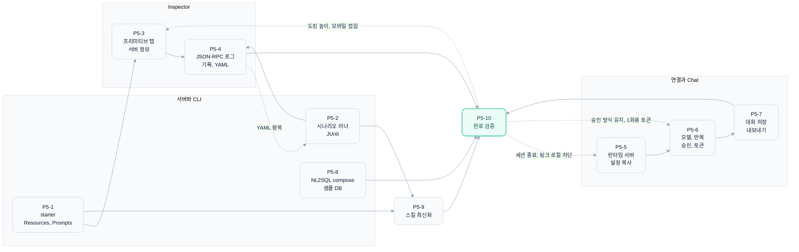

# Phase 5 신규 기능 완료 검증 (P5-10)

기준일은 2026-10-23이고 대상은 브랜치 `revamp/phase-5-features`입니다. P5-1부터 P5-9까지 만든 기능을 깨끗한 상태에서 다시 돌려 보고, 묶음마다 넘어온 이월 항목과 별도 코드 리뷰(읽기 전용 리뷰어)의 지적을 확인한 뒤 고쳤습니다. 결론부터 적으면 Phase 5 완료 기준("각 기능 단위 테스트와 Playwright E2E 시나리오 통과")을 충족합니다.

## 1. 범위와 방법

| 영역 | 내용 |
|---|---|
| 대상 | Python MCP 서버 3종과 CLI, 시나리오 러너, Next.js 16.4 프론트엔드(`frontend/`), Docker compose 스택 |
| 서버 | starter-mcp-http 8001, mock-repo-mcp 8002, nl2sql-mcp-http 8004(Mock), 통합 테스트용 PostgreSQL + Pagila(`sample-db` profile) |
| 프론트 회귀 | lint, tsc, vitest, `next build`, Playwright 전체 2회 연속 |
| 화면 감사 | 프로덕션 빌드(`next start`, Chat은 `CHAT_MOCK_LLM=1`과 `CHAT_MOCK_LLM_ALLOW_PRODUCTION=1`, 런타임 프록시 켬)에 Phase 4 감사(`p4_audit.mjs`, 키보드, 경계 폭)와 Phase 5 감사 4종을 폭 5종(390, 768, 900, 1024, 1440), 라이트/다크, EN/KO로 실행. 프록시를 끈 두 번째 인스턴스(3001)에는 서버 추가 대화상자 감사를 따로 실행 |
| Lighthouse | `lighthouse@12`, Playwright의 Chrome for Testing, desktop과 mobile 프리셋. Dashboard, Inspector, Chat, Settings |
| 정적 검사 | `uv run pre-commit run --all-files`(gitleaks 포함), Phase 5 변경 파일의 한국어 작성 규칙 grep |

Phase 5 기능 지도는 아래와 같습니다. 회색 점선은 P5-10에서 이월 항목이나 리뷰 지적을 고친 지점입니다.



## 2. 재현 명령

저장소 루트 기준입니다.

```bash
# Python
uv run ruff check src/ scripts/ tests/
uv run ruff format --check src/ scripts/ tests/
make test && make test-http && make test-cli
make test-scenarios && make test-scenarios-starter
make test-integration && make test-scenarios-real      # Docker 필요 (sample-db 자동 기동)

# Docker 스택
docker compose up -d --build --wait && docker compose ps
docker compose --profile sample-db down

# Frontend 회귀 (next dev 가 떠 있지 않아야 함)
cd frontend && npm run lint && npx tsc --noEmit && npx vitest run && npm run build
npx playwright test && npx playwright test

# 화면 감사 (서버 3종을 띄운 뒤)
make run-starter-mcp-http & make run-mock-repo-mcp & make run-nl2sql-mcp-http &
cd frontend && CHAT_MOCK_LLM=1 CHAT_MOCK_LLM_ALLOW_PRODUCTION=1 MCP_ALLOW_RUNTIME_PROXY=true npm run start &
npm run start -- -p 3001 &                               # 프록시 꺼진 기본 설정
npx tsx -e "import fs from 'node:fs'; import {en} from './src/lib/i18n/en'; import {ko} from './src/lib/i18n/ko'; fs.writeFileSync('/tmp/dict.json', JSON.stringify({en, ko}))"
cd ..
W=390,768,900,1024,1440
for a in p4_audit p5_inspector_audit p5_servers_audit p5_chat_controls_audit p5_conversations_audit; do
  node docs/revamp/scripts/$a.mjs --out /tmp/audit/$a --dict /tmp/dict.json --widths $W --no-shots
done
node docs/revamp/scripts/p5_servers_audit.mjs --proxy-off --base http://localhost:3001 --out /tmp/audit/off --dict /tmp/dict.json --widths $W
node docs/revamp/scripts/p4_keyboard.mjs && node docs/revamp/scripts/p4_breakpoints.mjs

# Lighthouse (desktop은 --preset=desktop, mobile은 생략)
npx -y lighthouse@12 http://localhost:3000/ --only-categories=accessibility,best-practices,performance \
  --chrome-flags="--headless=new --no-sandbox" --preset=desktop --output=json --output-path=<file>.json

# 정적 검사
uv run pre-commit run --all-files
git diff main --name-only | grep -E '^docs/|i18n|^\.claude/' | xargs git diff main -U0 -- | grep '^+' | perl -CSD -ne 'print if /\x{2014}|\x{00B7}/'
```

## 3. 결과

### 3.1 Python과 CLI

| 명령 | 결과 |
|---|---|
| ruff check, ruff format --check | 통과, 107개 파일 정리 상태 |
| `make test` | 595 passed (통합 62건은 별도 마커로 제외) |
| `make test-http` | 9 passed |
| `make test-cli` | 151 passed (P5-2 종료 시 144건, 리뷰 반영 7건 추가) |
| `make test-scenarios` | PASS 263, FAIL 0, ERROR 0, SKIP 17, 통과율 100%, 필수 27/27 |
| `make test-scenarios-starter` | 15/15 PASS (P5-2의 6건에 리소스, 프롬프트, `sample_content` 9건 추가) |
| `make test-integration` | 62 passed (수정 전 1건 실패, 4.1절) |
| `make test-scenarios-real` | PASS 260, FAIL 0, ERROR 0, SKIP 20, 통과율 100%, 필수 27/27 |
| Docker `compose up --build --wait` | frontend, starter-mcp, mock-repo-mcp, nl2sql-mcp 모두 정상, `/api/registry` 응답과 `/api/chat`의 415, 403 거부 확인 |

### 3.2 Frontend

| 명령 | 결과 |
|---|---|
| `npm run lint`, `npx tsc --noEmit` | 0건 |
| `npx vitest run` | 80개 파일, 679 passed (P5-7 종료 시 621건) |
| `npm run build` | 통과 |
| Playwright 1회차 | 86건 중 85 passed, 1 skipped(서버 키 환경 의존, Phase 4부터 같은 조건부 skip) |
| Playwright 2회차 | 같은 결과, 실패와 재시도 0건 |

### 3.3 화면 감사 (axe + 자체 검사)

폭 5종(390, 768, 900, 1024, 1440) x 라이트/다크 x EN/KO 조합입니다. 판정은 axe-core(wcag2a, wcag2aa, wcag21a, wcag21aa, wcag22aa, best-practice)와 Phase 3의 자체 검사(가로 넘침, 잘림, 대비, 겹침, 타깃 24px, 이름 없는 컨트롤)이고 콘솔 오류도 실패로 셉니다.

| 스크립트 | 범위 | 상태 수 | 실패 | axe 노드 |
|---|---|---|---|---|
| `p4_audit.mjs` | Phase 4의 5개 화면과 주요 상태 | 264 | 0 | 0 |
| `p5_inspector_audit.mjs` | Resources/Prompts 탭, 서버 정보, 로그, 기록, 내보내기 | 480 | 0 | 0 |
| `p5_servers_audit.mjs` | 런타임 서버, 서버 추가, 설정 복사, 팔레트 | 440 | 0 | 0 |
| `p5_servers_audit.mjs --proxy-off` (신규) | 프록시 꺼진 서버 추가 대화상자 | 40 | 0 (수정 전 40) | 0 (수정 전 40) |
| `p5_chat_controls_audit.mjs` | 모델, 반복, 승인 카드, 토큰 미터 | 300 | 0 | 0 |
| `p5_conversations_audit.mjs` | 대화 목록, 내보내기와 가져오기, 승인 만료 | 360 | 0 | 0 |
| 합계 | | 1,884 | 0 | 0 |
| `p4_keyboard.mjs` | 키보드와 reduced-motion | 35 항목 | 0 | |
| `p4_breakpoints.mjs` | 경계 폭 6종 x 5화면 | 30 조합 | 0 | |

새로 넣은 프록시 꺼짐 상태가 바로 결함을 잡았습니다. 비활성 선택지 전체에 `opacity-70`을 걸어 "왜 꺼졌는지" 안내 글자의 대비가 3.97:1(다크)로 떨어졌어요. 비활성 표시를 점선 테두리와 sunken 바탕으로 바꾸고 안내 글자는 원래 색을 유지해 40개 상태가 모두 통과합니다. 서버 추가 대화상자를 고친 뒤 프록시 켠 감사(440개 상태, 실패 0)도 다시 돌렸습니다.

### 3.4 Lighthouse (프로덕션 빌드)

점수는 접근성 / 성능 / 모범 사례입니다. Inspector는 starter-mcp-http(Resources, Prompts, 도킹 패널이 모두 보이는 서버)로 쟀습니다.

| 화면 | desktop | mobile |
|---|---|---|
| Dashboard `/` | 100 / 98 / 100 | 100 / 70 / 100 |
| Inspector `/inspector?server=starter-mcp-http` | 100 / 97 / 100 | 100 / 77 / 96 |
| Chat `/chat?server=mock-repo-mcp` | 100 / 91 / 100 | 100 / 79 / 100 |
| Settings `/settings` | 100 / 99 / 100 | 100 / 81 / 100 |

```mermaid
%%{init: {'theme':'base','themeVariables':{'fontFamily':'Pretendard, Inter, sans-serif','xyChart':{'backgroundColor':'transparent','titleColor':'#69797e','xAxisLabelColor':'#69797e','xAxisTitleColor':'#69797e','xAxisTickColor':'#69797e','xAxisLineColor':'#69797e','yAxisLabelColor':'#69797e','yAxisTitleColor':'#69797e','yAxisTickColor':'#69797e','yAxisLineColor':'#69797e','plotColorPalette':'#007781, #9aa7ab, #c2410c'}}}}%%
xychart-beta
    title "Lighthouse 접근성(청록)과 성능(회색), 기준선 90(주황)"
    x-axis ["Dash D", "Dash M", "Insp D", "Insp M", "Chat D", "Chat M", "Set D", "Set M"]
    y-axis "점수" 60 --> 100
    bar [100, 100, 100, 100, 100, 100, 100, 100]
    bar [98, 70, 97, 77, 91, 79, 99, 81]
    line [90, 90, 90, 90, 90, 90, 90, 90]
```



접근성은 8개 측정 모두 100으로 Phase 4와 같고 기준 90을 넘습니다. 성능은 완료 기준이 아니지만 Dashboard mobile이 76에서 70으로 내려갔습니다(Phase 5에서 Runtime servers 섹션, 서버 추가와 설정 복사 대화상자, 시작하기 4단계가 늘어난 영향으로 보이며 Phase 6의 번들 점검 때 함께 봅니다). Inspector mobile의 모범 사례 96은 Phase 4와 같은 11px 보조 글자 지적입니다. D는 desktop, M은 mobile입니다.

### 3.5 정적 검사

| 항목 | 결과 |
|---|---|
| pre-commit 전체(gitleaks, ruff, 공백, 줄 끝) | 통과. 첫 실행에서 `chat-servers.test.ts` 줄 끝 개행 1건을 훅이 고쳤고 재실행은 모두 Passed |
| 줄표(U+2014)와 가운뎃점(U+00B7), Phase 5 변경 문서와 사전의 추가 줄 | 수정 전 47줄, 수정 후 8줄. 남은 8줄은 규칙 자체를 적은 문장(spec-writer SKILL, evals 검사 값)과 실제 코드에서 글자 그대로 옮긴 `common_module.md`의 코드 주석이라 의도된 것입니다. `starter-mcp_v0.2.md`가 v0.1에서 물려받은 39줄은 쉼표와 콜론, "/"로 바꿨습니다 |

## 4. 고친 문제

### 4.1 이월 항목

| 항목 | 결정과 수정 | 검증 |
|---|---|---|
| starter 시나리오에 리소스, 프롬프트가 없음 | `tests/scenarios/starter.yaml`에 `starter://about`(markdown), template `starter://greeting/{name}`(JSON, untrusted 격리), `starter://logo.png`(`image/png` blob), 없는 리소스 오류, `explain_tool`(필수와 기본 인자, 잘못된 audience 오류), `code_review_session`(user, assistant, user), `sample_content`(블록 3종과 빈 메시지 오류)를 더했습니다 | `make test-scenarios-starter` 15/15, 로더 테스트가 세 종류 단계를 모두 확인 |
| Inspector 도킹 패널 높이 고정(216px) | 위쪽 가장자리에 `role="separator"` 핸들을 두었습니다. 끌기, 방향키(ArrowUp이 키움, 16px), PageUp/PageDown(64px), Home/End, 두 번 눌러 기본값, `aria-valuenow/min/max`. 높이는 3분할 비율처럼 localStorage에 저장하되 데스크톱과 모바일을 나눴고(`mcpc-inspector-dock-h-*`), 위쪽 패널에 160px를 남기도록 범위를 묶습니다. Settings "패널 크기" 항목과 초기화 대상에도 넣었습니다 | 단위 테스트 4건, e2e(키보드, 끌기, 새로고침 유지, 두 번 눌러 초기화, 접으면 핸들 숨김) |
| 모바일 도킹 기본 펼침(40vh) | 900px 이하는 기본 접힘으로 바꿨습니다. 390px 화면에서 40vh를 먼저 차지하면 요청 폼과 응답이 절반 가까이 가려지고, 도킹은 매번 보는 정보가 아니라서입니다. 시안은 펼친 모습을 보여 주지만 반드시 펼쳐야 한다는 조건은 없어 사용성을 우선했어요. 접힌 상태에서 탭을 누르면 그 탭으로 펼치고, 펼침 여부는 데스크톱과 따로 기억합니다 | e2e(모바일 기본 접힘, 탭 눌러 펼침, 새로고침 유지) |
| Chat 승인 방식이 새로고침하면 자동으로 돌아감 | 대화별 저장(P5-7)에 더해 이 탭의 마지막 선택을 `sessionStorage`(`mcpc-chat-approval`)에 둡니다. 저장된 대화를 열 때는 그 대화의 방식과 지금 방식 중 더 엄격한 쪽(수동)을 쓰므로 수동이 조용히 자동으로 바뀌는 경로가 없습니다. 자동으로 돌아가는 길은 툴바에서 직접 고르는 것뿐이에요 | 단위 테스트 3건, e2e(새로고침, 새 대화, 자동 대화를 열어도 수동 유지) |
| 직결 런타임 서버에 세션과 SSE 스트림이 겹쳐 열림 | 두 가지를 고쳤습니다. `MCPClient.close()`가 `Mcp-Session-Id`를 실은 DELETE로 서버 세션을 끝내고(405는 무시), 상태 점검은 직결 서버의 연결을 확인 뒤 바로 닫습니다. 점검이 연결을 붙잡지 않으니 Inspector와 겹치지 않아요. 팔레트는 이미 탭 캐시를 먼저 쓰고 끝나면 닫고 있었습니다. 탭 단위 공유 클라이언트는 Inspector의 로그 훅과 섞이는 문제가 있어 택하지 않았습니다 | 네트워크 측정(Dashboard에서 추가, Inspector, 팔레트, Dashboard 복귀): 종료되지 않은 서버 세션 4개에서 1개(Inspector 사용 중인 것), DELETE 0건에서 4건. 단위 테스트 2건 |
| 프록시 꺼진 서버 추가 대화상자가 감사에 없음 | `p5_servers_audit.mjs --proxy-off`를 추가했습니다. 프록시를 끈 인스턴스에서 대화상자의 빈 입력과 검증 오류 상태를 감사하고, 서버 프록시 라디오가 비활성이며 꺼짐 안내가 보이는지 함께 확인합니다 | 3.3절 |
| 프록시 꺼짐 안내 글자 대비 3.97:1 (감사에서 발견) | 서버 추가 대화상자의 비활성 "서버 프록시" 선택지가 `opacity-70`으로 안내 문구까지 흐리게 했습니다. 점선 테두리와 sunken 바탕으로 비활성을 보이고 문구 대비는 그대로 둡니다 | `--proxy-off` 감사 40개 상태 실패 40에서 0 |
| NL2SQL 통합 테스트 1건 실패 | `test_search_tables_schema_all_objects`가 P4-4a 이전의 한국어 오류 문구("너무 많")를 찾고 있었습니다. 영어 문구와 `[TOO_MANY_TABLES]` 태그로 맞췄습니다 | `make test-integration` 62 passed |

### 4.2 리뷰 반영

읽기 전용 리뷰어가 Phase 5 diff에서 찾은 8건을 하나씩 코드로 확인했고 모두 사실이라 고쳤습니다.

| 심각도 | 지적 | 수정 | 테스트 |
|---|---|---|---|
| 높음 | `/api/chat` POST에 출처 검사가 없어 다른 사이트의 `text/plain` 단순 요청으로 서버의 `MCP_API_KEY`나 런타임 프록시를 쓰는 도구 실행을 일으킬 수 있음 | `lib/chat/request-guard.ts`: 다른 출처의 Origin과 `Sec-Fetch-Site: cross-site`는 403, `Content-Type`이 `application/json`이 아니면 415. 본문을 읽기 전에 검사합니다(Next 라우트 파일은 추가 export를 허용하지 않아 lib로 분리) | 단위 5건, Docker 스택에서 curl로 415와 403 확인, Chat e2e 통과 |
| 중간 | 승인 토큰을 30분 동안 재사용할 수 있음 | 토큰에 발급마다 무작위 nonce를 넣어 서명하고(`<시각>.<반복>.<nonce>.<서명>`), 모든 검사를 통과한 이어서 실행만 nonce를 프로세스 메모리 사용 목록(TTL 동안)에 넣습니다. 재사용은 `token_used` 400이고, 잘못된 결정으로 거부된 요청은 토큰을 태우지 않아요. `token_invalid` 문구에는 재시작이나 다른 인스턴스(`CHAT_APPROVAL_SECRET` 미설정)라는 흔한 원인을 적었습니다 | 단위(nonce 고유성, 1회 사용), 라우트(재사용 거부와 MCP 미호출, 문구) |
| 중간 | Chat의 런타임 서버 MCP 클라이언트가 리다이렉트를 따라감, 메타데이터 주소 차단 없음 | `createMCPClient(..., { noRedirects: true })`가 `redirect: "manual"`로 요청하고 3xx를 오류로 만듭니다(Chat의 런타임 서버에 적용, 프록시 경로는 원래 `manual`). 두 서버 측 경로(`/api/mcp-runtime`, Chat)는 게이트가 켜져 있어도 169.254.0.0/16, fe80::/10, IPv4를 담은 IPv6, `fd00:ec2::254`, `metadata.google.internal` 등을 403으로 거부합니다. loopback과 사설망은 이 도구의 주 대상이라 막지 않으며, 호스트 글자만 보고 DNS를 풀지 않는다는 한계를 `guards.ts`에 적었습니다 | 차단 10종과 허용 8종, Chat 라우트(`noRedirects` 전달, 메타데이터 403), 런타임 프록시 403, `noRedirectFetch` 2건 |
| 중간 | 프록시 요청 크기 상한이 chunked 본문에서 우회됨 | `readBodyWithLimit`가 청크를 세며 읽다가 상한을 넘는 순간 스트림을 취소하고 413을 돌려줍니다. Content-Length 사전 검사는 빠른 경로로 남겼습니다 | `proxy.test.ts` 4건 |
| 중간 | 대화 저장 상한(`fitToLimit`)이 본문과 턴 수가 클 때 지켜지지 않음, 가져오기 상한을 글자 수로 비교 | 도구 결과 축소 뒤에도 넘으면 본문을 줄이고, 그래도 넘으면 사용자 턴 경계에서 오래된 턴을 빼며 첫 남은 턴에 생략 표시를 붙입니다. 마지막 수단은 표시 턴 하나라 결과는 항상 상한 안입니다. 턴 상한 5000을 스키마와 함께 두었고, 가져오기는 UTF-8 바이트로 비교합니다 | 단위 5건 |
| 낮음 | IndexedDB 열기 실패를 영구 캐시 | 대화 저장소가 실패한 열기를 잊고 다음 접근에서 다시 엽니다. 차단 뒤 늦게 열린 연결은 닫습니다 | 단위 3건 |
| 낮음 | 가리기가 문자열 전체 모양만 봄 | `redactInline`이 문장 안의 Bearer/Basic 토큰, `sk-` 키, JWT, URL userinfo의 비밀번호, 비밀 이름의 쿼리 값만 `[REDACTED]`로 바꿉니다. 로그, 기록, 내보내기가 같은 함수를 쓰고, 설정 복사는 런타임 서버 URL의 비밀 쿼리 값을 자리표시자로 바꿉니다 | 단위 3건 |
| 낮음 | JUnit `time`이 병렬 실행에서 케이스 합, XML 금지 제어 문자, 필수 케이스 SKIP 문서, 필터 값 안의 `\|` | 파일별 실측 시간으로 바꾸고 금지 문자는 U+FFFD로 치환합니다. SKIP된 필수 케이스가 `required_failed`(종료 코드 1)라는 점을 docstring과 `scenario-format.md`에 적었고, 경로의 `\|`는 괄호와 따옴표 밖에서만 나눕니다 | `test_scenario_review_fixes.py` 7건 |

## 5. Phase 6, 7로 넘기는 것

| 구분 | 내용 |
|---|---|
| Phase 6 문서 | README와 `docs/`에 런타임 서버의 보안 경계(직결 기본, 프록시 게이트, 링크 로컬 차단과 DNS 한계), 승인 토큰의 다중 인스턴스 조건(`CHAT_APPROVAL_SECRET`), 시나리오 형식을 옮겨 적기. `CLAUDE.md`의 shadcn 목록과 명령 갱신 |
| Phase 6 품질 | 모바일 성능(Dashboard mobile 70, 나머지 mobile 77에서 81), 실제 스크린 리더(VoiceOver, NVDA) 점검. 승인 토큰 사용 목록은 프로세스 메모리라 여러 인스턴스 배포에서는 같은 인스턴스로 다시 보낸 재사용만 막습니다 |
| Phase 7 CI | Playwright, 감사 스크립트, `make test-integration`(Docker)과 `test-scenarios-real`을 CI에 올리기. 등록 서버 프록시(`/api/mcp/[server]`)는 요청 크기 상한을 두지 않는데(같은 origin, 레지스트리 대상) 공개 배포 시 함께 정하면 좋습니다 |
| 기능 이월 | 런타임 서버를 탭 단위 공유 클라이언트로 묶는 일(지금은 점검이 연결을 닫는 방식), 로그 줄의 요청과 응답 짝 이동, 여러 탭 사이 기록 동기화, 새 대화 단축키, 대화 목록 가상화, 스킬 트리거 정확도 측정 |
