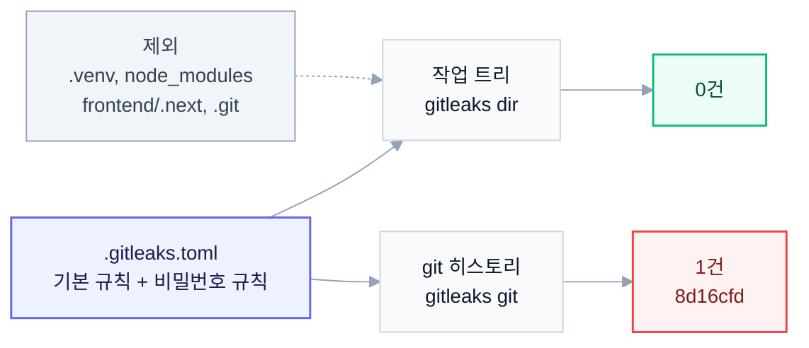

# 비밀 정보 스캔 결과 (Phase 0-3)

- 스캔 일자: 2026-10-21
- 도구: gitleaks v8.30.1 (Homebrew)
- 기준 커밋: `33df13d` (main), 작업 트리 미커밋 변경 포함
- 설정 파일: 저장소 루트 [`.gitleaks.toml`](../../.gitleaks.toml)

## 요약

| 구분 | 범위 | 정리 전 | 정리 후 | 비고 |
|---|---|---|---|---|
| 작업 트리 (기본 규칙) | 생성물 디렉토리 제외 | 0건 | 0건 | 생성물 포함 시 `frontend/.next/` 에서 9건 (빌드 산출물) |
| 작업 트리 (기본 + 사용자 정의 규칙) | 생성물 디렉토리 제외 | 4건 | **0건** | 4건 모두 오탐, 규칙 전용 허용 목록으로 처리 |
| git 히스토리 (기본 규칙) | 전체 73 커밋 | 0건 | 0건 | 기본 규칙은 실제 유출을 탐지하지 못함 |
| git 히스토리 (기본 + 사용자 정의 규칙) | 전체 73 커밋 | 5건 | **1건** | 남은 1건이 커밋 `8d16cfd` 의 실제 Oracle 비밀번호 |

작업 트리에서 발견된 실제 비밀 정보는 없습니다. 따라서 이번 단계에서 삭제하거나 placeholder로 바꾼 파일도 없습니다. 히스토리에는 0-2에서 이미 확인한 Oracle 비밀번호 1건이 그대로 남아 있으며, 히스토리 재작성은 하지 않았습니다.

## 스캔 범위



## 사용한 명령

모든 실행에 `--redact` 를 붙여 리포트와 터미널 출력에 비밀 값이 남지 않게 했습니다. JSON 리포트는 저장소 밖 임시 디렉토리에 저장했고 커밋하지 않습니다.

```bash
# 작업 트리 스캔 (최종 판정)
gitleaks dir . --config .gitleaks.toml --redact \
  --report-format json --report-path <tmp>/tree-after.json

# 비교용: 생성물 디렉토리까지 포함한 기본 규칙 스캔
gitleaks dir . --config <(printf '[extend]\nuseDefault = true\n') --redact \
  --report-format json --report-path <tmp>/tree-noexclude.json

# 히스토리 스캔 (기록용, 기본 규칙만)
gitleaks git . --redact --report-format json --report-path <tmp>/history.json

# 히스토리 스캔 (기본 + 사용자 정의 규칙)
gitleaks git . --config .gitleaks.toml --redact \
  --report-format json --report-path <tmp>/history-after.json
```

## 작업 트리 결과

### 생성물 디렉토리 (스캔 대상에서 제외)

설정 없이 기본 규칙만으로 돌리면 `frontend/.next/` 에서 `generic-api-key` 9건이 나옵니다. 모두 `next build` 가 실행할 때마다 새로 만드는 preview mode 서명 키와 server action 암호화 키입니다. `.gitignore` 대상이고 저장소 내용이 아니므로 경로 단위로 제외했습니다.

| 파일 | 건수 |
|---|---|
| `frontend/.next/cache/.previewinfo` | 2 |
| `frontend/.next/cache/.rscinfo` | 1 |
| `frontend/.next/prerender-manifest.json` | 2 |
| `frontend/.next/server/server-reference-manifest.json` | 1 |
| `frontend/.next/standalone/.next/prerender-manifest.json` | 2 |
| `frontend/.next/standalone/.next/server/server-reference-manifest.json` | 1 |

`.venv/` 와 `node_modules/` 에서는 탐지 건이 없었지만, 저장소 내용이 아니고 스캔 시간만 늘리므로 함께 제외했습니다. 제외 후 스캔 크기는 약 36.6 MB에서 3.6 MB로 줄었습니다.

### 정리 전 (기본 + 사용자 정의 규칙)

기본 규칙 결과는 0건이었습니다. 다만 아래 "사용자 정의 규칙" 절의 이유로 비밀번호 규칙을 추가했고, 그 규칙이 작업 트리에서 4건을 잡았습니다.

| 규칙 ID | 파일 | 판정 | 근거 |
|---|---|---|---|
| `env-password-assignment` | `docs/oracle-nl2sql-mcp-test-plan.md:63` | 오탐 | 0-2에서 넣은 placeholder (`<...>` 형태) |
| `env-password-assignment` | `src/mcp-servers/oracle_nl2sql_mcp/db/connector.py:49` | 오탐 | 설정 객체 속성 참조 (`settings.<필드>`) |
| `env-password-assignment` | `temp/.env.example:10` | 오탐 | 관용 예시 값 `changeit` |
| `env-password-assignment` | `temp/guardrail/db/connector.py:49` | 오탐 | 설정 dict 참조 (`self._config[...]`) |

### 정리 후

0건입니다. 수정한 파일은 `.gitleaks.toml` 하나이고, 실제 비밀 정보를 지운 파일은 없습니다.

## 사용자 정의 규칙

기본 규칙만 쓴 히스토리 스캔은 0건이었지만, 커밋 `8d16cfd` 에는 실제 Oracle 비밀번호가 `.env` 형식(`ORACLE_PASSWORD="..."`)으로 들어 있었습니다. 기본 규칙의 `generic-api-key` 는 엔트로피 기준을 넘는 값만 잡기 때문에 사람이 정한 비밀번호를 놓칩니다. 같은 사고를 막으려면 이 유형을 직접 잡는 규칙이 필요해서 `env-password-assignment` 를 추가했습니다.

- 대상: 이름에 `PASSWORD`, `PASSWD`, `PWD` 가 들어간 키에 `=` 나 `:` 로 6자 이상 값을 넣는 대입문 (대소문자 무시)
- 판정 기준 값: 정규식의 첫 번째 그룹(비밀 값 부분)만 사용
- 검증: 임시 디렉토리의 합성 샘플(`DB_PASSWORD="<임의 값>"`)은 탐지하고, `<your-password>` 형태 placeholder는 통과시키는 것을 확인했습니다.

0-4에서 pre-commit 훅을 붙일 때 이 설정 파일을 그대로 쓰면 됩니다.

## 허용 목록 결정

허용 목록은 두 층으로 나눴습니다. 경로를 통째로 무시하는 범위는 생성물 디렉토리로 한정하고, 오탐은 비밀 값의 형태로만 거르도록 좁게 잡았어요.

| 위치 | 항목 | 이유 |
|---|---|---|
| 전역 `[allowlist] paths` | `(^\|/)\.venv/` | Python 가상환경, 저장소 내용 아님 |
| 전역 `[allowlist] paths` | `(^\|/)node_modules/` | npm 의존성, 저장소 내용 아님 |
| 전역 `[allowlist] paths` | `^frontend/\.next/` | Next.js 빌드 산출물, 빌드마다 키가 새로 생성됨 |
| 전역 `[allowlist] paths` | `(^\|/)\.git/` | git 내부 객체, 히스토리는 `gitleaks git` 으로 따로 스캔 |
| `env-password-assignment` 전용, `regexTarget = "secret"` | `^<[^<>\s]+>$` | 문서 placeholder (`<set-in-.env>` 등) |
| `env-password-assignment` 전용, `regexTarget = "secret"` | `^[A-Za-z_]\w*(?:\.\w+)+\[?$` | 코드의 설정 참조 (`settings.oracle_password`, `self._config[...]`) |
| `env-password-assignment` 전용, `regexTarget = "secret"` | `^changeit$` | `.env.example` 관용 예시 값 |

전용 허용 목록은 이 규칙에만 걸리고 기본 규칙에는 영향을 주지 않습니다. 파일 경로가 아니라 값의 형태로 거르기 때문에, 같은 파일에 실제 비밀번호가 새로 들어오면 그대로 탐지됩니다.

## 히스토리 결과

### 기본 규칙

전체 73 커밋, 약 3.97 MB를 스캔했고 0건입니다. 앞에서 설명한 대로 이 결과는 "유출 없음"이 아니라 "기본 규칙으로는 못 잡음"을 뜻합니다.

### 기본 + 사용자 정의 규칙

허용 목록 적용 전에는 5건이었고, 적용 후에는 1건이 남았습니다. 값은 모두 redact 처리했습니다.

| 커밋 | 날짜 | 파일 | 규칙 ID | 판정 |
|---|---|---|---|---|
| `8d16cfd` | 2026-06-18 | `docs/oracle-nl2sql-mcp-test-plan.md:60` | `env-password-assignment` | **실제 비밀번호** (작업 트리에서는 `33df13d` 에서 제거) |
| `33df13d` | 2026-10-21 | `docs/oracle-nl2sql-mcp-test-plan.md:63` | `env-password-assignment` | 오탐, placeholder (허용 목록으로 제외) |
| `1e9f64b` | 2026-06-16 | `src/mcp-servers/oracle_nl2sql_mcp/db/connector.py:49` | `env-password-assignment` | 오탐, 설정 참조 (허용 목록으로 제외) |
| `0d98b3d` | 2026-06-12 | `temp/.env.example:10` | `env-password-assignment` | 오탐, 예시 값 (허용 목록으로 제외) |
| `0d98b3d` | 2026-06-12 | `temp/guardrail/db/connector.py:49` | `env-password-assignment` | 오탐, 설정 참조 (허용 목록으로 제외) |

같은 커밋 `8d16cfd` 의 문서에는 DB 호스트 주소와 계정명도 함께 들어 있었습니다. 두 값은 비밀 정보 규칙의 대상이 아니라서 스캔 건수에는 잡히지 않지만, 0-2에서 작업 트리 기준으로 함께 제거했습니다.

히스토리 재작성(`git filter-repo` 등)은 하지 않았습니다. 이유는 아래 후속 조치와 같습니다.

## 후속 조치

1. **0-1 비밀번호 교체 (사용자 직접 수행)**: 히스토리에 남은 비밀번호는 지울 수 없으므로 교체만이 유효한 대응입니다. 교체와 함께 해당 호스트의 접근 허용 범위도 점검해 주세요.
2. **히스토리는 공개하지 않음**: update-plan 0.3 결정에 따라 Phase 7에서 정리를 마친 최종 상태를 히스토리 없는 새 public 저장소에 첫 커밋으로 올립니다. 기존 private 저장소는 보존하며 공개하지 않으므로, `8d16cfd` 의 내용은 외부로 나가지 않습니다.
3. **0-4 pre-commit 훅**: 이번에 만든 `.gitleaks.toml` 을 그대로 사용해 커밋 전에 같은 규칙으로 검사합니다.
4. **Phase 7 공개 직전 재스캔**: 새 저장소 첫 커밋을 만들기 전에 `gitleaks dir` 를 다시 돌려 0건인지 확인합니다. `temp/` 는 Phase 1-A에서 삭제 예정이라 그 뒤에는 관련 허용 목록 항목(`changeit`)이 필요 없을 수 있습니다.

## pre-commit 훅 적용 (0-4)

`.pre-commit-config.yaml` 의 `repos` 맨 앞에 gitleaks 공식 훅을 추가했습니다. 다른 훅(pre-commit-hooks, ruff, add-trailing-comma)은 그대로 둡니다.

```yaml
  - repo: https://github.com/gitleaks/gitleaks
    rev: v8.30.1
    hooks:
      - id: gitleaks
```

- **버전**: `v8.30.1` 태그(커밋 `83d9cd6`)로 고정했습니다. 로컬 brew 설치본과 같은 버전입니다.
- **실행 방식**: 훅은 `language: golang` 이라 pre-commit 이 gitleaks 를 직접 빌드해 캐시에 둡니다. 로컬에 gitleaks 를 따로 설치하지 않아도 됩니다.
- **검사 범위**: 훅 명령은 `gitleaks git --pre-commit --redact --staged --verbose` 입니다. 스테이징된 변경분만 검사하고, 출력에서 값은 redact 처리됩니다.
- **설정 파일**: `--config` 를 주지 않아도 저장소 루트의 `.gitleaks.toml` 을 자동으로 읽습니다. 아래 음성 테스트에서 사용자 정의 규칙 `env-password-assignment` 가 탐지된 것으로 확인했습니다.
- **설치**: `make init-dev` 가 이미 `uv run pre-commit install` 을 실행하므로 새로 받은 개발자도 따로 할 일이 없어요.

### 수동 실행

```bash
uv run pre-commit run gitleaks --all-files
```

훅이 스테이징 영역만 보기 때문에 `--all-files` 를 붙여도 작업 트리 전체를 훑지는 않습니다. 작업 트리 전체 점검은 위 "사용한 명령"의 `gitleaks dir` 를 쓰세요.

### 검증 결과

| 시나리오 | 스테이징 내용 | 결과 |
|---|---|---|
| 정상 상태 | 변경 없음 | Passed |
| 음성 테스트 1 | 가짜 `.env` 형식 비밀번호 1줄 | Failed, `env-password-assignment` 1건 |
| 음성 테스트 2 | 가짜 비밀번호, 가짜 AWS 형식 키, 가짜 GitHub PAT | Failed, `env-password-assignment`, `generic-api-key`, `github-pat` 3건 |
| 정리 후 | 테스트 파일 제거 | Passed |

테스트 파일은 커밋하지 않았고, 스테이징 해제와 삭제까지 마쳤습니다.

### 우회에 대해

`SKIP=gitleaks git commit ...` 이나 `git commit --no-verify` 로 훅을 건너뛸 수는 있지만 권장하지 않습니다. 오탐이라면 우회 대신 `.gitleaks.toml` 허용 목록에 근거와 함께 추가하는 편이 맞습니다. 정말 급한 상황에서만 쓰고, 그때는 커밋 메시지나 PR 에 이유를 남겨 주세요.
