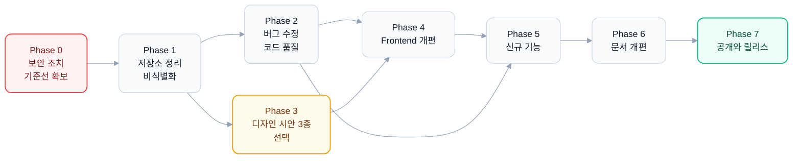

# MCP Connectors 개편 작업 계획서

> 작성일: 2026-10-21
> 상태: 초안 v1
> 범위: 코드, 화면 디자인, 문서, 저장소 정리, 오픈소스 공개 준비

## 0. 배경과 목표

### 0.1 왜 개편하나요

MCP Connectors는 사내 시스템을 AI Agent와 연결하는 MCP 서버를 같은 컨벤션으로 만들고 검증하는 코드베이스입니다. MVP 단계에서 스킬 워크플로우, 4개 서버, CLI, 검증용 Frontend까지 갖췄지만 코드 점검 결과 다음 문제가 확인됐습니다.

- **보안**: 실제 DB 접속 정보(호스트, 계정, 비밀번호)가 문서에 평문으로 커밋되어 git 히스토리에 남아 있습니다.
- **비식별화**: 회사명, 사내 시스템명, 내부 호스트명이 코드와 문서, 스킬, 테스트 데이터 약 30개 파일에 퍼져 있습니다.
- **기능 결함**: Docker 환경에서 Chat이 동작하지 않을 가능성이 높고(프롬프트 파일 누락, 컨테이너 내부에서 MCP 접근 불가), API Key 인증 모듈은 작성만 되어 있고 어디서도 호출되지 않습니다.
- **화면 완성도**: 다크 모드 미작동, 폰트 변수 자기참조 버그, Markdown 스타일 미적용, 모바일 대응 부재, 한/영 문구 혼용이 있습니다.
- **정리 부족**: 다른 프로젝트 프로토타입(`temp/`), 중복 결과 파일, 빈 파일, 중복 서버, 무관한 에이전트와 스킬이 함께 있습니다.
- **문서 불일치**: README와 CLAUDE.md에 NL2SQL 서버가 빠져 있고, 테스트 수와 포트 정보가 실제와 다릅니다.

### 0.2 목표

1. 오픈소스로 공개해도 안전하고, 처음 보는 개발자가 10분 안에 로컬에서 띄워 볼 수 있는 상태를 만듭니다.
2. 검증용 Frontend를 "MCP 서버 개발자가 매일 켜 두는 도구" 수준으로 끌어올립니다.
3. 스펙 작성부터 구현, 검증까지 이어지는 고유 워크플로우를 차별점으로 내세웁니다.

### 0.3 확정된 결정 사항

| 항목 | 결정 |
|---|---|
| 공개 대상과 언어 | 글로벌 + 한국어 병행. `README.md`는 영문, `README.ko.md`는 한글. UI는 영어 기본에 한국어 전환 지원 |
| oracle_nl2sql_mcp | `nl2sql_mcp`로 이름을 바꾸고 DB 중립 구조(dialect 어댑터)로 일반화. 기본 백엔드는 Docker로 띄우는 PostgreSQL + Pagila 샘플, Oracle은 선택 백엔드로 유지 (2026-10-21 변경, 기존 Oracle DB 서버 종료에 따름) |
| git 히스토리 | 지금 저장소(`github.com/sguys99/mcp-connectors`)를 그대로 public으로 씁니다(2026-10-24 변경). 비식별화 전 원문이 히스토리에 남아 있으므로 Phase 7에서 히스토리를 정리해 force push하고, 정리 전 히스토리는 저장소 밖 로컬 git bundle과 로컬 백업 브랜치로 보존합니다(2026-10-25 확정). 처음 계획은 히스토리 없는 새 public 저장소였어요 |
| 디자인 시안 | 방향이 다른 HTML 인터랙티브 시안 3종을 링크로 공유한 뒤 선택 |
| `.claude/` 정리 | MCP 관련 스킬과 에이전트만 남기고 나머지는 private 저장소나 개인 `~/.claude`로 이동 |
| 예제 서버 | `echo_mcp`와 `simple_mcp_server`를 하나로 합치고, Resources와 Prompts 예제를 추가 |

### 0.4 전체 흐름

Phase 3(시안 선택)은 사용자 결정이 필요한 관문입니다. 시안을 검토하는 동안 Phase 2를 병행할 수 있어요.

### 0.5 진행 규칙

- 각 Phase는 별도 브랜치(`revamp/phase-N-<주제>`)에서 진행하고, 끝나면 main에 병합합니다.
- Phase를 마칠 때마다 "완료 기준"을 모두 확인한 뒤 체크박스를 채웁니다.
- 문서 작성 규칙: Em dash 미사용, 키워드 나열은 쉼표나 "와/과", "/" 사용, 해요체와 습니다체 비율은 2:8.
- 다이어그램은 Mermaid(테마 변수 지정)나 직접 그린 SVG로 만들고, 라이트/다크 양쪽에서 읽히도록 확인합니다.

---

## Phase 0. 보안 긴급 조치와 기준선 확보

> 목표: 노출된 자격 증명을 무력화하고, 개편 전 상태를 기록합니다.

- [x] **0-1. DB 비밀번호 교체** (사용자 직접 수행): 문서에 노출된 Oracle 계정 비밀번호를 변경하고, 해당 호스트의 접근 허용 범위를 점검합니다.
  - 해당 없음으로 완료(2026-10-21): 노출된 비밀번호를 쓰던 Oracle DB 서버는 이미 종료, 삭제된 상태라 교체할 대상이 없습니다. 히스토리(`8d16cfd`)에 남은 값은 무효입니다. 공개는 처음에 히스토리 없는 새 저장소로 계획했지만 2026-10-24에 지금 저장소를 public으로 쓰기로 바꿨고, 히스토리 정리는 Phase 7에서 진행합니다. 실 DB 기반 검증은 Phase 1-C의 공개 샘플 스키마로 다시 구성해요.
- [x] 0-2. `docs/oracle-nl2sql-mcp-test-plan.md`에서 접속 정보를 제거하고 `.env` 참조 방식으로 바꿉니다.
  - 완료(2026-10-21): 호스트, 계정, 비밀번호를 placeholder로 교체했습니다. 작업 트리에 남은 노출은 0건입니다. 실제 서버가 읽는 위치는 `src/mcp-servers/.env`라서 문서도 그 경로로 안내합니다. 비밀번호는 커밋 `8d16cfd` 히스토리에 남아 있으므로 0-1 교체가 반드시 필요해요.
- [x] 0-3. 비밀 정보 스캐너(gitleaks)로 작업 트리 전체를 스캔하고 결과를 기록합니다.
  - 완료(2026-10-21): 작업 트리 0건입니다. 기본 규칙은 사람이 정한 비밀번호를 놓쳐서 `.gitleaks.toml`에 `env-password-assignment` 규칙을 추가했습니다. 히스토리 스캔에서는 `8d16cfd`의 1건만 남습니다. 상세 결과는 [docs/revamp/security-scan.md](revamp/security-scan.md)에 있어요.
- [x] 0-4. pre-commit에 gitleaks 훅을 추가해 같은 사고가 재발하지 않게 합니다.
  - 완료(2026-10-21): 공식 훅 `gitleaks v8.30.1`을 맨 앞에 추가했고 루트 `.gitleaks.toml`을 자동으로 읽습니다. 가짜 비밀번호와 토큰을 스테이징한 음성 테스트에서 커밋이 차단되는 것을 확인했습니다. 훅은 스테이징된 변경만 검사하므로 전체 점검은 `gitleaks dir .`로 따로 돌려야 해요.
- [x] 0-5. 기준선 기록: `make test-*` 전체 결과, `npm run test`, `npm run build`, `npm run lint` 결과를 `docs/revamp/baseline.md`에 남깁니다.
  - 완료(2026-10-21): Python 테스트 75건, vitest 118건, E2E 1건, Frontend 빌드와 lint 모두 통과했습니다. 반면 ruff check 120건(117건이 NL2SQL), format 미적용 16개 파일로 Python lint 게이트는 실패 상태입니다. NL2SQL 테스트 38건은 전부 Mock 백엔드라 실 DB 연결 코드는 검증되지 않아요. 상세는 [docs/revamp/baseline.md](revamp/baseline.md)에 있습니다.
- [x] 0-6. NL2SQL YAML 시나리오 테스트를 최신 코드(커밋 91d766a 이후)로 다시 돌려 현재 통과율을 기록합니다. 지금 남아 있는 결과(32.7%)는 수정 전 결과입니다.
  - 완료(2026-10-21, Mock 기준): 실 DB가 종료돼 Mock 모드로 280건을 돌렸고 공식 통과율은 39.5%(104/263, SKIP 17)입니다. 러너의 `_is_error()`가 91d766a에서 바뀐 CLI 에러 형식(`{"error": ...}`)을 인식하지 못해 정상 차단 68건이 FAIL로 집계됐고, 이를 보정하면 65.4%(필수 PASS 25건 전부 통과)예요. 실제 코드 버그 12건을 찾았고, SQL 케이스 189건 중 144건이 Oracle 전용 구문을 씁니다. 상세는 [docs/revamp/nl2sql-scenario-baseline.md](revamp/nl2sql-scenario-baseline.md)에 있습니다.

**완료 기준**: 비밀번호 교체 확인, gitleaks 0건, 기준선 문서 작성 완료

**결과 (2026-10-21 완료)**: 비밀번호 교체는 DB 서버 종료로 해당 없음, gitleaks 작업 트리 0건, 기준선 문서 3종([baseline](revamp/baseline.md), [security-scan](revamp/security-scan.md), [nl2sql-scenario-baseline](revamp/nl2sql-scenario-baseline.md)) 작성을 모두 확인했습니다.

---

## Phase 1. 저장소 정리와 비식별화

> 목표: 공개해도 문제없는 깨끗한 저장소를 만듭니다.

### 1-A. 불필요 파일 삭제

- [x] `temp/` 전체 삭제 (`oracle_nl2sql_mcp`로 대체된 별도 프로토타입)
- [x] `temp/` 전용 의존성 제거: tiktoken, prometheus-client, pybreaker, structlog, slowapi, python-dotenv, 사용하지 않는 pytest-httpx
- [x] 빈 파일 삭제: `docker-compose.prod.yaml`(0바이트), `tests/test_health.py`, 내용 없는 `tests/conftest.py`
- [x] 빈 디렉토리 삭제: `data/raw`, `data/intermediate`, `data/processed`, `img/`
- [x] NL2SQL 결과 JSON 중복본(`latest.json`과 동일한 타임스탬프 파일) 삭제, `results/`는 `.gitignore` 처리
- [x] Frontend 보일러플레이트 삭제: `public/*.svg` 5종, 기본 `favicon.ico`, `tailwind.config.ts`(v4에서 불필요)
- [x] Frontend 데드 코드 삭제: `lib/llm/factory.ts`와 테스트, 사용하지 않는 `ToolCall` 타입
- [x] pre-commit `exclude`에 남아 있는 `notebooks/` 항목 정리
  - 완료(2026-10-21): `temp/` 프로토타입(34개 파일)과 전용 의존성 7개, 빈 파일과 빈 디렉터리, Frontend 보일러플레이트와 데드 코드(`factory.ts`, `ToolCall`)를 지웠습니다. NL2SQL `results/`는 `.gitignore`로 돌렸고, 기준선 결과 파일은 사내 스키마명이 들어 있어 옮기지 않고 커밋 `0fbc500` 기준 `git show` 경로로 남겼어요. 검증 결과 pytest 75건, vitest 111건(삭제한 factory 테스트 7건 제외)이 통과했고 lint와 build도 통과입니다.

### 1-B. 문서 정리

- [x] `docs/archives/`의 내부 Word 문서(.docx) 삭제 (private 저장소에만 보존)
- [x] `docs/archives/` PRD, task-plan, meta-prompt에서 개인 정보와 로컬 경로를 제거하고, 공개판에서는 `docs/history/`로 옮기거나 요약본으로 대체
- [x] CLAUDE.md의 "PRD가 우선" 규칙 폐기 (PRD는 역사 문서로 격하)
- [x] `docs/mcp-spec/oracle-nl2sql-mcp_v0.0.md` 삭제 (v0.1로 대체됨)
- [x] 구현되지 않은 사내 시스템 스펙(사내 코드 저장소 정의서 v2) 삭제, 스킬 참고 예시도 일반 예시로 교체
- [x] `docs/mcp-spec/mcp-server-spec_template_v2.md`와 스킬 내 `template_v2.md` 중복 해소 (스킬 쪽을 정본으로)
  - 완료(2026-10-21): .docx와 미구현 사내 스펙, 구버전 스펙, 중복 템플릿(스킬 쪽과 내용이 완전히 같았음)을 삭제했습니다. PRD, task-plan, meta-prompt는 실명, 로컬 경로, 사내 시스템명을 정제해 `docs/history/`로 옮겼고, CLAUDE.md의 사실 출처는 현재 코드와 이 계획서로 바꿨습니다. 스킬 모범 예시는 실제 구현된 mock_repo_mcp 기반의 `example_code_repo.md`로 교체했고, 치환 목록은 커밋하지 않는 `docs/revamp/redaction-map.md`에 기록해 1-C에서 이어 써요.

### 1-C. 비식별화

- [x] 회사명, 사내 시스템명, 내부 호스트명 일괄 치환 목록 작성 (`docs/revamp/redaction-map.md`, private 보관)
- [x] NL2SQL 테스트 데이터 YAML과 스펙, 도구 docstring의 스키마를 Pagila 샘플 스키마로 교체 (기존 카드사 테이블과 Pagila 테이블 매핑 표 먼저 작성)
- [x] 스킬 references와 evals fixtures의 사내 예시 교체
- [x] "사내 시스템" 표현을 "enterprise/internal systems"로 일반화
- [x] 최종 grep 검증: 회사명, 시스템명, 내부 도메인, 개인 이메일, 로컬 경로 0건
  - 완료(2026-10-22): 치환 목록은 커밋하지 않는 `docs/revamp/redaction-map.md`에 정리했습니다(공개 문서에는 원문을 남기지 않음). NL2SQL은 카드 도메인 22개 테이블을 Pagila 22개로 대응시킨 [nl2sql-pagila-mapping.md](revamp/nl2sql-pagila-mapping.md)를 먼저 만들고, Mock 백엔드, 단위 테스트(38건에서 54건), 정의서, 시나리오 YAML 280건을 그 표로 교체했습니다. 시나리오 공식 통과율은 44.9%, 보정 통과율은 76.0%이고 필수 PASS 케이스는 모두 통과했어요. 상세는 [nl2sql-scenario-pagila.md](revamp/nl2sql-scenario-pagila.md)에 있습니다. 스킬 예시와 eval 픽스처는 code-repo, order-ops, sales-dw 같은 중립 도메인으로 바꿨고, 최종 grep에서 회사명, 시스템명, 내부 도메인, 개인 이메일, 로컬 경로는 0건입니다(1-D 삭제 대상 제외, shadcn `CardContent` 오탐만 남음).

### 1-D. `.claude/` 정리

- [x] 유지: `skills/mcp-spec-writer`, `skills/mcp-server-builder`, `agents/dev/code-reviewer`, `agents/dev/backend-developer`, `agents/dev/nextjs-app-developer`, `agents/dev/ui-markup-specialist`
- [x] 이동 후 삭제: humanize 계열 에이전트 12개와 스킬 3종, `starter-cleaner`, `prd-generator`, `prd-validator`, 외부 스킬 6종, `skills-lock.json`
- [x] `.claude/memory/` 삭제, `.gitignore`에 추가
- [x] `.claude/settings.json`에서 무관한 플러그인(supabase, vercel, figma)과 과도한 권한(Bash, Write 전면 허용) 정리
- [x] `.claude/commands/`의 존재하지 않는 ROADMAP 참조 명령 정리
  - 완료(2026-10-22): `.claude/`에는 MCP 스킬 2종, dev 에이전트 4종, git 명령 4종만 남겼습니다. 나머지 에이전트(humanize 12개, development-planner, starter-cleaner, prd 계열 2개)와 스킬 9종, `skills-lock.json`, ROADMAP 명령은 사용자 레벨 `~/.claude`로 복사해 diff로 확인한 뒤 삭제했어요. 이미 같은 이름이 있던 brainstorming은 덮어쓰지 않고 `brainstorming.from-mcp-connectors`로 보관했습니다. `settings.json`은 figma, supabase, vercel, hookify 플러그인과 `Bash`, `Edit`, `Write` 전면 허용을 걷어내고 테스트, 린트, git 조회 위주의 최소 권한으로 줄였고, `.claude/memory/`와 `settings.local.json`은 `.gitignore`에 추가했습니다. 저장소 전체 비식별 grep은 예외 없이 0건입니다.

### 1-E. 예제 서버 통합

- [x] `echo_mcp`를 `simple_mcp_server`로 흡수 (기능 동일, `_common` 활용은 simple 쪽만 함)
- [x] 이름 재정의 검토: `simple_mcp_server`를 `starter_mcp`로 바꿔 "starter → mock_repo → nl2sql" 학습 단계를 이름에 드러냄
- [x] 레지스트리, Makefile, docker-compose, 테스트, Frontend 레지스트리의 echo 참조 일괄 갱신 (포트 8001은 starter HTTP로 재배정)
  - 완료(2026-10-22): `echo_mcp`를 흡수한 `simple_mcp_server`를 `starter_mcp`로 바꾸고 HTTP 포트를 8001로 재배정했습니다. echo에만 있던 빈 입력 에러와 Seoul 시간대 테스트를 옮겨 starter 테스트는 13건이 됐고, 정의서는 `starter-mcp_v0.1.md` 하나로 합쳤어요. 레지스트리(`starter-mcp`, `starter-mcp-http`), Makefile, docker-compose, Frontend 레지스트리와 테스트를 갱신했고 CLI의 stdio, HTTP 호출과 Playwright E2E 1건까지 통과를 확인했습니다. starter의 `echo`는 `wrap_untrusted` 형태로 응답하므로 인수 기준은 "응답에 `hi` 포함"으로 맞췄습니다.

**완료 기준**: 1-C grep 0건, 전체 테스트 통과, `git status`에 의도하지 않은 삭제 없음

**결과 (2026-10-22 완료)**: 저장소 전체 비식별 grep 0건, gitleaks 작업 트리 0건, pytest 83건(echo와 simple 중복 8건 제거, NL2SQL 16건 추가), vitest 111건, Frontend lint와 build, E2E 1건 통과, 의도하지 않은 삭제 없음을 확인했습니다. NL2SQL 시나리오는 Pagila 기준 공식 44.9%, 보정 76.0%입니다.

---

## Phase 2. 버그 수정과 코드 품질 개선

> 목표: 현재 기능이 문서대로 동작하게 만듭니다.

### 2.0 진행 방식 (2026-10-22 확정)

체크박스 38개를 논리 묶음 8개로 나눠 묶음마다 subagent 1개가 맡고, 끝나면 커밋과 푸시를 한 번씩 합니다. 브랜치는 `revamp/phase-2-fixes` 하나이며 Phase 완료 기준을 확인한 뒤 main에 병합합니다. NL2SQL 이름 변경과 dialect 분리(2-D)를 가드레일 수정보다 먼저 해서 같은 파일을 두 번 고치지 않게 했어요.

| 순서 | 묶음 | 포함 항목 | 상태 |
|---|---|---|---|
| P2-1 | 품질 인프라 | ruff/format, pre-commit rev, `pyproject.toml`, Makefile, `config.py` 경로 | ✅ |
| P2-2 | 공통 모듈 | API Key 미들웨어, retry, PII 정규식 통합, 미사용 코드 | ✅ |
| P2-3 | NL2SQL 이름과 dialect | `nl2sql_mcp` 이름 변경, dialect 어댑터, psycopg 커넥터, Oracle extra | ✅ |
| P2-4 | Postgres 샘플 DB | compose `postgres` + Pagila 시드, 읽기 전용 계정, Mock 재정비, 통합 테스트 | ✅ |
| P2-5 | NL2SQL 구조 | 설정 정리, 감사 로그, 테이블 인지형 PII, 순환 import, `models.py` | ✅ |
| P2-6 | NL2SQL 가드레일 | 0-6, 1-C에서 발견한 가드레일 버그와 Mock 보정 | ✅ |
| P2-7 | 러너와 테스트 보강 | `run_mcp_tests.py` 수정, 2-C 전체, 시나리오 95% 목표 | ✅ |
| P2-8 | Frontend | 2-B 전체 (Docker Chat, 레지스트리 단일화, 스타일, 의존성) | ✅ |

결정 사항: PII 판정은 테이블 인지형(`(테이블, 컬럼)` 쌍)으로 바꿉니다. `npm audit`은 마이너/패치 업데이트까지만 적용하고 메이저 업데이트가 필요한 항목은 원인과 함께 기록합니다.

### 2-A. Python 서버

- [x] **API Key 인증 실제 적용**: `_common/auth.py`를 HTTP 미들웨어로 바꿔 모든 서버에 연결 (`MCP_API_KEY` 미설정 시 비활성 동작 유지)
- [x] `_common/retry.py`를 `mock_repo_mcp`의 HTTP 클라이언트에 실제 적용하거나 삭제
- [x] `_common/masking.py`와 NL2SQL `enforce_pii_control.py`의 PII 정규식 통합 (정본은 `_common`)
- [x] 사용하지 않는 `anonymize_employee_id`, `echo_mcp/client.py` 플레이스홀더 정리
  - 완료(2026-10-22, P2-2): `_common/auth.py`를 순수 ASGI 미들웨어(`APIKeyMiddleware`)로 바꿔 세 서버의 HTTP transport에만 연결했습니다(stdio는 그대로). 키 비교는 `hmac.compare_digest`, 미들웨어 순서는 CORS가 바깥이라 preflight가 먼저 응답하고 401에도 CORS 헤더가 붙어요. 401 본문은 JSON-RPC 에러 형식입니다. CLI는 `MCP_API_KEY`를 OS 환경 변수나 루트 `.env`에서 읽어 `X-MCP-API-Key`로 보내고, 레지스트리 yaml의 `headers:`(`${VAR}` 치환)가 우선합니다. retry는 삭제하지 않고 `mock_repo_mcp`의 `HttpBackendClient`(httpx)에 적용했으며, `MOCK_REPO_BACKEND_URL`을 설정했을 때만 쓰고 기본은 fixtures Mock입니다. PII 정규식은 `_common/masking.py::PII_RULES`가 정본이고 NL2SQL `mask_pii_output`은 이를 위임 호출합니다. `anonymize_employee_id`는 삭제했고, `echo_mcp` 잔재는 이미 없었습니다. 검증: pytest 127건(auth, masking, HTTP 클라이언트, CLI 헤더 테스트 추가), 키를 켠 상태와 끈 상태에서 curl과 CLI로 401/200을 수동 확인했어요. 남은 일: Frontend가 키를 브라우저에 두지 않고 보내는 방식은 P2-8에서 정합니다.
- [x] NL2SQL 설정 정리: 읽히지 않는 `guardrail_require_where`, `guardrail_block_tautology`, `guardrail_mock_delay_sec`를 실제 연결하거나 삭제
- [x] NL2SQL 감사 로그가 `settings.audit_log_path`를 실제로 쓰도록 수정, `sql`과 `latency_ms` 기록
- [x] NL2SQL `PII_CATALOG`를 `mask_pii_output`에 연결, 중복 기본값 제거
- [x] NL2SQL 순환 import 우회 코드(`server.py`) 구조 개선 (도구 등록 함수 분리)
- [x] NL2SQL `models.py`를 도구 반환 타입에 적용하거나 삭제, 남은 `TODO(Phase 3/4)` 해소
- [x] ruff 위반 120건과 format 미적용 16개 파일 정리, pre-commit의 ruff rev(v0.15.8)를 로컬 ruff(0.15.13)와 맞춤 (Phase 0-5에서 발견)
- [x] `pyproject.toml`: description 작성, dev 의존성 그룹 단일화, `known-first-party`에 NL2SQL 추가, coverage 의존성 추가
- [x] Makefile: `.PHONY` 보완, 통합 `make test`, `make test-scenarios`(YAML 러너) 추가, 테스트 수 표기 제거(문서와 어긋나는 원인)
- [x] `scripts/run_mcp_tests.py`의 중복 정규식 항목 수정
- [x] `run_mcp_tests.py::_is_error()`가 `mcp_cli.py`의 `{"error": {...}}` 응답을 인식하도록 수정, 미지원 연산자(`length_eq`, `exists`, `not_contains`, `in` 등)와 경로(`tables | length`, `columns[0]`) 지원 (Phase 0-6에서 발견, 오집계 68건)
- [x] NL2SQL 가드레일 버그 수정 (Phase 0-6에서 발견): 하한만 있는 날짜 조건의 기간 검사 누락, 정상 `UNION` 차단, 주석과 문자열 안의 `@`/`UNION SELECT` 오탐, `SYSTEM.` 스키마 미차단, 공백 SQL의 에러 코드, `TOO_MANY_TABLES`/`TOO_MANY_COLUMNS` 메시지의 `[CODE]` 태그 누락
- [x] NL2SQL 가드레일 추가 버그 (Phase 1-C에서 발견): `enforce_date_range`가 `FETCH FIRST` 뒤에 `AND` 조건을 붙임, 날짜 컬럼이 여럿이면 주입 대상이 비결정적, `DBA_` 뷰 미차단, `DBMS_METADATA`가 7.9 목록에 없음
- [x] NL2SQL 감사 로그 정합성 (Phase 1-C에서 발견): `result_status` 값(`"ok"`)과 시나리오 기대(`'success'`) 불일치, `session_id`/`error_type` 항상 None, 차단된 호출 미기록, G78-016이 없는 모듈을 참조
- [x] NL2SQL PII 판정을 테이블 인지형으로 바꿀지 결정 (현재는 컬럼 이름 기준이라 `actor`, `staff` 이름도 차단, Phase 1-C에서 발견)
  - 완료(2026-10-22, P2-5): `require_where`와 `block_tautology`는 `block_mass_scan`에 실제로 연결했고(정의서대로 기본 true), Mock 지연은 `NL2SQL_MOCK_DELAY_SEC`로 바꿔 Mock에서도 timeout 가드레일을 재현할 수 있게 했습니다. 감사 로그는 기본 `<repo>/var/nl2sql_mcp/audit.db`(절대 경로, gitignore)에 쓰고 `sql_text`(정규식 마스킹), `latency_ms`, `params`를 남깁니다. `result_status`는 `success`/`blocked`/`error` 3종으로 통일했고 `session_id`는 MCP 컨텍스트에서, `error_type`은 `[CODE]`에서 채우며 차단된 호출도 모두 기록해요(시나리오 263건 중 263건). PII는 테이블 인지형 `pii_catalog.py`로 바꿨습니다. customer 이름과 이메일, staff 이메일과 비밀번호, address 주소와 전화는 차단, staff 이름과 username, 우편번호는 마스킹(`M***`)이고 actor 이름은 PII가 아닙니다. 판정기는 별칭, 조인, CTE, 서브쿼리, `*`까지 따라가고 애매하면 가장 엄격한 조치를 고릅니다. `server.py`의 `sys.modules` 우회는 없애고 `state.py`와 `tools.register_tools(mcp)`로 나눴으며, `models.py`는 다섯 도구의 반환 타입이 되어 `outputSchema`를 노출합니다. 검증: pytest 282건, 통합 51건, 시나리오 공식 46.8%(123/263), 보정 78.3%.
- [x] NL2SQL Mock 보정: 7.3이 주입한 `FETCH FIRST N`을 COUNT 집계값으로 반환, GROUP BY 합성이 별칭을 무시 (Phase 1-C에서 발견)
  - 완료(2026-10-22, P2-6): 검사를 sqlglot 토큰과 AST 기반으로 바꿔 주석과 문자열 안의 `@`, `UNION SELECT` 오탐을 없앴고, `EXECUTE`/`COPY`도 컬럼 이름이 아닌 문장 단위로 막습니다. UNION, UNION ALL, INTERSECT, EXCEPT는 허용하되 테이블 없는 분기와 시스템 카탈로그 결합은 계속 막아요. 하한만 있는 날짜 조건은 오늘까지의 기간으로 검사하고, 날짜 조건 주입은 AST에 넣어 GROUP BY와 LIMIT 앞에 들어가며 대상 컬럼은 `GUARDRAIL_DATE_COLUMNS`로 고정했습니다. LIMIT은 `max_rows + 1`로 넣어 `truncated`가 정확해졌고, 끝의 `--` 주석에 LIMIT이 묻히는 문제도 고쳤습니다. Oracle은 `SYSTEM`, `DBA_`/`CDB_`, `V$` 뷰, `DBMS_METADATA`를 막습니다. 에러는 모두 `[CODE]` 태그를 달고, 공백 SQL은 `INVALID_INPUT`, 구문 오류는 `INVALID_SQL`입니다. 실 DB의 numeric과 timestamp를 Mock과 같은 형식(숫자, ISO 8601)으로 맞췄고 뷰의 `estimated_rows`는 0 대신 null입니다. Mock은 단순 WHERE, LIMIT/OFFSET, ORDER BY, GROUP BY 별칭을 따르고 COUNT가 주입된 LIMIT을 돌려주지 않습니다. 사용자 결정에 따라 WHERE 없는 조회는 참조 테이블 모두가 `GUARDRAIL_MASS_SCAN_ROW_THRESHOLD`(기본 10,000행) 이하일 때만 허용합니다(film, actor 허용, rental, payment 차단). 검증: pytest 385건(회귀 테스트 103건 추가), 통합 58건, 실 DB CLI 확인, 시나리오 공식 49.8%(131/263), 보정 81.7%, 후퇴 0건.
- [x] 서버별 `config.py`의 `env_file=".env"`가 실행 디렉터리 기준이라 패키지 `.env.example`과 실제로 읽는 `.env` 위치가 어긋남. 패키지 경로 기준 절대 경로(또는 루트 `.env` 단일화)로 정리 (Phase 0-2에서 발견)
  - 완료(2026-10-22, P2-1): ruff 위반과 format 미적용을 모두 0건으로 만들었고(`tests/`도 lint 범위에 포함), noqa는 쓰지 않았습니다. pre-commit ruff rev는 v0.15.13으로 맞췄고, ruff format과 충돌해 105자를 넘는 줄을 만들던 add-trailing-comma 훅은 뺐습니다. `pyproject.toml`은 dev 의존성을 `[dependency-groups] dev` 하나로 합치고 pytest-cov와 coverage 설정을 넣었어요. Makefile에는 `make test`, `make coverage`, `make test-nl2sql`, `make test-scenarios`를 추가하고 `.PHONY`를 채웠으며, 숫자가 들어간 타깃을 가리던 help 정규식도 고쳤습니다. `.env`는 새 `_common/env.py`가 `__file__` 기준 절대 경로로 루트 `.env`를 먼저, 패키지 `.env`를 다음으로 읽어 실행 위치와 무관하게 동작합니다(우선순위: OS 환경 변수, 패키지 `.env`, 루트 `.env` 순). 기존에 실제로 읽히던 `src/mcp-servers/.env`는 더 이상 읽지 않습니다. 검증: pytest 88건(env 테스트 5건 추가), coverage 51%, pre-commit 전체 통과, 시나리오 러너는 공식 44.9%로 1-C 기준선과 같습니다.

### 2-B. Frontend

- [x] **Docker Chat 수정 1**: 프롬프트 템플릿을 이미지에 포함 (빌드 컨텍스트를 루트로 바꾸거나 `configs/`를 복사)
- [x] **Docker Chat 수정 2**: 서버 측 MCP 호출용 URL(`internalUrl`, 예: `http://starter-mcp:8001/mcp`)과 브라우저용 URL 분리
- [x] **레지스트리 단일화**: `registry.ts` 수작업 사본을 없애고 `configs/mcp_servers.yaml`을 서버에서 읽어 API로 제공
- [x] `globals.css`의 `--font-sans` 자기참조 버그 수정
- [x] `@tailwindcss/typography` 추가해 Chat Markdown 스타일 적용
- [x] Composer 스피너 조건 분기 버그, `MessageCard`의 "최대 5회" 하드코딩, `MessageList` index key 수정
- [x] Dashboard "4 서버" 문구를 실제 개수 기반으로 변경
- [x] `shadcn` CLI를 devDependencies로 이동, Dockerfile에 non-root 사용자 적용
- [x] Frontend `.env.example`과 `README.md` 최신화
- [x] `npm audit` 취약점 31건(critical 2, high 21) 점검과 의존성 업데이트 (Phase 0-5에서 발견)
  - 완료(2026-10-22, P2-8): 등록된 서버는 브라우저가 직접 붙지 않고 Next.js 서버 측 프록시 `/api/mcp/[server]`를 거칩니다. 프록시는 SSE를 그대로 흘려보내고 `mcp-session-id`를 양방향으로 넘기며, `X-MCP-API-Key`는 서버에서만 붙여 브라우저에는 키가 보이지 않아요. 레지스트리에 없는 이름은 404, stdio는 400, 다른 Origin은 403으로 막아 열린 프록시가 되지 않게 했습니다. Docker 안에서는 `MCP_USE_INTERNAL_URL=true`로 `internalUrl`(예: `http://starter-mcp:8001/mcp`)을 씁니다. 수작업 `registry.ts` 사본은 지우고 `configs/mcp_servers.yaml`을 서버에서 읽어 `/api/registry`로 제공하며, 프롬프트와 레지스트리는 compose `additional_contexts`로 이미지에 넣었습니다. `--font-sans` 자기참조, typography `prose`, Composer 스피너, 최대 반복 횟수 하드코딩, 메시지 key, Dashboard 서버 수 문구도 고쳤습니다. Dockerfile은 `node` 사용자와 healthcheck를 쓰고, 없던 `public/` 때문에 빌드가 깨지던 문제도 함께 해결했어요. `npm audit`은 31건에서 11건(high 9, moderate 2)으로 줄었고 운영 의존성(`--omit=dev`)은 0건입니다. 남은 high 9건은 모두 dev 도구 경로의 `braces`로 아직 패치 버전이 없으며, 상세는 [npm-audit.md](revamp/npm-audit.md)에 있습니다. 검증: vitest 141건, E2E 5건(프록시 신규), lint와 build 통과, Docker 스택에서 키를 켠 상태로 프록시 경유 `tools/list`와 `echo` 호출 성공.

### 2-D. NL2SQL DB 중립화 (PostgreSQL 기본)

Oracle 종속 코드는 `db/connector.py`, `enforce_row_limit.py`(`ROWNUM`, `FETCH FIRST`), `enforce_date_range.py`(`TO_DATE`, `SYSDATE`), `mock_backend.py` 4곳에 모여 있어 범위가 크지 않습니다.

- [x] 서버 이름 변경: `oracle_nl2sql_mcp` → `nl2sql_mcp` (레지스트리, Makefile, 테스트 경로, 문서 일괄)
- [x] dialect 어댑터 도입: 카탈로그 조회, 행 수 제한 구문, 날짜 함수를 `postgres`/`oracle` 구현으로 분리하고 `NL2SQL_DB_DIALECT` 환경 변수로 선택
- [x] PostgreSQL 커넥터 추가(`psycopg` 3, 읽기 전용 트랜잭션과 `statement_timeout` 적용), Oracle 드라이버는 optional extra로 분리
  - 완료(2026-10-22, P2-3): 패키지, 테스트, 정의서, 테스트 데이터 문서를 `git mv`로 `nl2sql_mcp`로 옮기고 레지스트리 이름은 `nl2sql-mcp`/`nl2sql-mcp-http`로 바꿨습니다. `db/dialects/`에 `SQLDialect`(행 수 제한, 날짜 리터럴, 금지 스키마/함수 규칙, 카탈로그 SQL 7종)와 `postgres`/`oracle` 구현을 두고, 모든 가드레일이 `dialect=`를 주입받습니다. Oracle 규칙은 그대로 유지했고, Postgres는 `pg_catalog`, `information_schema`, `dblink`, `COPY`, `pg_read_file`/`pg_sleep` 계열을 막아요. PostgreSQL 커넥터는 psycopg 3로 요청마다 연결하며 `default_transaction_read_only=on`과 `statement_timeout`을 겁니다. oracledb는 `oracle` extra로 분리해 dialect가 oracle일 때만 import합니다. 환경 변수는 `NL2SQL_DB_DIALECT`(기본 postgres), `NL2SQL_DB_BACKEND`(기본 mock, 기존 `ORACLE_MOCK_MODE` 대체), `NL2SQL_PG_*`, `NL2SQL_ORACLE_*`로 정리했습니다. 시나리오 YAML은 Postgres 구문으로 바꿨고(`LIMIT`, `CURRENT_DATE - INTERVAL`, 수작업 29건) 공식 통과율은 44.9%에서 45.6%, 보정 통과율은 71.5%에서 74.1%로 올랐으며 후퇴한 케이스는 없습니다. 검증: pytest 196건(dialect, 커넥터 테스트 69건 추가), CLI stdio로 도구 5개 확인. 실 DB 실행은 P2-4에서 검증합니다.
- [x] `docker-compose.yaml`에 `postgres` 서비스와 Pagila 시드 추가, 읽기 전용 계정 생성 스크립트 포함
- [x] Mock 백엔드를 Pagila 스키마 기준으로 재작성
- [x] 실 DB 통합 테스트 추가(`pytest -m integration`, Postgres 컨테이너 필요), 단위 테스트는 Mock 유지
  - 완료(2026-10-22, P2-4): compose에 `postgres` 서비스(postgres:17.10-alpine, healthcheck, `pagila-data` 볼륨)를 `sample-db` profile로 추가해 기본 `docker compose up`에는 뜨지 않게 했고, `make sample-db-up`/`down`/`reset`/`psql`로 다룹니다. Pagila SQL은 저장소에 넣지 않고 이미지 빌드 때 고정 커밋(`5ba5a57`)에서 내려받아 sha256으로 검증하며, 출처는 `NOTICE`에 적었습니다. 최신 upstream은 pgvector와 PostgreSQL 18 이상을 요구해서 쓰지 않았어요. 읽기 전용 계정 `nl2sql_ro`는 `pagila`의 `public` 스키마 SELECT만 갖고, `public` CREATE와 TEMP, 다른 DB 접속을 회수했으며 세션 기본값으로 read-only와 `statement_timeout` 30초를 겁니다. Mock은 실제 카탈로그와 대조해 `text` 타입, 분할 테이블 `payment`, 행 수, 누락된 머티리얼라이즈드 뷰 `rental_by_category`(카탈로그 23개)를 바로잡았고, 한국어 컬럼 주석을 실 DB와 Mock에 똑같이 넣었습니다. 실 DB에서 찾은 버그(파티션 노출, `column_count` 0, 분할 테이블 FK 누락, 행 추정치 0, CLI stdio가 환경 변수를 넘기지 않음 등)도 고쳤습니다. 검증: 처음부터 다시 띄운 DB에서 `make test-integration` 40건, 기본 pytest 207건(통합 40건 제외, Docker 불필요), 시나리오 공식 45.6% 유지.

### 2-C. 테스트 보강

- [x] `_common` 모듈 단위 테스트 (cors, auth, masking, logging, errors)
- [x] HTTP transport 통합 테스트 (서버 기동 후 Streamable HTTP로 list_tools, call)
- [x] `scripts/mcp_cli.py` 스모크 테스트
- [x] NL2SQL YAML 시나리오 재실행, 실패 원인 분류 후 수정 (목표: Pagila 기준 95% 이상, 필수 PASS 27건 100%. 근거는 0-6 결과. 처음에 25건으로 적었으나 목록의 실제 ID는 27건)
  - 완료(2026-10-22, P2-7): 러너가 CLI의 `{"error": {...}}` 응답을 인식하고, 하드코딩 정규식 대신 서버의 새 `error_codes.py`에서 에러 코드를 가져옵니다(감사 로그도 같은 목록 사용). `length_eq`, `exists`, `not_contains`, `in` 등 연산자와 `tables | length`, `columns[0]`, `a[*].b` 경로를 지원하고, 케이스별 `env`, `setup_calls`, `requires`, `expected_by_backend`, `audit_verification`(케이스마다 임시 감사 DB)을 실행합니다. 실패 132건은 에러 형식 84건, 미지원 연산자/경로 35건, 서버 환경 변수 필요 9건, 낡은 기대값 4건으로 분류됐어요. 실 DB 실행에서 찾은 서버 버그 3건(`pg_catalog` 테이블 스키마 노출, 중복 테이블명, DB 거부 SQL의 태그 누락)도 고쳤습니다. YAML은 52건을 고쳤고 대부분은 하한만 있는 날짜를 상대 날짜로 바꾼 것이며, 정의서에 없는 필드 검사는 같은 의미의 정의된 필드로 옮겼습니다(목록과 사유는 [nl2sql-scenario-phase2.md](revamp/nl2sql-scenario-phase2.md)). 결과: Mock 263/263(100%), 실 DB 260/260(100%), 필수 27/27, SKIP 17건은 LLM이 필요한 chat 케이스입니다. 테스트는 `_common` 30건, HTTP transport 8건(임시 포트, API Key 켬/끔, 기본 pytest에 포함), CLI 스모크 18건, 러너 58건을 더해 pytest 505건, 통합 62건이 되었고 coverage는 82%입니다.

**완료 기준**: Docker로 띄운 상태에서 Chat 한 턴이 도구 호출까지 성공, 전체 테스트와 lint 통과

**결과 (2026-10-22 완료)**: 묶음 8개를 모두 마쳤습니다. Docker 스택(`MCP_API_KEY` 켬)에서 Chat이 Anthropic `claude-sonnet-4-6`으로 starter `echo` 도구를 호출해 `isError: false` 결과를 받는 한 턴을 확인했어요. 이때 Frontend는 컨테이너 내부 주소(`internalUrl`)와 서버 측 키로 MCP에 붙었습니다. 서버 측 LLM 키는 접속자 누구나 쓸 수 있어 `CHAT_ALLOW_SERVER_KEYS=true`일 때만 대체 사용하도록 막았습니다(기본 꺼짐). 최종 수치: pytest 505건(통합 62건 별도 통과), coverage 82%, ruff와 format 0건, vitest 142건, E2E 5건, Frontend lint와 build 통과, NL2SQL 시나리오 Mock 263/263과 실 DB 260/260(필수 27/27), pre-commit 전체 통과입니다. `npm audit`의 남은 11건은 dev 도구 경로라 운영 의존성은 0건이에요.

---

## Phase 3. 테스트 화면 디자인 시안 (선택 관문)

> 목표: 방향이 다른 3가지 시안을 보고 하나를 고릅니다.

### 3.0 진행 방식 (2026-10-22 확정)

브랜치는 `revamp/phase-3-design` 하나이고, 작업 항목마다 subagent 1개가 맡아 끝날 때마다 커밋과 푸시를 합니다. 시안 A/B/C는 토큰이 정해진 뒤 병렬로 만듭니다. 산출물은 `docs/revamp/design/`에 두고, 검토용 링크는 claude.ai 비공개 Artifact로 공유해요.

| 항목 | 결정 |
|---|---|
| 시안 범위 | Dashboard, Inspector, Chat 3화면에 Phase 5 기능(Resources/Prompts 탭, JSON-RPC 로그, 히스토리, 런타임 서버 추가, 설정 복사, 승인 모드, 토큰 사용량)까지 배치해 레이아웃 수용력을 미리 검증 |
| 브랜드 컬러 | 시안마다 다르게: A 청록, B 인디고, C 앰버. 선택 시 색과 레이아웃을 따로 섞을 수 있음 |
| UI 문구 | 영어 기본 + 한국어 토글. 한국어 문구 길이에서도 레이아웃 유지 확인 |
| 데이터 | 실제 레지스트리의 서버 5개와 도구 이름, Pagila 예시 사용 |

### 3.1 시안 방향

| | 시안 A "Console" | 시안 B "Studio" | 시안 C "Workbench" |
|---|---|---|---|
| 콘셉트 | IDE형 개발자 도구 | 깔끔한 SaaS 제품 | 대화와 실행 추적 중심 플레이그라운드 |
| 기본 테마 | 다크 우선 | 라이트 우선 | 라이트/다크 균형 |
| 레이아웃 | 좌측 서버 사이드바 + 3분할 패널(도구 목록, 요청, 응답) | 상단 내비 + 카드 그리드, 넓은 여백 | 좌측 Chat, 우측 Tool Trace 타임라인 분할 |
| 정보 밀도 | 높음 | 중간 | 중간 |
| 강점 | 반복 호출과 디버깅에 빠름 | 첫인상과 온보딩에 강함 | LLM과 도구 상호작용이 한눈에 보임 |
| 참고 감성 | VS Code, Postman | Linear, Vercel Dashboard | LangSmith, Claude Console |

### 3.2 작업 항목

- [x] 공통 디자인 토큰 초안 (컬러, 타이포, 간격, 라운드, 그림자) 정의
  - 완료(2026-10-22): 정본은 [tokens.css](revamp/design/tokens.css)이고 설명은 [tokens.md](revamp/design/tokens.md)에 있습니다. 간격, 라운드 단계, 그림자, 모션, 의미 색, JSON 구문 강조 색은 공통이고, 브랜드 색과 서체, 기본 라운드만 시안별로 바꿉니다. A는 청록에 JetBrains Mono와 IBM Plex Sans(4px), B는 인디고에 Geist(8px), C는 앰버에 Bricolage Grotesque와 Atkinson Hyperlegible Next(10px)이며 한국어 폴백은 각각 IBM Plex Sans KR, Noto Sans KR, Gothic A1입니다. 브랜드 토큰은 shadcn의 hover 면 `--accent`와 겹치지 않게 `--brand-*`로 이름 지어 Phase 4에서 자기 참조 없이 옮길 수 있어요. `scripts/check_contrast.py`로 시안 3종의 라이트/다크 480쌍을 검사해 미달 0건입니다(첫 실행 미달 6건은 의미 색 명도 조정으로 해소). C 라이트의 앰버 버튼 면은 배경 대비 1.82라 글자 없는 상태 표시에는 `--brand-text`를 써야 합니다. 미리보기는 `tokens.html`(Artifact 비공개 링크로 공유)입니다.
- [x] 시안 A: Dashboard, Inspector, Chat 3화면 HTML 인터랙티브 시안 제작
  - 완료(2026-10-22): [concept-a-console.html](revamp/design/concept-a-console.html)(약 269KB, 비공개 Artifact로 공유). 타이틀바, 활동 바, 서버 사이드바, 3분할 패널, 청록 상태바로 이어지는 IDE 골격이고 다크가 기본입니다. ⌘K 명령 팔레트, ⌘↵ 실행, Esc 취소, ⌘J 패널 접기, / 도구 필터로 키보드만으로 조작할 수 있고 패널 경계는 끌어서 조절합니다. Inspector는 Content/JSON-RPC/Timing 응답 탭과 하단 도킹 패널(JSON-RPC 로그, 호출 기록, 서버 정보)을 갖췄고, stdio 서버의 CLI 안내와 오프라인 서버의 502 전송 오류도 보여 줘요. Chat은 우측에 터미널 형식 실행 추적을 붙였습니다. 오프라인 예시는 NL2SQL 데모를 살리려고 mock-repo-mcp로 두었습니다. 클릭 테스트 35건, 1440px/390px, 라이트/다크, EN/KO에서 가로 넘침과 콘솔 에러 0건입니다. 약점은 첫인상과 온보딩이 약하고, 모바일에서는 툴바와 탭이 쌓여 내용 영역이 좁다는 점입니다.
- [x] 시안 B: 동일 3화면 제작
  - 완료(2026-10-22): [concept-b-studio.html](revamp/design/concept-b-studio.html)(약 228KB, 비공개 Artifact로 공유). 상단 내비와 카드 그리드에 Getting started 체크리스트(4단계, 실제 사용 시 자동 체크)와 선화 빈 상태를 두어 첫인상과 온보딩에 집중했습니다. 요약 지표는 타일 대신 한 줄 문장으로 줄였고, offline 카드는 2열을 차지하며 해결 명령을 복사할 수 있어요. Inspector는 스키마 기반 폼과 Raw JSON 전환, 실행/취소(⌘↵, Esc), text/image/resource 블록, `[MASS_SCAN_BLOCKED]` 오류, initialize 정보, 히스토리와 JSON-RPC 로그를 담았고, Chat은 Pagila 시나리오와 수동 승인(Approve/Deny), 모델과 최대 반복, 컨텍스트 대비 토큰 미터를 보여 줍니다. 모바일은 하단 탭바와 Inspector 3단계 흐름입니다. 클릭 테스트 31건, 1440px/390px, 라이트/다크, EN/KO에서 가로 넘침과 콘솔 에러 0건을 확인했습니다. 약점은 넓은 여백 탓에 Inspector 한 화면 정보량이 적어 반복 디버깅이 느리다는 점입니다.
- [x] 시안 C: 동일 3화면 제작
  - 완료(2026-10-22): [concept-c-workbench.html](revamp/design/concept-c-workbench.html)(약 241KB, 비공개 Artifact로 공유). 시그니처는 Chat, Inspector, Dashboard가 함께 쓰는 워터폴 하나입니다. 막대와 눈금, 격자를 같은 스케일로 그리고, LLM(앰버), 도구(청록), 가드레일(보라), 프록시와 DB(파랑), 오류(빨강), 승인 대기(점선 해치)를 색과 아이콘으로 함께 구분해 색만으로 판단하지 않게 했어요. Chat에서 도구 카드를 누르면 해당 스팬이 강조되고, 수동 승인 모드에서는 대기 스팬이 타이머와 함께 자라며 Deny 결과도 타임라인에 남습니다. Inspector는 오른쪽에 proxy, spawn, initialize, tools/call, guardrails, postgres 순의 단건 trace를 그리고, Dashboard는 서버 표와 최근 실행 미니 워터폴을 보여 줍니다. 모바일은 Chat | Trace 세그먼트 탭이고 워터폴 행은 라벨을 막대 위로 올립니다. 1440px/390px, 라이트/다크, EN/KO 조합에서 가로 넘침과 콘솔 에러 0건, 승인, 취소, 최대 반복 도달까지 상호작용 테스트를 통과했습니다. 약점은 1280px 미만에서 3열이 빡빡하고, 실제 SSE 이벤트를 시간 정보가 있는 스팬으로 바꾸는 구현 비용이 크다는 점입니다.
- [x] 각 시안 라이트/다크, 모바일 폭(390px) 확인
  - 완료(2026-10-22): 시안을 만들지 않은 별도 subagent가 교차 검사했고 결과는 [qa-report.md](revamp/design/qa-report.md)에 있습니다. 범위를 390px에서 넓혀 폭 5종(390, 768, 1024, 1280, 1440), 라이트/다크와 시스템 설정 모드, EN/KO, 화면 3종을 조합한 420개 상태를 axe-core(WCAG 2.1 AA), 가로 넘침, 잘림, 텍스트 대비, 포커스 표시, 터치 타겟 기준으로 검사했습니다. 수정 전에는 362개 상태가 실패했고, 찾은 19건(높음 4, 중간 12, 낮음 3)을 모두 고쳐 420/420 통과입니다. 높음 4건은 B의 768px 가로 넘침, C의 닫힌 대화 드로어가 Tab 포커스를 받던 문제, A와 C의 서버 표 버튼 잘림, A의 Prompts 탭 넘침이었어요. 토큰은 바꿀 필요가 없었고 대비 검사 480쌍도 그대로 통과합니다. 남은 낮은 이슈는 A와 C의 1024px 밀도, A와 C의 skip link 부재, C의 한국어 mono 간격(Phase 4에서 Nanum Gothic Coding 폴백 비교 제안)입니다. 재검사는 `node docs/revamp/design/scripts/qa_check.mjs --out <dir>`로 합니다.
- [x] 시안 비교 페이지(장단점 요약 포함) 공유
  - 완료(2026-10-22): [comparison.html](revamp/design/comparison.html)(비공개 Artifact로 공유). 시안별로 실제 1440x900 비율을 지킨 SVG 와이어프레임과 390px 모바일 와이어프레임, 브랜드 스와치, 서체 견본, 화면별 바로가기 링크를 나란히 두었습니다. 비교 매트릭스는 10개 기준(반복 디버깅, 온보딩, LLM과 도구 흐름 가시성, Phase 5 수용력, 모바일, 밀도, 1024~1280px, Phase 4 비용, 다크 모드, 브랜드 존재감)을 같은 5단 막대와 근거 한 줄로 보여 주고, 점수는 측정값이 아닌 상대 판단이라 합계를 내지 않았어요. 섞어 쓰기 가이드는 셸, 화면, 컴포넌트, 브랜드, 공통 토큰의 5개 층을 섞기 쉬운 정도로 나눠 그렸습니다. 추천안은 A 셸과 A Inspector, B의 Getting started를 얹은 A Dashboard, C 워터폴을 넣은 Chat, A 청록, 시스템 테마 추종이고, 대안은 B 셸에 C 워터폴을 더한 조합입니다. 셸, 화면 3종, 브랜드, 테마를 고르면 미리보기와 선택 요약 문장이 만들어지는 선택기도 넣었습니다.
- [x] **사용자 선택 및 피드백 반영** (요소 혼합 가능, 예: B의 대시보드 + A의 Inspector)
  - 완료(2026-10-22): 사용자가 비교 페이지의 추천 조합을 확정했습니다. A 셸과 Inspector, B의 Getting started를 얹은 A Dashboard, C 워터폴을 넣은 Chat, A 청록과 A 서체, 시스템 테마 추종입니다. Phase 4가 세 파일을 오가며 해석하지 않도록 이를 하나의 확정 시안 [final.html](revamp/design/final.html)로 합쳤습니다(비공개 Artifact로 공유). Getting started는 B 원본을 붙이지 않고 A의 패널 문법(1px 선, 4px 라운드, mono 헤더)으로 다시 그렸고, 실제 Inspector 호출, Chat 도구 호출, 설정 복사에 맞춰 자동으로 체크됩니다. Chat의 터미널형 추적은 C 워터폴로 바꿨고, 같은 컴포넌트를 Inspector의 Timing 탭에도 써서 trace 언어를 하나로 맞췄어요. C의 도구 스팬 청록이 A 브랜드와 겹쳐서 `--span-*` 토큰(LLM 브랜드, 도구 자홍, 가드레일 보라, 프록시/DB 파랑, 오류, 승인 대기)과 `--chart-6`을 추가했고, 대비 검사는 630쌍 미달 0건입니다. QA 남은 이슈 중 1024px 밀도, skip link, 리사이즈 핸들 `aria-valuenow`도 함께 해결했습니다. 검증: QA 매트릭스 120개 상태(5개 페이지 합계 540개) 0 실패, 상호작용 테스트 일반 41건과 reduced-motion 42건 통과, 콘솔 에러 0건.
- [x] 선택 결과와 확정 토큰을 `docs/revamp/design-decision.md`에 기록
  - 완료(2026-10-22): [design-decision.md](revamp/design-decision.md)에 결정 근거와 버린 대안, 요소별 출처를 보여 주는 Mermaid 구성도, `data-concept="a"` 기준 확정 토큰 전체(라이트/다크, oklch와 hex), shadcn 변수 매핑과 next-themes, `next/font` 적용법, 화면별 컴포넌트 인벤토리(Phase 4/5 범위 표시), 실제 브레이크포인트, Phase 4/5 주의점을 담았습니다. 4-A 목록 외에 shadcn `command`(⌘K 팔레트), `resizable`(분할 패널), `toggle-group`이 필수로 추가돼요. globals.css와 대조하다 찾은 이름 충돌 5건(`--font-mono` 자기 참조, `--radius-*` 비율 차이 등)과 `layout.tsx`의 `lang="ko"`, next-themes 미설치도 기록했습니다. 디렉터리 안내는 [design/README.md](revamp/design/README.md)에 있고, 정본은 화면은 `final.html`, 값은 `tokens.css`입니다.

**완료 기준**: 시안 확정, 토큰 문서화

**결과 (2026-10-22 완료)**: 사용자가 추천 조합(A 셸과 Inspector, B Getting started, C 워터폴 Chat, A 청록, 시스템 테마)을 확정했고, 이를 합친 [final.html](revamp/design/final.html)이 Phase 4의 화면 기준입니다. 토큰은 [tokens.css](revamp/design/tokens.css)와 [design-decision.md](revamp/design-decision.md)에 문서화했으며 대비 검사 630쌍 미달 0건, QA 매트릭스 5개 페이지 540개 상태 0 실패를 확인했습니다.

---

## Phase 4. Frontend 개편 구현

> 목표: 확정 시안을 실제 Next.js 앱에 반영합니다.

### 4.0 진행 방식 (2026-10-22 확정)

브랜치는 `revamp/phase-4-frontend` 하나이고, 체크박스 12개를 논리 묶음 9개로 나눠 묶음마다 subagent 1개가 맡습니다. 묶음이 끝날 때마다 커밋과 푸시를 하고, Phase 완료 기준을 확인한 뒤 main에 병합합니다. 화면 기준은 [final.html](revamp/design/final.html), 값은 [tokens.css](revamp/design/tokens.css), 옮기는 방법은 [design-decision.md](revamp/design-decision.md) 4~7절입니다. 묶음 대부분이 셸과 사전 파일을 함께 고치므로 순서대로 진행해요.

| 결정 항목 | 확정 내용 |
|---|---|
| 언어 저장 | 쿠키(`mcpc-lang`). 서버 컴포넌트가 첫 렌더부터 선택 언어와 `<html lang>`을 그려 깜빡임이 없음 |
| 워터폴 시간 소스 | Phase 4에서 실측을 추가합니다. 프록시가 `Server-Timing` 헤더(proxy, upstream)를 붙이고, Chat SSE가 도구 시작/종료 시각을 보냅니다 |
| Phase 5 기능 자리 | 레이아웃 슬롯과 변수만 만들고 동작하지 않는 UI(Resources/Prompts 탭, 도킹 패널 내용, Runtime servers, Add server, 승인 모드, 토큰 미터)는 노출하지 않음 |
| Settings 위치 | 활동 바 맨 아래 톱니 아이콘, 모바일은 타이틀바 메뉴와 ⌘K 팔레트에서 진입 |
| 서버 문구 언어 | 레지스트리 설명은 영어 `description`에 선택 `description_ko`를 더해 UI 언어에 맞춰 보여 줍니다. 예제 서버의 도구 description과 인자 설명은 영어로 바꿉니다(LLM이 읽는 프롬프트이기도 해서 글로벌 공개 기준을 따름) |

| 순서 | 묶음 | 포함 항목 | 상태 |
|---|---|---|---|
| P4-1 | 토큰과 테마 | `globals.css` 토큰, `next/font`, `next-themes`, shadcn 컴포넌트 추가 | ✅ |
| P4-2 | i18n | 쿠키 기반 경량 사전, 하드코딩 문자열 이전 | ✅ |
| P4-3 | 앱 셸 | 타이틀바, 활동 바, 사이드바, 상태바, ⌘K 팔레트, 모바일 탭바와 드로어, skip link | ✅ |
| P4-4 | 상태 화면과 피드백 | `loading`/`error`/`not-found`, skeleton, toast, dialog | ✅ |
| P4-4a | 서버 문구 영어화 | 레지스트리 `description`/`description_ko`, 예제 서버 도구 설명 영어화 (P4-4와 병렬) | ✅ |
| P4-5 | Dashboard | 지표, 서버 표, Getting started, 오프라인 안내, Recent checks | ✅ |
| P4-6 | Inspector | 3분할 레이아웃, 도구 필터, 원본 JSON, 취소, Timing 워터폴, `Server-Timing` | ✅ |
| P4-7 | Chat | 뷰포트 레이아웃, 도구 카드, 메시지 복사, trace 워터폴, SSE 시각 | ✅ |
| P4-8 | Settings | 섹션 구분, API Key 저장 위치 안내 | ✅ |
| P4-9 | 접근성과 완료 검증 | axe, Lighthouse, 라이트/다크, 폭 5종, 시안 대조 | ✅ |

### 4-A. 기반

- [x] 확정 토큰을 `globals.css` 테마 변수로 반영 (브랜드 컬러 포함)
  - 완료(2026-10-22, P4-1): 시안 A 토큰을 `globals.css`의 `:root`와 `.dark`로 옮겼고, shadcn 변수 매핑, 브랜드, 의미 색, 스팬, 레이아웃 변수와 반응형 값을 함께 넣었습니다. 서체는 `next/font/google`로 JetBrains Mono, IBM Plex Sans, IBM Plex Sans KR을 불러오고 Geist는 제거했어요. 고정폭 한국어 폴백은 Nanum Gothic Coding과 비교한 뒤 Plex Sans KR을 유지했고, 10px 간격은 `--space-2-5`로 추가했습니다. 이름 충돌은 `--font-mono`를 `--font-code`로, 그림자 토큰을 `--elev-*`로 바꿔 해소했습니다(Tailwind가 `--shadow-*` 기본값을 유틸리티에 그대로 넣어 다크 전환이 안 되던 문제). 라디우스는 4px 기준이고 `text-sm`은 13px이 됩니다. 브랜드 라이트 값은 oklch 원값에서 변환하면 `#007883`으로, design-decision.md의 `#007781`과 반올림 차이만 있습니다. 대비 검사 630쌍은 미달 0건입니다.
- [x] 다크 모드: 시스템 설정 연동 + 수동 토글 (`next-themes`)
  - 완료(2026-10-22, P4-1): `next-themes`의 ThemeProvider(`attribute="class"`, 기본 `system`, 저장 키 `mcpc-theme`)와 Light/Dark/System 토글을 붙였습니다. 토글은 임시로 기존 헤더에 두었고 P4-3에서 타이틀바로 옮겨요. 하이드레이션 경고 없이 시스템 설정 추종과 수동 전환을 Playwright로 확인했습니다.
- [x] 앱 셸 재구성: 내비게이션 활성 상태, `aria-current`, 모바일 메뉴
  - 완료(2026-10-22, P4-3): 타이틀바, 활동 바(맨 아래 Settings 톱니), 사이드바, 상태바, ⌘K 팔레트, 모바일 탭바와 드로어, skip link를 `components/shell/`에 구현해 루트 레이아웃에 붙였습니다. Dashboard와 Inspector는 공용 서버 탐색기를 쓰고, Chat은 `SidebarSlot`이 비어 있으면 사이드바가 접혀요. 선택 서버(`?server=`), 서버 상태, 브레드크럼, 상태바 값은 작은 스토어와 훅(`useShellMeta`, `useServerHealth`)으로 공유하고, 상태 점검은 셸이 한 번만 보내 카드별 중복 호출을 없앴습니다. 상태바는 실제 값이 있을 때만 항목을 보여 주며, 프로토콜 버전도 실제 협상 값(`2025-11-25`, 시안은 `2025-06-18`)을 표시합니다. 단축키 레지스트리(`useShortcut`)로 P4-6, P4-7이 ⌘↵, Esc, ⌘J, /를 등록할 수 있습니다. Phase 5 항목(Runtime 그룹, Add server, 팔레트 Actions)은 결정대로 노출하지 않았습니다. 검증: lint, tsc, vitest 177건, 빌드 통과, 상호작용 35건 통과, 폭 5종과 라이트/다크, EN/KO의 axe 108회 위반 0건(수정 전 88개 상태 실패).
- [x] i18n 도입: 영어 기본, 한국어 전환 (경량 사전 방식, 하드코딩 문자열 전부 이전)
  - 완료(2026-10-22, P4-2): 쿠키 `mcpc-lang` 기반의 경량 사전 i18n을 도입했고, 영어가 기본이며 한국어로 전환할 수 있습니다. 서버 컴포넌트는 `getT()`, 클라이언트 컴포넌트는 `useT()`로 문구를 가져오고, ko 사전은 en과 키가 다르면 컴파일 단계에서 막혀요. 보간(`{name}`), 단복수, ReactNode를 끼우는 `t.rich()`를 지원합니다. 화면 문구와 aria-label, placeholder, confirm 메시지를 모두 옮겼고, 브랜드명, 모델 id, 명령어, 서버가 주는 도구 설명과 오류 원문은 번역하지 않습니다. vitest가 키 일치, 빈 값, 자리표시자 일치, 한국어 문구의 줄표와 가운뎃점을 계속 점검합니다. 루트 레이아웃이 쿠키를 읽어 모든 라우트가 동적 렌더링으로 바뀌었고, 쿠키를 넣은 첫 응답부터 `<html lang="ko">`가 나오는 것을 확인했습니다. 검증: lint, tsc, 테스트 153건, 빌드 통과.
- [x] 필요한 shadcn 컴포넌트 추가: tabs, dialog, tooltip, sonner, skeleton, scroll-area, separator, dropdown-menu, sheet
  - 완료(2026-10-22, P4-1): 목록 9종에 design-decision 5.6절의 command, resizable, toggle-group(toggle 포함), kbd, collapsible, alert, empty, progress, input-group, field, spinner, breadcrumb, item을 더해 23종을 추가했습니다. 모두 base-nova(base-ui) 변형이 있었고, CLI가 21개 파일에 만든 잘못된 `import { cn } from "cn"`과 가짜 `cn` 패키지는 `@/lib/utils`로 바로잡았습니다. 기존 button, badge, input, label, textarea는 덮어쓰지 않았어요. `<Toaster />`는 루트 레이아웃에 붙였고, `tokens.html`에는 `--chart-6`과 `--span-*` 견본을 더했습니다. 검증: lint 0건, tsc 통과, vitest 142건, 빌드 성공.
- [x] `loading.tsx`, `error.tsx`, `not-found.tsx` 추가, 텍스트 로딩 표시를 skeleton으로 교체
  - 완료(2026-10-22, P4-4): 화면별 `loading.tsx` 4개와 루트 `error.tsx`, `not-found.tsx`, `global-error.tsx`를 추가했습니다. 로딩 화면은 각 화면의 골격(지표 띠와 서버 표, 3분할 Inspector, 스레드와 입력창, 설정 섹션)을 따르고, 이후 묶음이 재사용하도록 `components/skeletons/`에 모았어요. 오류 화면은 제목으로 포커스를 옮기고 `role="alert"`를 쓰며, 운영에서는 스택 없이 오류 ID(digest)만 보여 줍니다. 도구 목록, 응답 뷰어, Chat 초기 로딩의 텍스트 표시는 skeleton으로, 호출 중 버튼은 spinner로 바꿨습니다. 검증: lint, tsc, vitest 182건, 빌드 통과, EN/KO, 라이트/다크, 1440/390px의 axe 56개 상태 위반 0건.
- [x] `confirm()`과 인라인 저장 표시를 toast와 dialog로 교체
  - 완료(2026-10-22, P4-4): Settings의 `window.confirm()`을 `dialog` 위에 만든 `ConfirmDialog`와 Promise 방식의 `useConfirm`으로 바꿨습니다. 첫 포커스는 취소 버튼, Esc는 취소이고, 닫으면 포커스가 열었던 버튼으로 돌아갑니다. 저장됨, 복사됨 표시는 sonner 토스트(`lib/ui/notify.ts`)로 옮겼고, 이전에 조용히 실패하던 클립보드 오류에도 토스트를 붙였어요. 모든 dialog는 900px 이하에서 하단 시트가 되며, shadcn 기본 파괴 버튼은 대비가 4.38:1이라 의미 색 토큰으로 바꿨습니다.

### 4-B. 화면별 개편

- [x] Dashboard: 서버 상태, 응답 지연, 도구 수를 한눈에 보여주는 카드, 빈 상태와 오류 상태 안내
  - 완료(2026-10-22, P4-5): Dashboard를 final.html 기준으로 다시 만들었습니다. 지표 띠(HTTP 응답, stdio, 도구 합계, p50), p50 스파크라인이 붙은 서버 표, 오프라인 안내 행, 최근 확인 기록, 시작하기 패널로 구성했고 모두 셸의 공용 헬스 스토어 값을 읽습니다. 시작하기는 Phase 5 기능인 설정 복사를 뺀 3단계이며, 진행 상태는 localStorage(`mcpc-getting-started`)에 두고 `markGettingStarted()`로 Inspector와 Chat이 체크해요. 지연과 스파크라인은 이 세션의 실제 샘플만 쓰고 "이 세션 기준"으로 표기했으며, 헬스 스토어에 탭이 보일 때만 도는 30초 재확인을 더했습니다. 오프라인 안내는 프록시의 실제 오류를 보여 주고, `docker compose`와 `make` 명령은 실제 서비스와 타깃이 있을 때만 내놓습니다(테스트로 두 파일과 대조). 레지스트리가 비었거나 읽기에 실패하면 빈 상태와 오류 상태를 안내합니다. 검증: lint, tsc, vitest 233건, 빌드 통과, 폭 5종, 라이트/다크, EN/KO의 axe 20개 상태 위반 0건.
- [x] Inspector: 시안 레이아웃 적용, 도구 검색 필터, 원본 JSON 입력 모드, 호출 취소
  - 완료(2026-10-23, P4-6): Inspector를 도구 목록, 요청, 응답의 3분할로 개편했습니다. 분할 비율은 폭 구간별로 localStorage에 저장되고, 핸들은 끌기와 방향키로 조절하며 더블클릭하면 기본값으로 돌아갑니다. 도구 필터(`/` 단축키, 일치 강조, 방향키 이동), Form과 원본 JSON 입력의 양방향 동기화, NL2SQL SQL 예시 칩(Pagila 샘플 연도에 맞춰 2022년)을 넣었어요. 취소는 `AbortSignal`로 실제 `notifications/cancelled`를 보내고, 같은 세션에서 다음 호출이 이어지는 것을 확인했습니다. 프록시는 `Server-Timing`(proxy, upstream, headers)을 붙이는데, FastMCP의 SSE 응답은 헤더가 도구 실행 전에 오기 때문에 POST는 첫 본문 바이트까지를 upstream으로 재고 스트림은 그대로 통과시킵니다. 이 실측값으로 그리는 공용 워터폴(`components/trace/Waterfall`)을 만들어 Timing 탭에 붙였고, 하위 스팬(handler, 가드레일, DB)은 가짜 값을 쓰지 않고 5-A로 넘겼습니다. 오프라인일 때는 세션에 캐시한 도구 목록을 보여 주고, stdio 서버에는 CLI 명령과 `-http` 쌍둥이 서버 링크를 안내합니다. 검증: lint, tsc, vitest 311건, 빌드, Playwright e2e 9건(API Key 테스트 1건 조건부 skip), 폭 5종, 라이트/다크, EN/KO, 6개 상태의 axe 120회 위반 0건.
- [x] Chat: 뷰포트 높이 레이아웃과 하단 고정 Composer, 도구 호출 카드 재디자인, 메시지 복사
  - 완료(2026-10-23, P4-7): Chat을 뷰포트 높이 레이아웃(상단 툴바, 스크롤 스레드, 하단 고정 Composer, 크기 조절 Trace 열)으로 다시 만들었고, 모바일에서는 대화와 추적 탭으로 나뉩니다. Chat SSE의 모든 이벤트에 서버가 잰 경과 시간(`t`)과 서버, 도구 이름을 붙였고, 변환 계층(`lib/chat/trace.ts`)이 LLM 반복과 도구 호출을 실측 시각으로 공용 워터폴에 그려요. LLM 스팬은 5-C 예정이었지만 실측 시각이 있어 토큰 없이 먼저 넣었습니다. 사이드바 "모델에 공개할 도구"에서 여러 서버를 고를 수 있고, 서버가 둘 이상이면 도구 이름에 `server__` 접두를 붙여 각 호출을 해당 서버로 돌려보냅니다. 도구 카드와 스팬 상호 연동, 메시지 복사, 중지(Esc, 진행 중인 MCP 호출까지 취소)와 반복 한도 알림, 지우기 확인을 넣었고, 중지한 턴에서 결과 없는 도구 호출이 다음 요청을 깨뜨리던 직렬화 버그도 고쳤습니다. e2e용 가짜 LLM(`CHAT_MOCK_LLM=1`)은 테스트에서만 켜집니다. 검증: lint, tsc, vitest 364건, 빌드, Playwright 20건(chat 11건), axe 100회 위반 0건, 실제 Anthropic 키로 짧은 실행 4회.
- [x] Settings: 섹션 구분, API Key 저장 위치 안내(브라우저 localStorage임을 명시)
  - 완료(2026-10-23, P4-8): Settings를 A 패널 문법의 섹션 6개(LLM 제공자와 모델, API 키, 화면과 언어, 시작 안내, 로컬 데이터, 정보)로 다시 만들었고, 901px 이상에서는 왼쪽 앵커 목록, 그 아래에서는 가로 칩 줄로 섹션을 오갑니다. API 키 섹션에는 키가 이 브라우저의 localStorage(`mcp-connectors.settings`)에 평문으로 저장되고 Chat 요청마다 `/api/chat`으로 전송되며, 서버 측 키(`CHAT_ALLOW_SERVER_KEYS=true`)와 MCP 키(프록시가 서버에서 첨부)는 방식이 다르다는 안내를 실제 코드와 대조해 넣었어요. 키 입력은 가림, 보기, 지우기, 끝 4자리 표시를 지원합니다. 비밀값이 입력 중에 저장되지 않도록 명시적 Save를 유지하고 변경 표시, 변경 취소, ⌘/Ctrl+S, 인라인 검증을 더했습니다. 로컬 데이터 목록과 확인 대화상자를 거치는 전체 초기화도 추가했습니다(테마와 언어는 유지). 검증: lint, tsc, vitest 375건, 빌드, Playwright 29건(조건부 skip 1건), 폭 5종, 라이트/다크, EN/KO, 4개 상태의 axe 80회 위반 0건.
- [x] 접근성 점검 (WCAG 2.1 AA: 대비, 키보드 이동, 라벨)
  - 완료(2026-10-23, P4-9): axe-core(wcag2a, wcag2aa, wcag21a, wcag21aa, wcag22aa, best-practice)와 Phase 3의 자체 검사(가로 넘침, 잘림, 대비, 겹침, 타깃 크기 24px)를 프로덕션 빌드의 5개 화면, 폭 5종, 라이트/다크, EN/KO, 팔레트, 드로어, Inspector 응답, isError, Timing, Chat 실행, Settings 대화상자, 30초 재확인 이후까지 256개 상태에 돌렸고, 수정 전 182개 실패를 모두 고쳐 0건이 됐습니다. 키보드 점검 35항목(skip link, 포커스 가둠과 복귀, 단축키, 키보드 함정, reduced-motion, 아이콘 버튼 툴팁)도 전부 통과합니다. 주요 수정은 한 글자 단축키 `/`를 도구 목록 포커스로 한정(WCAG 2.1.4), 도구 목록에서 ⌘↵ 실행이 막히던 문제, Tailwind v4 `outline-none` 충돌로 포커스 링이 없던 8곳, 타깃 크기 24px, Recent checks 대비 3.07:1, reduced-motion 전역 적용, 간헐 하이드레이션 불일치(#418)입니다. 이월 이슈였던 한국어 고정폭 헤더의 성김, 900px 경계 불일치(`max-[901px]` 규칙과 단위 테스트), `CHAT_MOCK_LLM` 운영 차단(`CHAT_MOCK_LLM_ALLOW_PRODUCTION` 이중 잠금), 죽은 코드와 의존성 정리도 함께 처리했어요. axe는 전후 모두 0건이라 결함은 자체 검사, 키보드 스크립트, Lighthouse에서 나왔습니다. 상세와 재현 명령은 [phase-4-qa.md](revamp/phase-4-qa.md)에 있습니다.
  - 보완(2026-10-23, P4-9): 최종 QA에서 나온 빈틈 두 가지를 메웠습니다. 명령 팔레트(⌘K)에 시안의 "Tools on 서버"(한국어 "서버 도구") 그룹을 추가했고, 팔레트가 열릴 때만 이 탭의 도구 캐시를 읽거나 없으면 프록시로 `tools/list`를 한 번 요청합니다. stdio 서버나 오프라인이면 그룹을 그리지 않아요. 도구를 고르면 `/inspector?server=…&tool=…`로 이동하고 Inspector가 `tool` 쿼리를 읽어 그 도구를 선택합니다(Playwright e2e, axe 위반 0건). 또 첫 방문 때 사용자 동작 없이 "Getting started: 1 of 3 done" 토스트가 뜨던 문제를 고쳤습니다. 서버 기동을 자동 감지한 1단계는 `silent`로 기록만 하고, 사용자 동작으로 끝난 단계만 알립니다(단위 테스트로 고정).
- [x] 서버 문구 영어화: 레지스트리 설명 `description`(영어)과 `description_ko`, 예제 서버 도구 description과 인자 설명 영어화 (2026-10-22 추가)
  - 완료(2026-10-22, P4-4a): 레지스트리 `description`을 영어로 바꾸고 선택 필드 `description_ko`(프런트에서는 `descriptionKo`)를 추가했습니다. starter, mock_repo, nl2sql 세 서버의 도구 설명, 인자 설명, 응답 모델 필드 설명, 클라이언트로 돌려주는 오류와 가드레일 메시지, `_common/auth.py`의 401 본문을 영어로 옮겼고, 도구 이름, 인자, 스키마, 동작, `[CODE]` 태그는 그대로입니다. 코드 주석과 로그는 한국어로 두었어요. 남은 일은 두 가지입니다. NL2SQL Mock 카탈로그의 테이블/컬럼 comment(샘플 DB SQL과 연결)와 `mcp-server-builder` 스킬 예시의 한국어 docstring은 Phase 6에서 함께 정리합니다. 검증: pytest 505건, 시나리오 263/263(100%), ruff, tsc, vitest 통과.

**완료 기준**: 3화면 시안 일치, Lighthouse 접근성 90점 이상, 라이트/다크와 모바일 확인

**결과 (2026-10-23 완료)**: 묶음 10개(P4-1~P4-9, P4-4a)를 모두 마쳤습니다. Lighthouse 접근성은 4개 화면의 desktop과 mobile 8개 측정에서 모두 100점입니다(기준 90점). 시안과의 대조는 Dashboard, Inspector 응답, Chat 실행을 1440px과 390px, 라이트와 다크로 찍은 12장으로 확인했고, Phase 5 항목은 결정대로 숨겼어요. 폭 5종과 경계 폭 6종, 라이트/다크, EN/KO의 256개 상태가 0 실패입니다. 최종 수치: lint와 tsc 0건, vitest 352건, 빌드 통과, Playwright 31건(조건부 skip 1건), 루트 pytest 505건. Phase 6으로 넘기는 것은 실제 스크린 리더(VoiceOver, NVDA) 점검, 모바일 성능(Lighthouse 76~81점), `CLAUDE.md`의 shadcn 컴포넌트 목록 갱신입니다.

---

## Phase 5. 신규 기능 개발

> 목표: 오픈소스로 공개했을 때 "써 볼 이유"를 만듭니다. 아래 7장의 검토 결과 중 Now 항목을 구현합니다.

### 5.0 진행 방식 (2026-10-23 확정)

브랜치는 `revamp/phase-5-features` 하나이고, 체크박스 18개와 추가 제안 4개를 묶음 10개로 나눠 묶음마다 subagent 1개가 맡습니다. 묶음이 끝날 때마다 계획서에 결과를 적고 커밋과 푸시를 한 뒤 다음 묶음으로 넘어가요. Inspector의 Resources/Prompts 탭이 실제 데이터로 검증되도록 starter 서버 프리미티브(5-D)를 먼저 만들고, 히스토리를 시나리오 YAML로 내보내는 기능이 형식을 맞출 수 있도록 범용 러너도 Inspector 작업보다 앞에 둡니다. 화면 기준은 Phase 4와 같이 [final.html](revamp/design/final.html)과 [design-decision.md](revamp/design-decision.md)이며, Phase 4에서 숨겨 둔 자리(Resources/Prompts 탭, 도킹 패널, Runtime servers, Add server, 승인 카드, 토큰 미터)를 이번에 실제 동작과 함께 노출합니다.

| 결정 항목 | 확정 내용 |
|---|---|
| 런타임 서버 연결 경로 | 하이브리드. 기본은 브라우저 직결(대상 서버의 CORS 필요, 헤더와 키는 브라우저에만 존재)이고, `MCP_ALLOW_RUNTIME_PROXY=true`일 때만 서버 프록시 경유를 허용해 CORS 없는 서버와 Chat에서도 쓸 수 있게 합니다. 기본값은 꺼짐이라 열린 프록시나 SSRF 경로가 생기지 않아요 |
| 런타임 서버 저장 | 시안대로 세션 한정(`sessionStorage`). 탭을 닫으면 URL과 헤더가 함께 사라집니다 |
| 승인 모드 | 기본은 자동(현재 동작 유지). 수동이면 도구 호출마다 승인 카드(Approve / Deny)를 띄우고, 서버는 무상태를 유지하도록 턴을 승인 대기 이벤트로 끝낸 뒤 클라이언트가 결정을 담아 이어서 요청합니다 |
| 토큰 사용량 | LLM 제공자 응답의 `usage` 실측값만 표시하고 추정치는 쓰지 않습니다. 가격표 유지 부담이 커서 비용 환산은 넣지 않습니다 |
| 추가 기능 (사용자 선택) | 호출 히스토리를 시나리오 YAML로 내보내기, 시나리오 러너 JUnit XML 출력(`--junit`), 대화 Markdown/JSON 내보내기와 가져오기, 설정 복사에 Claude Code(`claude mcp add`, `.mcp.json`) 추가 |

| 순서 | 묶음 | 포함 항목 | 상태 |
|---|---|---|---|
| P5-1 | starter 프리미티브 | 5-D starter 서버 Resources와 Prompts (P5-2와 병렬) | ✅ |
| P5-2 | 범용 시나리오 러너 | 5-D `mcp_cli.py test <yaml>`, JUnit 출력 (P5-1과 병렬) | ✅ |
| P5-3 | Inspector 프리미티브 | 5-A Resources/Prompts 탭, 서버 정보 패널, 콘텐츠 블록 렌더링 | ✅ |
| P5-4 | Inspector 관측 | 5-A JSON-RPC 로그, 히스토리와 재실행, 시나리오 YAML 내보내기 | ✅ |
| P5-5 | 서버 연결 관리 | 5-B 런타임 서버(하이브리드), 클라이언트 설정 복사(Claude Code 포함) | ✅ |
| P5-6 | Chat 실행 제어 | 5-C 모델과 최대 반복 변경, 승인 모드, 토큰 사용량 | ✅ |
| P5-7 | Chat 대화 저장 | 5-C IndexedDB 대화 목록, 내보내기와 가져오기 | ✅ |
| P5-8 | NL2SQL 실행 환경 | 5-D compose 서비스(mock 기본), `make nl2sql-sample-db` (P5-3과 병렬) | ✅ |
| P5-9 | 스킬 최신화 | 5-E 전체 (P5-4와 병렬) | ✅ |
| P5-10 | 완료 검증 | 기능별 단위 테스트, Playwright E2E, axe, 라이트/다크, 폭 5종, EN/KO | ✅ |

### 5-A. Inspector 확장

- [x] Resources, Prompts 탭 (서버 capabilities에 따라 표시)
- [x] 서버 정보 패널: `initialize` 응답, 프로토콜 버전, capabilities
- [x] JSON-RPC 원본 로그 패널 (요청과 응답, 소요 시간)
- [x] 호출 히스토리 (이미 작성된 `pushRecentCall` 등을 연결), 재실행 버튼
- [x] 응답 콘텐츠 블록 렌더링 (text, image, resource 구분)
  - 완료(2026-10-23, P5-3): Inspector 왼쪽 목록을 Tools / Resources / Prompts 탭(개수 표시)으로 넓혔고, 서버가 `initialize`에서 선언한 기능만 목록을 부릅니다. 선언하지 않았으면 "선언하지 않은 기능" 빈 상태를 보여 줘요. Resources는 리소스와 template을 함께 나열하고 template은 URI 변수 폼과 "읽을 URI" 미리보기를 거쳐 `resources/read`로 읽습니다. Prompts는 필수/선택 인자 폼으로 `prompts/get`을 보내 메시지를 역할 칩과 함께 그려요. 필터(`/`), 방향키, 취소, Timing 워터폴, 오프라인 캐시는 기존 것을 그대로 쓰고, 딥링크는 `?resource=`(uri 또는 uriTemplate)와 `?prompt=`를 더했습니다. 서버 정보는 시안대로 하단 도킹 패널의 Server info 탭에 넣었고(serverInfo, protocolVersion, transport, endpoint, Mcp-Session-Id, auth, capabilities 칩, instructions, initialize 원문, ⌘J로 접기, 펼침 상태는 localStorage), JSON-RPC 로그와 History 탭은 P5-4가 `DockTab`에 더하면 됩니다. 클라이언트(`lib/mcp/client.ts`)에는 `getServerInfo`, `listResources`, `listResourceTemplates`, `readResource`, `listPrompts`, `getPrompt`를 추가했고 세 실행 요청이 같은 추적 경로(`runTraced`)를 거칩니다. 전송 계층의 `onTraffic` 훅이 모든 JSON-RPC 요청을 알려 주므로 P5-4의 로그 패널은 여기에 붙이면 돼요. 콘텐츠 블록은 text(JSON 강조), image, audio, 내장 resource(텍스트, Markdown 렌더링과 원문 전환, 이진 정보), resource_link, `structuredContent`를 구분해 그리고, `data:` URL은 `image/*`, `audio/*` mime과 순수 base64일 때만 만듭니다(그 밖은 차단 안내와 잘라 낸 원본 JSON). HTML은 해석하지 않고, 신뢰할 수 없는 Markdown은 원격 이미지를 불러오지 않으며 제목을 일반 블록으로 그려 제목 수준을 건드리지 않습니다. 검증: lint, tsc 0건, vitest 396건(352건에서 44건 추가), 빌드 통과, Playwright e2e 39건 통과(조건부 skip 1건, 신규 8건), axe와 자체 검사를 새 상태 11종 x 폭 5종 x 라이트/다크 x EN/KO(260개)에 돌려 위반 0건(재현 스크립트 `docs/revamp/scripts/p5_inspector_audit.mjs`). 이월: 도킹 패널 높이 끌기(지금은 고정 216px), 모바일에서 도킹 기본 펼침(시안대로, 사용성 확인 필요), 팔레트의 Resources/Prompts 이동 항목, Server info의 서버 원문 `initialize` 응답(SDK가 주지 않아 같은 모양으로 재구성).
  - 완료(2026-10-23, P5-4): 하단 도킹 패널에 JSON-RPC 로그, History, Server info 세 탭을 두고 기본 탭은 시안대로 로그로 바꿨습니다. 로그는 `createMCPClient`의 새 `onMessage` 훅이 transport의 `send`와 `onmessage`를 감싸 잡은 원문 메시지(요청, 응답, 알림, SSE로 오는 응답, `notifications/cancelled`)를 시각과 함께 쌓아요. 응답은 id로 요청과 짝을 지어 소요 시간(단조 시계)을 재고, 상태는 ok, error(JSON-RPC 오류와 `isError`), cancelled, pending으로 나누며, 보내기 자체가 실패하면 해당 요청을 전송 오류로 표시합니다. 줄을 누르면 JSON을 펼치고, 메시지 하나 또는 필터된 전체를 JSON으로 복사하며, 필터(메서드, id, 상태, 본문 글자)와 지우기가 있어요. 500건 링 버퍼이고 넘치면 오래된 개수를 알립니다. 비밀 값은 `lib/inspector/redact.ts`가 키 이름(`Authorization`, `*api-key*`, `password` 등)과 값 모양(Bearer, JWT, `sk-`)으로 가리며 로그, 기록, 내보내기가 같은 규칙을 씁니다(런타임 서버용 `redactHeaders`도 같이 두었습니다). 호출 기록은 예전 `pushRecentCall`을 `lib/inspector/history.ts`로 교체했고(같은 localStorage 키, 설정 초기화 그룹 유지) 도구, 리소스, 프롬프트 호출마다 입력, 상태, 소요 시간, 줄여 둔 응답을 서버당 50건, 전체 200건까지 남겨요. 줄마다 열기(요청 패널 채우기만), 다시 실행(채운 뒤 바로 전송, template 리소스는 변수까지 복원), 삭제가 있고 지우기는 확인을 거칩니다. 비밀 값을 가려 저장한 기록은 다시 실행하면 보내지 않고 입력만 채워 다시 입력하게 해요. Dashboard의 "Recent checks"는 별도 저장소(health-history)를 써서 영향이 없습니다. 시나리오 내보내기는 선택한 기록(없으면 전체)을 `docs/scenario-format.md` v1 파일로 만들며(`lib/inspector/scenario-export.ts`), 기대값을 관찰한 응답에서 보수적으로 끌어냅니다(상태, `error_code`, 안정적인 값의 `eq`, 시각과 UUID는 모양만). 케이스마다 `op: note` 검사와 `derived` 태그, 파일 머리 주석으로 끌어낸 검사임을 표시하고, 취소나 전송 실패 기록은 빼며 가려진 입력이 있는 케이스는 `skip`으로 둡니다. 명령 팔레트에는 "Resources on 서버", "Prompts on 서버" 그룹을 더해 `?resource=`(uri 또는 uriTemplate), `?prompt=` 딥링크로 이동하게 했고, 도구 그룹과 같은 지연 로드(탭 캐시 우선, 없는 것만 한 번 요청, `initialize`에서 선언한 기능만 목록 호출)를 따릅니다. 확인한 점: 도킹 패널의 기본 탭이 로그가 되면서 P5-3의 서버 정보 e2e 2건은 탭을 눌러 여는 단계를 더했습니다. 검증: lint, tsc 0건, vitest 429건(396건에서 33건 추가, 로그 캡처와 짝짓기, 링 버퍼, 가리기, 기록 저장소와 상한, YAML 내보내기를 `configs/schemas/scenario.schema.json`으로 검증하는 테스트 포함), 빌드 통과, Playwright e2e 44건 통과(조건부 skip 1건, 신규 5건), 새 상태 11종을 더한 감사(axe와 자체 검사)를 상태 24종 x 폭 5종 x 라이트/다크 x EN/KO 480개 상태에 돌려 위반 0건. 왕복 증명: e2e가 History에서 내려받은 YAML을 `uv run python scripts/mcp_cli.py test <파일>`로 starter HTTP 서버(8001)에 돌려 `PASS=5 FAIL=0 ERROR=0 SKIP=0`을 확인합니다(`cd frontend && npx playwright test tests/e2e/inspector-observability.spec.ts`, uv가 없으면 그 단계만 건너뜀). 이월: 도킹 패널 높이 끌기와 로그 줄의 요청과 응답 짝 이동(P5-3에서 이월한 항목 그대로), 서버가 보낸 알림과 요청을 로그에 띄우는 경로는 단위 테스트로만 확인(starter가 보내지 않음), 팔레트의 JSON-RPC 패널 토글 동작, 여러 탭 사이 기록 동기화(저장소 이벤트)는 하지 않았습니다.

### 5-B. 서버 연결 관리

- [x] 런타임 서버 추가: URL과 헤더(API Key 등)를 UI에서 입력해 임시 연결 (yaml 수정 없이 외부 MCP 서버도 점검 가능)
- [x] "Claude Desktop, Cursor, VS Code 설정 복사" 버튼: 선택 서버의 클라이언트 설정 JSON 생성
  - 완료(2026-10-23, P5-5): 런타임 서버를 하이브리드로 넣었습니다. 사이드바의 `+`, Dashboard 머리의 "Add server", ⌘K의 "Add server"가 대화상자(이름, Streamable HTTP URL, 가려 입력하고 눈 아이콘으로 보는 헤더 행, 연결 방식)를 열고, `initialize`로 연결을 확인한 뒤 저장합니다. 실패하면 "연결하지 않고 추가"를 고를 수 있어요. 입력은 이름 형식(소문자, 숫자, 대시)과 레지스트리 이름 충돌, URL(http/https만, userinfo 거부), 헤더 이름(token 형식, `Host` 같은 연결 예약 헤더 거부, 중복)을 검사합니다(`lib/runtime/validate.ts`, `guards.ts`). 기본은 브라우저 직결이고 CORS나 네트워크 실패는 브라우저가 구분해 주지 않으므로 한 문구에 `MCP_CORS_ORIGINS`(이 저장소의 서버), `mcp-session-id` 노출, 서버 프록시 대안을 함께 적었습니다(`lib/runtime/errors.ts`, Inspector와 상태 점검도 같은 문구). 서버 프록시는 서버 env `MCP_ALLOW_RUNTIME_PROXY=true`일 때만 열리고(기본 꺼짐, `/api/registry`의 `runtimeProxy`와 레이아웃 prop으로 UI가 선택지를 숨김) 꺼져 있으면 403이며 아무것도 가져오지 않습니다. 프록시 `/api/mcp-runtime`은 `/api/mcp/[server]`의 전달 로직(SSE 통과, `mcp-session-id`, `Server-Timing`)을 `lib/mcp/proxy.ts`로 뽑아 같은 코어를 쓰고, 같은 origin 검사를 유지하며, 대상 URL과 헤더는 URL이 아닌 요청 헤더(`x-mcp-runtime-target`, base64url JSON)로 받아 접근 로그에 남지 않게 했습니다. 사용자가 입력한 헤더만 전달하고 서버의 `MCP_API_KEY`는 붙이지 않으며, 응답 시작 60초와 응답 10MiB, 요청 2MiB 상한(env로 조정), 리다이렉트 미추적, http/https 외 스킴 거부를 적용했습니다. 저장은 `sessionStorage`뿐(탭을 닫으면 사라지고 새로고침은 견딤)이며 헤더 값은 localStorage, 로그, 기록, 내보내기, URL, 화면 어디에도 남지 않고 Server info에는 헤더 이름과 "값은 가림, 이 탭에서만 유지"만 보입니다. 런타임 서버는 사이드바 Runtime 그룹(행 메뉴: 설정 복사, 수정, 삭제), Dashboard Runtime servers 섹션(상태, 지연, 오프라인 경고, 수정과 삭제), Inspector 전 기능(탭, 서버 정보, 로그, 기록), 팔레트(Actions의 Add server와 Copy config, Servers 그룹)에 레지스트리 서버와 같은 행으로 나오고 `?server=` 딥링크는 같은 탭 세션 안에서 새로고침 뒤에도 동작합니다. Chat은 `/api/chat`이 MCP를 서버에서 호출하므로 프록시 방식 서버만 "Tools exposed" 목록에서 고를 수 있고(요청에 URL과 헤더를 실어 보내며 서버가 같은 문과 검사, 이름 충돌 거부, 결과 256KiB 제한으로 받음), 직결 서버는 이유와 함께 선택을 막습니다. 클라이언트 설정 복사는 Dashboard 행 메뉴(stdio 포함), Inspector Server info의 버튼, 팔레트, 시작하기 4단계에서 열리는 대화상자이고 Claude Desktop(`npx mcp-remote`, 콜론 뒤 공백 없는 `--header`와 env 블록, 평문 http는 `--allow-http`), Cursor(`.cursor/mcp.json`, `${env:NAME}`), VS Code(`.vscode/mcp.json`, `servers`, `type: http`, `inputs`의 `promptString`과 `${input:id}`), Claude Code(`claude mcp add --transport http ... --header`, `.mcp.json`) 형식을 만듭니다(`lib/client-config`, 공식 문서 주소는 코드 주석). API Key는 환경 변수 참조나 자리표시자로만 나가고 stdio는 `uv --directory <저장소 경로>/src/mcp-servers`와 경로 안내를 붙여요. 확인한 점: 시안이 가정한 `mcp-remote ... --header X-MCP-API-Key:${MCP_API_KEY}` 형태가 mcp-remote README의 권장 형식과 맞았고, Cursor와 VS Code, Claude Code 형식도 현재 공식 문서와 일치합니다. 등록 서버의 호스트 주소(yaml `url`)와 stdio `command`를 설정 복사용으로 `/api/registry` 응답에 더했습니다(`internalUrl`, `headers`는 그대로 제외). 시작하기는 시안대로 4단계로 늘렸습니다. 검증: lint, tsc 0건, vitest 488건(429건에서 59건 추가: 가드, 프록시 게이트와 한도, 저장 범위, 검증, 설정 생성기 스냅샷 16종, Chat 런타임 검사), 빌드 통과, Playwright e2e 52건 통과(조건부 skip 1건, 신규 8건: 직결과 프록시 추가, Dashboard와 Chat 사용, 삭제, 세션 한정 저장과 비누출, CORS 안내, 검증 오류, 설정 복사 4종과 stdio, 팔레트), 감사(axe와 자체 검사) 상태 22종 x 폭 5종 x 라이트/다크 x EN/KO 440개 상태 위반 0건(재현 스크립트 `docs/revamp/scripts/p5_servers_audit.mjs`, 감사 도중 대화상자 하단 버튼 줄이 스크롤에 가려지던 문제를 본문만 스크롤하는 구조로 고쳤습니다), gitleaks 통과. 이월: 서버 프록시가 꺼진 상태의 대화상자(연결 방식 라디오 비활성) 화면은 감사 서버가 프록시를 켠 채 떠 있어 감사에 넣지 못했고(단위 테스트와 e2e는 꺼진 기본값을 확인), "Reset all local data" 그룹에 세션 서버 정리는 넣지 않았습니다. 직결 서버는 점검, Inspector, 팔레트가 각자 클라이언트를 만들어 같은 대상에 세션과 SSE 스트림을 중복으로 열 수 있으니 런타임 서버를 많이 추가할 때는 유의해야 해요. 전체 e2e를 돌릴 때 설정 초기화 시험이 한 번 일시적으로 실패했다가 재실행에서 통과했습니다(시작하기 숨김 상태를 읽는 경쟁으로 보이며 이번 변경과 무관하게 재현되는지는 확인하지 못함). Chat 화면 개편은 P5-6, P5-7에서 합니다.

### 5-C. Chat 개선

- [x] 대화 저장과 목록 (IndexedDB)
- [x] 도구 실행 전 승인 모드 (자동/수동 전환)
- [x] Chat 화면에서 모델과 최대 반복 횟수 변경
- [x] 토큰 사용량 표시
  - 완료(2026-10-23, P5-6): Chat 툴바에 시안대로 모델, 최대 반복(1부터 20), 승인(자동/수동), 토큰 미터를 넣었습니다. 모델, 최대 반복, 승인 방식은 그 페이지의 대화에만 적용되고 설정에는 저장하지 않으며(시안의 툴바는 대화 상태이고 Settings는 기본값이라는 구분을 따랐고, 새로고침하면 대화와 함께 설정 값으로 돌아갑니다), 시작값은 Settings의 제공자, 모델과 새로 만든 "기본 최대 반복"입니다. 아직 건드리지 않은 값은 설정을 고치면 따라가요. 예전에는 툴바의 모델 선택이 설정에 저장됐는데 이 동작은 없앴습니다. `/api/chat`은 범위 밖의 반복 횟수(0, 21, 소수, 문자열)와 모르는 제공자, 공백이나 제어 문자가 든 모델 ID를 400으로 거부하고(조용히 줄이지 않습니다), OpenRouter의 자유 입력 모델 ID는 그대로 받습니다. 승인 모드는 서버를 무상태로 두었습니다. 수동 모드에서 모델이 도구를 부르려는 반복은 도구를 실행하지 않고 `approval_required`(대기 호출들과 서명 토큰)와 `done(awaiting_approval)`로 끝나며, 화면의 승인 카드(대기 타이머, 서버와 도구, SQL이면 SQL 블록, 선택적 "이 대화에서 항상 허용", Approve와 Deny, 호출이 둘 이상이면 모두 승인과 모두 거부)에서 결정하면 대화 기록과 결정을 `resume`으로 다시 보냅니다. 서버는 승인한 호출만 직접 실행하고 거부한 호출에는 isError 결과(실행하지 않았다는 안내)를 만들어 모델이 반응하게 하며, 같은 턴의 반복 번호와 한도를 이어 셉니다(마지막 반복의 승인이면 도구만 실행하고 반복 한도로 끝). 위조 방지는 `lib/chat/approval-token.ts`와 `resume.ts`에 있습니다. 토큰은 대기 호출의 id, 이름, 입력과 사용한 반복 수, 발급 시각에 대한 HMAC-SHA256 서명(비밀 키는 `CHAT_APPROVAL_SECRET`, 없으면 프로세스마다 무작위)이라 화면에 보인 SQL을 바꿔치기하거나 반복 수를 줄여 한도를 넘는 시도는 서명 불일치로 400이 되고, 30분이 지나면 만료됩니다. 결정은 대기 호출과 정확히 일치해야 하며(모르는 id, 중복, 누락 거부), 끝이 대기 중인 assistant 메시지가 아니거나 그 호출의 결과를 채워 보낸 요청은 거부합니다. 도구 결과는 서버가 실행해서 만든 것만 쓰고, 앞쪽 기록의 같은 id 결과는 맥락일 뿐이라 거부하지 않습니다(id를 재사용하는 호환 서버가 있어서 모든 중복을 위조로 보면 정상 대화가 깨집니다). "항상 허용" 목록은 사용자의 편의 설정이라 클라이언트가 보냅니다. 승인 대기 시간은 trace의 별도 "승인" 스팬(대기 중에는 시계를 따라 자라고 빗금)이고 도구 스팬은 승인 뒤 실제 실행부터 시작해 대기가 도구 시간에 들어가지 않으며, 거부한 호출은 도구 스팬 없이 승인 스팬만 남고 메시지 푸터에는 승인 대기 시간이 따로 나옵니다. 승인을 기다리는 중에도 Stop과 Esc가 동작해 실행하지 않은 호출을 취소하고 턴을 닫습니다(새 질문은 결정 전까지 막힘). 여러 서버의 `server__tool` 이름, 프록시 방식 런타임 서버(같은 도구 호출 다리)에서도 같은 경로로 동작하고, 승인 카드는 항상 펼쳐 두며 결정 뒤 포커스는 남은 승인 버튼이나 입력창으로 옮깁니다. 토큰 사용량은 제공자가 알려 준 `usage`만 씁니다(추정과 비용 환산 없음). Anthropic은 `final.usage`(입력은 캐시 읽기와 쓰기를 더해 전체 입력으로 맞춤), OpenAI와 OpenRouter는 `stream_options: { include_usage: true }`를 켜서 choices가 빈 마지막 chunk에서 읽고(context7과 SDK 타입으로 확인), 스트림이 usage를 주지 않으면 "보고되지 않음"으로 표시합니다. 툴바 미터는 입력, 출력, 마지막 요청이 컨텍스트 창에서 차지한 비율(창 크기를 아는 모델만 막대), 세션 합계(지운 대화 포함, 새로고침하면 0)를 보이고 일부 요청만 보고되면 "일부" 칩을, 하나도 없으면 0 대신 "토큰 미보고"를 보여 줍니다. 턴 합계는 메시지 푸터와 trace 요약에, 반복별 입력, 출력, 캐시(0이 아닐 때만)는 LLM 스팬 상세에 나옵니다. e2e 가짜 LLM은 반복마다 고정 사용량(입력 1000*(k+1), 출력 50*(k+1))과 `[[usage:off]]`, `[[usage:cache]]`, 승인 대기와 이어서 실행을 지원합니다. 대화 상태(승인 상태, 사용량, 허용 목록)는 모두 JSON으로 직렬화되는 값이라 P5-7이 그대로 저장할 수 있어요(승인 대기 중 저장한 대화는 토큰이 만료되므로 이어서 실행할 수 없습니다). 승인 뒤 이어서 실행하는 턴이 목록에서 같은 요소로 남도록 Thread를 한 목록으로 합치고, 내용이 줄어들 때(승인 패널이 접힘) 스크롤 따라가기가 풀리던 문제도 고쳤습니다. 검증: lint, tsc 0건, vitest 575건(488건에서 87건 추가: 어댑터별 usage와 승인 중단과 반복 이어 세기, 서명 토큰, resume 검증과 위조 거부 8종, 반복 범위, 사용량 집계, 승인 흐름 상태, 승인 카드와 툴바와 미터 컴포넌트), 빌드 통과, Playwright e2e 신규 18건(수동 승인과 대기 스팬 분리, 거부, 항상 허용, 반복마다 재승인, 모두 승인, 하나씩 결정, Esc, 위조 요청 거부, 반복 변경과 범위 보정, 모델 변경과 OpenRouter 자유 ID와 설정 미저장, 토큰 정확값과 누적과 미보고와 캐시) 포함 69건 통과, 감사(axe와 자체 검사) 상태 15종 x 폭 5종 x 라이트/다크 x EN/KO 300개 상태 위반 0건(재현 스크립트 `docs/revamp/scripts/p5_chat_controls_audit.mjs`, 감사 중 모바일 툴바의 시안 순서와 승인 버튼 겹침을 바로잡음), 실제 Anthropic 키(claude-haiku-4-5)로 짧은 실행 3회(API 수동 승인 1회와 거부 1회, 브라우저 수동 승인 1회; 이어서 실행과 실측 usage 확인), gitleaks 이상 없음(변경 파일 복사본 검사, 스테이징한 것이 없어 pre-commit 훅은 건너뜀). 이월: 승인 방식은 새로고침하면 자동으로 돌아옵니다(저장하려면 로컬 데이터 목록에 등록해야 해서 P5-7과 함께 정합니다). 컨텍스트 창 크기는 시안의 200,000(Anthropic)과 gpt-4o 128,000만 알고 그 밖의 모델은 막대 없이 숫자만 보입니다. 서버를 여러 개 두거나 재시작 뒤에도 승인을 이어야 하는 배포는 모든 인스턴스에 같은 `CHAT_APPROVAL_SECRET`을 줘야 합니다. 직전 단계부터 있던 `servers.spec.ts`의 "palette Actions: Add server"는 개발 서버에서 페이지 로드 직후 Ctrl+K를 눌러 hydration과 경쟁하는 시험이라 이번 변경과 무관하게(변경 전 코드에서도 같은 결과) 간헐적으로 실패합니다.
  - 완료(2026-10-23, P5-7): Chat 대화를 IndexedDB(`mcpc-chat`)에 자동 저장하고 사이드바 위쪽에 대화 목록을 넣었습니다(시안대로 아래쪽에 "모델에 공개할 도구"가 이어지고, 모바일은 드로어). 질문을 보내면 id를 만들어 주소를 `?c=<id>`로 바꾸므로 새로고침이나 링크로 같은 대화가 돌아오고, 알 수 없는 id는 경고 뒤 주소에서 지웁니다. 저장하는 것은 메시지(도구 호출과 결과), 워터폴을 다시 그릴 시각 정보, 토큰 사용량, 제공자와 모델, 최대 반복, 승인 방식, 노출 서버 이름(런타임 서버는 이름만이고 URL과 헤더 값은 어디에도 없음), "항상 허용" 도구, 시각입니다. 실행 중에는 저장하지 않고 끝난 뒤 300ms 안에 저장하며(창을 숨기거나 화면을 떠날 때는 바로), 쓰기는 한 줄로 이어 순서가 뒤바뀌지 않아요. 스키마는 `conversations`(전체 기록)와 `meta`(목록, 검색, 크기용 요약, `updatedAt` 인덱스) 두 저장소이고, 기록에는 `v: 1`이 있으며 `lib/storage/idb.ts`의 마이그레이션 목록(버전별 단계, 더 높은 버전의 DB는 열지 않음)과 zod 스키마로 읽을 때 검증합니다(모르는 버전과 깨진 기록은 건너뜀). 크기 상한은 도구 결과 하나 100,000자와 대화 하나 4MiB이고, 넘으면 결과를 20,000, 4,000, 1,000, 200자로 단계적으로 줄이며 "truncated when saving" 표시와 목록의 "일부 잘림" 칩을 붙입니다. 용량 초과(`QuotaExceededError`)는 한 번만 알립니다. 목록은 제목 자동 생성(첫 질문), 상대 시간, 모델, 토큰, 새 대화, 이름 바꾸기, 삭제(확인), 제목과 본문 검색(질문, 답변, 도구 이름과 인자), 다른 탭 변경(`BroadcastChannel`)과 포커스 때 새로고침을 갖춥니다. 실행 중이거나 승인 대기 중에는 다른 대화로 바꿀 수 없고(Stop 먼저), "대화 지우기"는 저장본도 함께 지웁니다. IndexedDB를 쓸 수 없는 브라우저(시크릿 모드, 정책)는 목록에 안내만 보이고 채팅은 저장 없이 그대로 동작합니다. 승인 대기 중에 저장된 대화는 서명 토큰과 브라우저 시계 값을 저장하지 않으며, 다시 열면 결정하지 않은 호출이 "취소됨"이 되고 "승인 요청이 만료되어 실행되지 않았다"는 알림이 뜹니다(목록 칩은 "승인 만료"). 세션 토큰 합계는 저장된 대화를 열 때 이미 들어 있던 사용량을 빼고 새로 쓴 만큼만 셉니다. 내보내기는 한 대화를 Markdown(사람이 읽는 기록, 도구 호출과 인자와 결과를 울타리 코드 블록에, 토큰 합계 포함)이나 JSON(`format: mcp-connectors.conversations`, `version: 1`)으로, 전체는 JSON으로 내려받으며 `lib/inspector/redact.ts` 규칙과 Bearer, `sk-`, JWT 모양 검사로 비밀 값을 `[REDACTED]`로 가립니다. 가져오기는 파일 크기(50MB)와 개수(500개) 상한, 형식과 버전 검사(모르는 버전은 파일의 버전을 밝힌 오류), 대화별 스키마 검증(잘못된 것은 건너뛰고 첫 문제를 보여 줌)을 거쳐 미리 본 뒤 저장하고, id가 겹치면 새 id를 붙이며 알 수 없는 키는 버리고 아무것도 실행하지 않습니다. Settings "Local data"에는 IndexedDB 행(대화 수와 크기)과 런타임 서버 행이 생겼고 "모든 로컬 데이터 초기화"는 저장된 대화와 이 탭의 런타임 서버(메모리 스토어 포함)까지 지웁니다(P5-5 이월 해결, 확인 문구도 갱신). 겸사로 모바일 드로어 안에서 메뉴와 대화상자가 드로어 뒤에 깔리던 문제(z-index가 모두 50)를 고쳤어요: 드롭다운, Select는 popover(1300), 대화상자는 overlay(1100)와 modal(1200), 툴팁은 tooltip(1500) 토큰을 씁니다. 불안정한 e2e 둘을 결정적으로 바꿨습니다. 팔레트 시험은 단축키 리스너가 달리면 `<html data-shortcuts-ready>`를 표시하게 하고(`ShortcutProvider`) 그 표시를 기다리며(`tests/e2e/helpers.ts`), Settings 초기화 시험은 원인이 "시작하기" 자동 완료가 늦게 메모리 캐시 전체를 다시 써 심은 `hidden` 값을 덮어쓰는 경합이었으므로 저장값을 새 페이지 스크립트보다 먼저 심도록(`addInitScript`) 고쳤습니다. 검증: lint, tsc 0건, vitest 621건(저장소 CRUD와 마이그레이션, 크기 상한, Markdown과 JSON 내보내기, 가져오기 검증, 상대 시간 등 신규 포함, `fake-indexeddb`는 devDependency), 빌드 통과, Playwright e2e 83건 중 82건 통과와 조건부 skip 1건을 3번 연속 재현(신규 12건: 저장과 새로고침 복원, `?c=`, 새 대화, 이름 바꾸기, 검색, 삭제, JSON 내보내기 뒤 가져오기와 Markdown 내용, 승인 만료, 지우기, 다른 탭 갱신, IndexedDB 없음, Settings 초기화), 감사(axe와 자체 검사)는 새 상태 18종 x 폭 5종 x 라이트/다크 x EN/KO(360개)에서 위반 0건(재현 스크립트 `docs/revamp/scripts/p5_conversations_audit.mjs`). 이월: 새 대화 단축키(시안에 없음)와 목록 가상화(수백 개 이상), 첫 질문 외 제목 자동 요약, 저장된 대화를 열 때 서버가 오프라인이면 선택을 조용히 줄이는 동작의 안내.

### 5-D. 서버 측

- [x] 예제 서버에 Resources와 Prompts 프리미티브 추가 (starter 서버)
  - 완료(2026-10-23, P5-1): starter 서버에 Resources 4종(`starter://about` markdown, `starter://config` JSON, `starter://greeting/{name}` template, `starter://logo.png` 바이너리 PNG)과 Prompts 2종(`explain_tool` 필수+선택 인자, `code_review_session` user/assistant/user 다중 메시지), 혼합 content 블록을 돌려주는 `sample_content` 도구를 추가했습니다. 함수는 `primitives.py`에 두고 등록은 `server.py`에서 하는 기존 분리 패턴을 따랐고, 기존 도구 3종의 동작은 그대로예요. `config`는 `MCP_API_KEY` 값 대신 설정 여부만 노출하며, 외부 입력(`greeting`의 name, `sample_content`의 message)은 `wrap_untrusted`로 격리합니다. FastMCP 3.3.1에서 두 가지를 확인했는데, prompt 인자는 `from __future__ import annotations`나 `Annotated`/`Literal`을 쓰면 설명에 JSON schema 안내문이 붙어 `str = Field(...)`로 선언했고, template 리소스는 `str`을 반환하면 mime type이 `text/plain`이 되어 `ResourceResult`로 명시했습니다. 정의서는 `starter-mcp_v0.2.md`로 개정했고 README와 레지스트리 설명(description, description_ko)도 갱신했습니다. 검증: starter 테스트 13건에서 31건으로(프리미티브 18건 추가), HTTP transport 테스트에 capabilities(resources, prompts) 확인 1건 추가, 전체 pytest 524 passed, `make test-http` 9 passed, ruff 통과, Frontend vitest 352 passed(변경 없음).
- [x] NL2SQL 샘플 DB 원클릭 실행: PostgreSQL 컨테이너 + Pagila 시드 (`make nl2sql-sample-db`), 2-D에서 만든 compose 서비스 재사용
  - 완료(2026-10-23, P5-8): `make nl2sql-sample-db`는 `sample-db` profile의 `postgres`와 컨테이너 `nl2sql-mcp`를 함께 띄우되, compose 변수 `NL2SQL_CONTAINER_BACKEND=real`로 서비스를 다시 만들어 backend를 real로 바꾸고 `--wait`로 둘 다 healthy가 된 뒤 Inspector 주소, CLI 예시, 되돌리는 방법을 출력합니다. 되돌리기는 `make nl2sql-mock`이고 샘플 DB는 그대로 둬요. 기존 `sample-db-*` 타깃은 그대로 동작하며, 호스트에서 `make run-nl2sql-mcp-http`로 샘플 DB에 붙이는 방법도 README에 남겼습니다(8004 포트가 겹치므로 컨테이너를 먼저 멈춤). 검증: mock 상태에서 `rental` 기간 조회 5건, 전환 뒤 실 Pagila 16044건으로 달라지는 것을 CLI로 확인했고 `nl2sql-mock`으로 복귀도 확인했습니다.
- [x] NL2SQL을 docker-compose에 추가 (mock 모드 기본)
  - 완료(2026-10-23, P5-8): compose에 `nl2sql-mcp`(Streamable HTTP :8004, 레지스트리 `internalUrl`과 일치)를 기본 스택으로 추가하고 frontend `depends_on`에 넣었습니다. 기본은 Mock이라 DB 없이 `docker compose up`이 됩니다. `MCP_API_KEY`와 `MCP_CORS_ORIGINS`는 다른 서비스와 같은 방식이고, 컨테이너는 /mcp에 HTTP 응답이 오면 healthy로 보는 healthcheck를 갖습니다(키 설정 시 401도 정상 취급). 공용 Dockerfile에 비루트 사용자(uid 10001)를 추가해 세 서비스가 모두 비루트로 돌며, 감사 로그 경로 `/app/var`는 소유권을 맞춰 `nl2sql-var` 볼륨에 붙였어요. Dashboard 오프라인 안내는 `COMPOSE_SERVICES`에 `nl2sql-mcp`를 더해 `docker compose up -d nl2sql-mcp`를 내놓고, 테스트의 "서비스 없음" 사례는 가상 서버 이름으로 바꿨습니다. 검증: `docker compose up -d --wait` 전 서비스 healthy, 도구 5종 확인, `MCP_API_KEY` 설정 시 키 없는 요청 401과 키 있는 요청 통과, pytest 588 passed, 시나리오 PASS 263, FAIL 0, SKIP 17(100%, 필수 27/27), Frontend vitest 396 passed, ruff 통과.
- [x] YAML 시나리오 러너를 NL2SQL 전용에서 범용 "MCP 시나리오 테스트" 도구로 일반화 (`mcp_cli.py test <yaml>`)
  - 완료(2026-10-23, P5-2): `mcp_cli.py test <파일|디렉터리> [--server] [--junit] [--id] [--tag] [--min-pass-rate] [--timeout] [--jobs]`를 추가했습니다. 레지스트리의 stdio와 Streamable HTTP 서버에 같은 방식으로 붙고 API Key 헤더도 기존 `call`과 같게 처리해요. 판정 엔진(연산자 20여 종, `tables | length`, `columns[0]`, `a[*].b` 경로, `_is_error`)은 `scripts/scenario_core.py`로 뽑아 `run_mcp_tests.py`와 새 러너가 공유하며, NL2SQL 전용 기능(케이스별 `env`, `setup_calls`, `requires`, `expected_by_backend`, `audit_verification`, 95% 기준, 필수 케이스 관문)은 `run_mcp_tests.py`에 NL2SQL 프로파일로 그대로 남겼습니다. 범용 형식(version 1)은 `server`, `defaults`, 케이스(`id`, `name`, `tags`, `required`, `skip`, `env`)와 단계(`tool`+`params`, `resource`, `prompt`+`arguments`, 다단계 `steps`, `repeat`), `expect`(`status`, `error_code`, `checks`)로 구성하고 [docs/scenario-format.md](scenario-format.md)와 `configs/schemas/scenario.schema.json`에 적었습니다. 이 스키마가 Inspector 히스토리 내보내기(P5-4)의 출력 형식입니다. 프리미티브 CLI로 `list-resources`, `read-resource --uri`, `list-prompts`, `get-prompt --name --args`도 더했고, `--junit`은 파일마다 testsuite, 케이스마다 testcase를 쓰며 FAIL은 failure, ERROR는 error, SKIP은 skipped로 기대값과 실제값을 담아요. 종료 코드는 0 합격, 1 실패, 2 입력 오류(형식 위반은 파일과 위치를 알려 주고 아무것도 실행하지 않음)입니다. starter 샘플은 `tests/scenarios/starter.yaml`과 `make test-scenarios-starter`(stdio, 서버를 따로 띄우지 않음)입니다. 확인한 점: YAML 한 줄 표기 안에서는 `field: contents[0].text`처럼 `[`가 든 경로를 따옴표로 감싸야 해서 문서에 적었습니다. 검증: `make test-scenarios` 전후 모두 PASS 263, FAIL 0, ERROR 0, SKIP 17(100%, 필수 27/27), `make test-scenarios-real` 전후 모두 PASS 260, FAIL 0, ERROR 0, SKIP 20(100%, 필수 27/27), `tests/scripts` 80건에서 144건으로(러너, 스키마, JUnit, 종료 코드, 프리미티브 CLI 64건 추가), 전체 pytest 588 passed, ruff 통과.

### 5-E. 스킬 최신화

- [x] `mcp-server-builder`의 `_common` 설명을 실제 코드(7개 모듈, cors 포함, `from _common.x` import)와 일치시킴
- [x] 스킬 트리거 문구와 예시에서 사내 고유명사 제거, 영어 스펙 작성 옵션 추가
- [x] 스킬 evals 재실행
  - 완료(2026-10-23, P5-9): 체크박스 문구의 "7개 모듈"은 계획 당시 수치이고, `_common`은 실제로 8개 모듈(auth, cors, env, errors, logging, masking, retry, trust)이라 그 기준으로 맞췄고, `common_module.md`의 코드 블록은 실제 파일에서 다시 만들어 글자 단위로 같게 했습니다. 빌더 템플릿은 저장소 세 서버의 구조로 바꿨어요. `from _common.x` import, 데코레이터 대신 `register_tools()`와 `state.py`(순환 import 제거), `--transport stdio|http`, HTTP 분기에만 `build_http_middleware`, `env_files(__file__)`, `tests/<서버>/__init__.py` 미생성, `known-first-party` 추가, kebab-case Makefile 타깃, 레지스트리 `description`/`description_ko` 항목, `mcp_cli.py test`용 시나리오 YAML, Resources/Prompts는 `starter_mcp/primitives.py` 방식입니다. LLM에 보이는 문자열은 영어로 쓰고 에러 끝에 `[CODE]`를 붙이며(P4-4a에서 넘긴 한국어 docstring 예시 정리 포함), 검증(ruff, pytest, 시나리오 러너)은 스킬이 직접 돌리게 했습니다. spec-writer에는 영어 작성 옵션(요청 언어 감지, 명시 우선, `template_v2.en.md`, 같은 10섹션과 헤딩 계약)을 넣었고, 한국어 작성 규칙은 한국어 출력에만 적용합니다. 두 스킬의 description은 영어 트리거 문구를 함께 담도록 바꿨고, 빌더는 영어 헤딩 정의서도 받습니다. 비식별 grep은 0건이며 남아 있던 카드 도메인 예시도 바꿨어요. evals는 러너가 없어 eval마다 subagent가 스킬을 그대로 따라 scratch 사본에 생성하고 ruff, pytest, 시나리오 러너로 채점했습니다. 수정 전 스킬로 만든 서버는 16개 항목 중 2개만 통과하고 테스트 수집부터 실패했지만, 수정 후 builder 5건(영어 정의서 eval 신규)과 spec 5건(영어 eval 2건 신규)이 모두 통과합니다. 1차 실행에서 나온 시나리오 YAML 따옴표, E501, Oracle 드라이버 안내, 한국어 정의서의 영어 LLM Description, Tool 과다 문제는 스킬을 고친 뒤 재실행으로 확인했습니다. 상세는 [skill-evals.md](revamp/skill-evals.md)에 있습니다. 이월: 대화형 경로(AskUserQuestion 실제 응답, 폴더 덮어쓰기)와 스킬 트리거 정확도 측정, 영어 모범 예시 문서.

**완료 기준**: 각 기능 단위 테스트와 Playwright E2E 시나리오 통과

**결과 (2026-10-23 완료)**: 묶음 10개(P5-1~P5-10)를 모두 마쳤고, 체크박스 18개와 사용자가 고른 추가 기능 4개(히스토리의 시나리오 YAML 내보내기, 러너 JUnit 출력, 대화 Markdown/JSON 내보내기와 가져오기, 설정 복사의 Claude Code 형식)가 동작합니다. 완료 기준은 깨끗한 상태에서 다시 돌려 확인했습니다. vitest 679건, Playwright 86건 중 85건 통과와 조건부 skip 1건을 두 번 연속 재현했고, 루트 pytest 595건, HTTP transport 9건, CLI 151건, 통합 62건, 시나리오 Mock PASS 263(SKIP 17)과 실 DB PASS 260(SKIP 20, 둘 다 필수 27/27), starter 시나리오 15/15가 통과합니다. 화면 감사는 Phase 4 스크립트와 Phase 5 스크립트 4종, 새로 넣은 프록시 꺼짐 상태를 폭 5종, 라이트/다크, EN/KO의 1,884개 상태에 돌려 실패 0건이고 키보드 35항목과 경계 폭 30조합도 통과하며, Lighthouse 접근성은 4개 화면 desktop과 mobile 8개 측정이 모두 100점입니다(기준 90점). Docker 스택은 nl2sql-mcp를 포함한 전 서비스가 정상이고 pre-commit(gitleaks 포함)도 통과합니다. P5-10에서는 이월 항목(starter 시나리오의 리소스와 프롬프트, 도킹 패널 높이 조절과 모바일 기본 접힘, 승인 방식 유지, 직결 서버 세션 종료, 프록시 꺼짐 감사)과 별도 코드 리뷰의 지적 8건(`/api/chat` 출처 검사, 1회용 승인 토큰, 런타임 대상의 리다이렉트와 링크 로컬 차단, chunked 요청 상한, 대화 저장 상한, IndexedDB 재시도, 문장 안 비밀 값 가리기, JUnit 세부)을 고쳤고, 새 감사 상태가 찾은 대비 결함 1건과 오래된 통합 테스트 1건도 바로잡았습니다. Phase 6으로 넘기는 것은 런타임 서버 보안 경계와 승인 토큰 운영 조건의 문서화, 모바일 성능(Dashboard mobile 70점), 실제 스크린 리더 점검, `CLAUDE.md` 갱신이고, Phase 7 CI에는 Playwright와 감사 스크립트, Docker 기반 통합 테스트를 올립니다. 상세와 재현 명령은 [phase-5-qa.md](revamp/phase-5-qa.md)에 있습니다.

---

## Phase 6. 문서 개편

> 목표: README만 읽고도 무엇인지, 왜 쓰는지, 어떻게 시작하는지 알 수 있게 합니다.

### 6.0 진행 방식 (2026-10-23 확정)

브랜치는 `revamp/phase-6-docs` 하나이고, 체크박스 11개와 Phase 5에서 넘어온 항목을 묶음 9개로 나눠 묶음마다 subagent가 맡습니다. 묶음이 끝날 때마다 계획서에 결과를 적고 커밋과 푸시를 한 뒤 다음 묶음으로 넘어가요. README가 그림과 문서를 가리키므로 다이어그램, 화면 캡처, 서버별 README, 표준 문서를 먼저 만들고, `docs/` 문서와 `CLAUDE.md`, README 두 벌을 그 뒤에 씁니다. 그림의 색과 글꼴은 화면 시안의 디자인 토큰([tokens.css](revamp/design/tokens.css))을 따라 화면 캡처와 한 벌로 보이게 합니다.

| 결정 항목 | 확정 내용 |
|---|---|
| 문서 언어 | `README.md`만 영문/한글 두 벌(`README.ko.md`)이고, `docs/`의 새 문서와 오픈소스 표준 문서, 서버별 README는 영문입니다. 기존 한국어 문서(이 계획서, `docs/revamp/`, `docs/history/`)는 그대로 둡니다 |
| 작성 규칙 | 영문과 한글 모두 Em dash와 중간점을 쓰지 않습니다. 해요체와 습니다체 2:8 비율은 한글 문서에 적용합니다 |
| 그림 형식 | 다이어그램은 라이트용과 다크용 SVG 두 장을 `<picture>`의 `prefers-color-scheme`로 고르게 하고, 화면 캡처도 라이트/다크 두 벌로 둡니다 |
| Chat 데모 | 실제 Anthropic 키로 녹화합니다(답변은 매번 달라질 수 있음) |
| 연락처와 주소 | 지금 저장소 주소(`github.com/sguys99/mcp-connectors`)와 관리자 이메일을 그대로 씁니다. Phase 7에서 공개 저장소 이름이 바뀌면 일괄 치환합니다 |
| 완료 기준 리허설 | 맥락 없는 subagent가 깨끗한 clone에서 README만 보고 따라 해 걸린 시간과 막힌 곳을 기록하고 문서를 보완합니다. 동료 1인 리허설은 사용자가 따로 진행하며 체크리스트를 남깁니다 |

| 순서 | 묶음 | 포함 항목 | 상태 |
|---|---|---|---|
| P6-1 | 다이어그램 | 아키텍처, 워크플로우 SVG (라이트/다크) (P6-2, P6-3, P6-4와 병렬) | ✅ |
| P6-2 | 화면 캡처와 데모 GIF | Dashboard, Inspector, Chat, Settings 캡처, Inspector 호출과 Chat 도구 사용 GIF | ✅ |
| P6-3 | 서버별 README | starter, mock_repo, nl2sql README 영문 재작성, NL2SQL 가드레일과 환경 변수 바로잡기, Mock 카탈로그 comment 영문화 | ✅ |
| P6-4 | 오픈소스 표준 문서 | `CONTRIBUTING.md`, `CODE_OF_CONDUCT.md`, `SECURITY.md`, `CHANGELOG.md`, Issue와 PR 템플릿 | ✅ |
| P6-5 | `docs/` 재구성 | `getting-started.md`, `architecture.md`, `writing-a-server.md`, `guardrails.md`, `faq.md`, 런타임 서버 보안 경계와 승인 토큰 운영 조건 (P6-6과 병렬) | ✅ |
| P6-6 | `CLAUDE.md` 갱신 | 서버 목록, 명령, 구조, 컨벤션, shadcn 컴포넌트 목록 | ✅ |
| P6-7 | README 두 벌 | `README.md`(영문), `README.ko.md` | ✅ |
| P6-8 | 이월 점검과 화면 결함 | 모바일 성능 개선 시도(Dashboard mobile 70점), 스크린 리더 점검 체크리스트, P6-2 캡처에서 찾은 화면 결함 수정과 재캡처 | ✅ |
| P6-9 | 완료 검증 | 작성 규칙 grep 0건, 링크 검사, README 리허설과 보완 | ✅ |

- [x] `README.md`(영문) 재작성: 한 줄 소개, 데모 GIF, 30초 Quick Start(Docker), 기능 표, 아키텍처 다이어그램, 워크플로우
- [x] `README.ko.md` 작성: 영문과 같은 구조, 작성 규칙(문체 2:8, Em dash 없음) 적용
  - 완료(2026-10-23, P6-7): `README.md`(영문)를 다시 쓰고 같은 구조의 `README.ko.md`를 새로 만들었습니다. 순서는 한 줄 소개와 배지, 언어 전환, 대표 GIF(Chat 도구 사용, LLM과 도구 호출과 Trace가 한 장면에 보여서 골랐어요), 차별점 4가지 표, Docker 빠른 시작(명령 4줄, 딥링크로 3단계 첫 Inspector 호출과 기대 응답, Inspector GIF, 선택 사항인 Chat 키와 NL2SQL 샘플 DB), 화면 둘러보기(Dashboard, Inspector, Chat은 전체 폭의 라이트/다크 `<picture>`, 나머지 6장은 2열 표), 구성 요소 표(서버, CLI, 화면), 아키텍처 그림, 서버 추가 워크플로우 그림과 5단계와 Claude 없는 경로, 저장소 구조, 문서 색인, 기여, 보안, 라이선스, 감사의 말입니다. 명령, 코드, 파일 이름은 두 파일이 같고 화면 대체 텍스트는 각 언어로 썼습니다. 검증: 작성 규칙 grep 두 파일 모두 0건, 상대 링크와 이미지 경로 전부 존재, `README.ko.md`의 해요체와 습니다체는 18:58(약 24:76, 권유형 3개를 빼면 21:79)입니다. 확인한 점: 빠른 시작은 starter `echo`를 부르지만 `inspector-call` 캡처와 GIF는 NL2SQL `run_sql_query` 장면이라 캡션은 그림에 맞춰 적었어요. 한글 앵커는 GitHub slug 형식으로 적었고 실제 렌더링 확인은 P6-9에서 합니다.
- [x] 아키텍처 다이어그램 (SVG, 라이트/다크 대응): 스킬 → 서버 → `_common` → CLI/Frontend 관계
- [x] 워크플로우 다이어그램: 스펙 작성 → 구현 → 테스트 → CLI → Inspector/Chat
  - 완료(2026-10-23, P6-1): `docs/assets/diagrams/`에 아키텍처(1200x929)와 워크플로우(1200x548) SVG를 라이트/다크 두 벌씩 만들었습니다. 두 테마는 배치가 같고 `<style>` 안의 색만 다르며, 한 배치에서 두 테마를 함께 만드는 `generate.py`(표준 라이브러리만 사용)를 같이 두어 다음 수정도 스크립트 한 곳에서 하면 돼요. 색, 모서리, 글꼴은 최종 시안(concept A)의 토큰을 따랐고 GitHub 이미지 안에서는 웹 글꼴을 못 읽으므로 시스템 글꼴로 대체합니다. 아키텍처 그림은 스킬 띠(spec-writer, 정의서, server-builder), MCP 서버 영역(`_common` 8개 모듈, starter stdio와 8001, mock_repo 8002, nl2sql stdio와 8004의 Mock 기본, PostgreSQL + Pagila, 선택 Oracle, 다음 서버 자리), 클라이언트 영역(레지스트리, CLI의 list-tools, call, test, Frontend 4개 화면과 서버 라우트 3개), 외부(런타임 서버, LLM 제공자)를 선 종류(생성, 실행 중 호출, opt-in, 합류)로 구분합니다. 워크플로우 그림은 "스킬로 작성"(1 정의서, 2 구현)과 "로컬 검증"(3 테스트, 4 CLI, 5 Inspector와 Chat) 두 묶음의 카드 5장과, Inspector History를 시나리오 YAML로 내보내 `mcp_cli.py test`로 다시 돌리는 되먹임 점선입니다. 모든 사실은 레지스트리, compose, API 라우트, `scenario-export.ts`로 확인했어요. 검증: `xmllint` 통과, 스크립트와 외부 참조 없음, Chromium 4장과 WebKit 1장 렌더링에서 글자 넘침과 겹침 0건, 글자 대비 최저 5.2:1(AA), 선 대비 3:1 이상, 작성 규칙 grep 0건. `<picture>` 삽입 예시와 대체 텍스트, 토큰 표는 같은 폴더 `README.md`에 있습니다.
- [x] 화면 스크린샷과 데모 GIF (Inspector 호출, Chat 도구 사용)
  - 완료(2026-10-23, P6-2): `docs/assets/screenshots/`에 화면 9종(dashboard, add-server, inspector-call, inspector-log, inspector-resources, client-config, chat, settings, mobile-dashboard)을 라이트/다크 두 벌로 담았습니다(1440x900을 2배로 찍은 2880x1800, 256색 PNG, 장당 58~201KB). `docs/assets/demo/`의 GIF는 `inspector-call.gif`(238KB, 11초, 8fps)와 `chat-tool-use.gif`(439KB, 15초, 6fps) 두 개이고 라이트 테마입니다. ffmpeg가 없어 Playwright로 프레임을 찍고 Pillow로 GIF를 만들며, 480KB 아래가 될 때까지 fps와 색 수를 낮춰요. 재현 스크립트는 `docs/revamp/scripts/p6_capture.mjs`(Playwright)와 `p6_capture_post.py`(PNG 양자화, GIF 조립)이고 명령은 같은 폴더의 README에 있습니다. 스택은 `CHAT_ALLOW_SERVER_KEYS=true docker compose up -d --build --wait`로 띄웠고, Chat은 실제 Anthropic API(`claude-haiku-4-5`)로 NL2SQL Mock에 "결제 테이블과 컬럼" 질문을 보내 `search_tables_schema`, `get_table_schema` 두 도구를 부르는 장면입니다. 키는 compose가 `.env`에서 넘겼고 화면, 파일, 로그 어디에도 나오지 않으며, 모든 이미지와 GIF 프레임에서 비밀 값과 오류 배지가 없는지 확인했습니다. 스크립트는 시작하기 카드를 숨기고 토스트를 가리며 GIF에 커서 점을 그리는 것 말고는 데이터를 넣지 않아요. 캡처 중 찾은 화면 결함 8건(Dashboard 지연 막대의 0~120ms 고정 축이 Docker 프록시 지연 120~280ms를 잘라 냄, Chat Markdown 표의 오른쪽 잘림, 1200px에서 Chat 툴바와 Inspector Reset 버튼 줄바꿈, Settings의 "Needs Save" 배지와 저장 표시줄의 모순, OpenRouter 예시의 오래된 모델 ID, starter 도구 설명의 RST 이중 역따옴표, 실행 중 대화 목록 빈 상태, Mock 결과가 표본 행이라는 안내 부족)은 P6-8에서 고치고 다시 찍습니다.
- [x] `CLAUDE.md` 갱신: 서버 목록, 명령, 구조, 컨벤션을 현재 코드와 일치 (Phase 4에서 지운 shadcn `badge`, `card`, `breadcrumb` 반영 포함)
  - 완료(2026-10-23, P6-6): `CLAUDE.md`를 현재 코드에 맞춰 고쳤습니다(한국어 유지, 155줄에서 170줄). 서버 표(레지스트리 이름, 패키지, transport와 포트, 도구/리소스/프롬프트 수, NL2SQL Mock 기본과 Pagila 샘플 DB, Oracle 선택), 기술 스택 버전(FastMCP 3.3, MCP Python SDK 1.27, sqlglot, psycopg 3, vitest, Playwright, 기본 모델은 `lib/storage/settings.ts` 기준), 디렉터리 구조(`_common` 8개 모듈, `scripts/` 5개 파일, `configs/schemas`, `docker/postgres`, API 라우트, `tests/` 하위 폴더 전체, `docs/assets`, 새 문서와 표준 문서, `.github/`), shadcn 컴포넌트 32종(badge, card, breadcrumb 삭제 반영), 명령(nl2sql, docker, 샘플 DB, 테스트 타깃 전체, CLI 프리미티브 명령과 `test --junit`), 컨벤션(`register_tools`와 `state.py`, LLM에 보이는 문자열은 영어와 `[CODE]`, 주석과 로그는 한국어, `description_ko`, i18n, 디자인 토큰, 프록시와 `internalUrl`, 런타임 서버, `CHAT_*` 변수)을 반영했고 문서 작성 규칙 절을 새로 두었어요. 예전 문서와 코드가 달랐던 곳은 12군데였습니다. `_common` 7개(실제 8개, `env` 누락), "Phase 5에서 채울 placeholder"라던 `chat_system.md`(실제로 `/api/chat`이 매 요청 읽음), "Phase 6 예정"이던 Playwright(이미 12개 spec), 틀린 shadcn 목록, `lib/mcp`와 `scripts/`의 누락 파일, 환경 변수 정본이 서버별 `.env.example`이라는 문구(실제는 루트 `.env.example`이고 `_common/env.py`가 루트 `.env`를 먼저 읽음), `uv run` 없는 CLI 예시, 역사 문서(PRD)를 가리키던 워크플로우 등입니다. 작성 규칙 grep 0건이고, 언급한 make 타깃과 경로는 모두 있으며 병렬로 쓰는 새 문서 5개와 `README.ko.md`만 아직 없어요.
- [x] 서버별 README 갱신 (특히 NL2SQL의 가드레일 "구현 예정" 문구와 잘못된 환경 변수)
  - 완료(2026-10-23, P6-3): starter, mock_repo, nl2sql README를 영문으로 다시 썼습니다. 구성은 한 줄 소개, 용도, 도구/리소스/프롬프트 표, 실행(stdio, HTTP, Docker), 설정 표, 예시 CLI 호출, 테스트, 파일 구성, 정의서 링크이고 예시 CLI 호출은 모두 실제로 돌려 확인했어요. "구현 예정" 문구와 환경 변수 이름은 앞 Phase에서 이미 바로잡혀 있었고, 가드레일은 코드 기준으로 다시 적었습니다(파서와 연결 양쪽의 읽기 전용, `max_rows + 1`과 `truncated`, 시간 제한, 금지와 위험 SQL, 대량 조회 차단, 테이블 단위 PII 차단과 가림, 감사 로그, 두 dialect, Mock과 실 DB, `make nl2sql-sample-db`와 `make nl2sql-mock`). 예전 문서에 빠져 있던 Cartesian join 차단(ON, USING, WHERE 없는 콤마 조인과 CROSS JOIN, 설정 없이 항상 켜짐)을 더했고, 한 단계 모자라던 상대 링크(`../../docs`)를 고쳤습니다. starter README의 "CLI와 Inspector는 이후 Phase" 문구와 `_common` 6개 모듈 표기(실제 8개), mock_repo의 기본 transport(http)와 stdio 변형이 레지스트리와 Makefile에 없다는 점도 바로잡았어요. P4-4a에서 넘어온 NL2SQL 카탈로그 comment는 Mock 픽스처(`db/mock_backend.py`)와 샘플 DB(`docker/postgres/initdb/03-pagila-comments.sql`)를 1:1로 영문화했고 식별자는 그대로이며, 이 문자열을 확인하는 통합 테스트 3개 파일의 기대값을 맞췄습니다. 검증: starter 31건, mock_repo 23건, nl2sql 318건, 루트 pytest 595건(통합 62건 제외), 시나리오 PASS 263, FAIL 0, SKIP 17(필수 27/27), starter 시나리오 15/15, ruff 통과. 확인한 점: 샘플 DB의 init 스크립트는 빈 볼륨에서만 돌기 때문에 기존 볼륨은 `make sample-db-reset` 전까지 한국어 comment를 유지하고, 그동안 통합 테스트 일부가 실패합니다. 실 DB 검증(`make test-integration`, `make test-scenarios-real`)은 병렬 작업 중이라 P6-9로 미뤘어요. `MCP_CORS_ORIGINS`는 `_common/cors.py`가 프로세스 환경 변수에서만 읽어 호스트 실행 시 `.env`에 적어도 반영되지 않으므로 README에 적었고, `.env.example`의 안내 문구는 P6-9에서 고칩니다. 남은 것: mock_repo 오류 문자열과 starter 일부 오류가 `[CODE]` 접미 규칙을 따르지 않고, mock_repo 픽스처 파일 내용이 한국어입니다. Pagila comment의 "(PII)" 표기는 PII 카탈로그와 일부 다르며(actor 이름은 표기만, `address.address2`는 차단만) README에 표기는 설명용이라고 적었습니다.
- [x] `docs/` 재구성: `getting-started.md`, `architecture.md`, `writing-a-server.md`, `guardrails.md`, `faq.md`
  - 완료(2026-10-23, P6-5): `docs/`에 영문 문서 6개를 만들었습니다. `getting-started.md`는 준비물, clone, `.env`, `docker compose up -d --wait`, 첫 Inspector 호출(딥링크 `/inspector?server=starter-mcp-http&tool=echo`), 첫 Chat 실행(브라우저 키와 `CHAT_ALLOW_SERVER_KEYS`), CLI, NL2SQL 샘플 DB, Docker 없이 실행, 문제 해결을 다룹니다. `architecture.md`는 아키텍처 그림, 구성 요소(`_common` 8개 모듈, 레지스트리 필드, API 라우트), Mermaid 순서도 3개(등록 서버 프록시, 런타임 직결과 프록시, 수동 승인과 이어서 실행), transport 표, Docker 구성, "Security boundaries" 절이에요. 이 절이 Phase 5에서 넘어온 런타임 서버 보안 경계와 승인 토큰 운영 조건(같은 비밀 키, 30분 만료, 60초 시계 오차, 인스턴스 메모리의 1회용 기록이라 여러 인스턴스면 sticky session 필요, 16자 미만 비밀 키는 조용히 무시되고 무작위 키 사용)을 담고, `SECURITY.md`가 여기로 링크합니다. `writing-a-server.md`는 워크플로우 그림과 스킬 경로, Claude 없이 만드는 경로, 컨벤션, 검증, Docker Frontend에 새 서버를 보이게 하는 방법이고, `guardrails.md`는 NL2SQL 가드레일별 코드와 설정, 실행해 본 CLI 예시, `_common` 도구 재사용, 오류 코드 표입니다. `faq.md`는 16문항, `docs/README.md`는 색인이에요. MVP 기록인 `nl2sql-mcp-plan.md`는 `docs/history/`로 옮겼고(참조 2곳 갱신), 코드가 인용하거나 읽는 `nl2sql-mcp-test-plan.md`와 `nl2sql-mcp-test-data/`는 그대로 두었습니다. CONTRIBUTING의 수동 경로는 starter가 `register_tools()`와 `state.py` 없이 `server.py`에서 도구를 묶는다는 사실에 맞춰 고쳤고, Node 최소 버전은 Next.js 16 기준 20.9로 바로잡았습니다. 확인한 점: Docker Frontend 이미지는 레지스트리와 Chat 프롬프트를 복사해 넣으므로 Docker에서 `configs/mcp_servers.yaml`을 고치면 다시 빌드해야 하고, compose가 `MCP_CORS_ORIGINS`를 고정값으로 넣고 있어 P6-8에서 `.env` 값을 따르도록 함께 고칩니다. mock_repo HTTP 클라이언트가 호출마다 `httpx.AsyncClient`를 만드는 점과 mock_repo, starter 오류의 `[CODE]` 누락은 `guardrails.md`에 적었어요. 작성 규칙 grep 0건, 상대 링크와 앵커 전부 확인. Mermaid 렌더링과 다크 모드 확인, `scenario-format.md` 영문화는 P6-9에서 합니다.
- [x] 오픈소스 표준 문서: `CONTRIBUTING.md`, `CODE_OF_CONDUCT.md`, `SECURITY.md`, `CHANGELOG.md`
- [x] GitHub 템플릿: Issue(버그, 기능 요청), PR 템플릿
  - 완료(2026-10-23, P6-4): 영문 표준 문서 4종과 `.github/` 템플릿 4종(버그와 기능 요청 issue form, 빈 issue를 막고 보안 정책으로 안내하는 `config.yml`, PR 템플릿)을 만들었습니다. CONTRIBUTING의 명령은 Makefile과 `package.json`에 실제로 있는 것만 적었고(타입 검사 스크립트가 없어 `npx tsc --noEmit`), 커밋 규칙은 git log의 gitmoji + `type(scope)` 형식입니다. CODE_OF_CONDUCT는 Contributor Covenant 2.1이며 연락처는 관리자 이메일이에요. SECURITY.md의 보안 모델은 코드로 확인한 것만 적었습니다: `X-MCP-API-Key` 상수 시간 비교와 미설정 시 비활성, CORS 기본값, 등록 서버 프록시(키는 서버에서만 첨부, 헤더 허용 목록, 리다이렉트 미추적), 런타임 프록시(기본 꺼짐, 링크 로컬과 메타데이터 호스트 차단, 60초와 10MiB와 2MiB 상한, 헤더 20개, `MCP_API_KEY` 미첨부, loopback과 사설 대역은 의도적으로 허용), Chat 서버 키 opt-in과 출처 검사, 승인 토큰(HMAC-SHA256, 16자 이상 `CHAT_APPROVAL_SECRET`, 30분, 1회용이고 사용 목록은 인스턴스 메모리), `wrap_untrusted`는 경계 표시일 뿐 정화하지 않는다는 점, PII 마스킹, NL2SQL 읽기 전용 계층, gitleaks. 배포 안내에는 HTTP 서버가 `0.0.0.0`에 붙고 compose가 3000, 8001, 8002, 8004를 모든 인터페이스에 여는 점과 인증 기본 꺼짐을 함께 적어 `MCP_API_KEY` 설정과 비공개 운영을 권했습니다. CHANGELOG는 Keep a Changelog 형식의 `0.1.0 (unreleased)`입니다. 작성 규칙 grep 0건, issue form YAML 파싱, pre-commit(gitleaks 포함) 통과. 확인한 점: 지금 저장소가 private이라 private vulnerability reporting 주소가 404이므로 공개 저장소에서 설정을 켜야 하고(Phase 7로 넘김, 그때까지는 이메일이 두 번째 창구), 신고 응답 기한(접수 3영업일, 1차 판단 10영업일)은 임의로 정한 값이라 확인이 필요해요. starter 도구 오류 일부(`text is required`)는 `[CODE]` 접미 규칙을 따르지 않습니다(P6-3에서 확인).
- [x] (추가) 이월 점검과 화면 결함 수정 (P6-8)
  - 완료(2026-10-23, P6-8): P6-2 캡처에서 찾은 결함과 Phase 5 이월 항목 11개를 고치고 화면을 다시 찍었습니다. (1) Dashboard 지연: `ping()`이 세션 준비(initialize)까지 재던 것을 `tools/list` 왕복만 재도록 고쳤고, 막대 축은 모든 행이 함께 쓰는 적응형 축(100, 200, 300, 500, 1000ms 단위 올림)으로 바꿨어요. Docker에서 p50은 약 37ms, 축은 0~200ms입니다. 같은 조사에서 상태 점검이 서버마다 GET SSE 스트림을 열어 두어 앱 탭 두 개면 브라우저의 호스트당 연결 6개를 다 써 `/api/chat`이 멈추는 버그를 찾았고, 점검마다 세션을 닫게(DELETE) 고쳤습니다. 간헐적으로 실패하던 "다른 탭 갱신" e2e의 원인이 이것이었어요. (2) Chat Markdown 표는 셀 줄바꿈(최대 48ch)과 가로 스크롤 영역(`role=region`, 이름 있음, 가장자리 그림자)으로 고쳤습니다. (3) Chat 툴바는 토큰 미터 칸을 container query로 줄여 가며(세션 합계, 막대, 입출력 순으로 숨김) 1200px에서 줄바꿈이 없고, 입력창 버튼과 힌트는 실행 중과 대기 중의 폭이 같습니다. (4) Inspector Run, Cancel, Reset은 한 줄에 묶고 좁으면 힌트와 글자를 줄입니다. (5) Settings 배지는 구역별 실제 변경 상태를 따르고("Applies on Save"와 "Unsaved"), OpenRouter 예시는 실제 목록으로 확인해 바꿨으며 기본값 `anthropic/claude-sonnet-4-6`이 OpenRouter에 없는 ID라 `anthropic/claude-sonnet-4.6`으로 고치고 저장된 예전 기본값은 자동으로 옮깁니다(문서 3곳도 갱신). (6) starter와 mock_repo 도구 설명의 RST 표기와 개발자 메모를 걷어 내고 계약 테스트로 막았습니다. (7) 첫 실행 중 대화 목록에 "실행 중" 초안 행을 보여 줘요. (8) NL2SQL Mock 결과에 `data_source: "mock_sample"`과 안내 문구를 넣고 Inspector가 "Mock sample data" 알림을 띄웁니다(시나리오 기대값 변경 없음). (9) `_common/cors.py`가 pydantic-settings로 `MCP_CORS_ORIGINS`를 읽어 프로세스 환경 변수, 서버 `.env`, 루트 `.env` 순으로 따르고, compose도 `${MCP_CORS_ORIGINS:-http://localhost:3000}`로 바꿔 `.env` 값이 Docker에도 반영됩니다. `_common` 주석의 Em dash를 지우고 `common_module.md` 코드 블록을 실제 파일과 다시 맞췄어요. (10) 모바일 성능은 시작하기 카드를 서버에서 그리고(숨김 상태는 첫 페인트 전 스크립트로 적용) 대화상자 3개를 처음 열 때 불러오게 해 Dashboard mobile이 66점(CLS 0.214)에서 78점(CLS 0)이 됐습니다. Settings는 78점에서 80점이고, Inspector는 71점에서 68점, Chat은 71점에서 69점으로 기준과 1~3점 차이입니다(연결 닫기 수정의 영향으로 보이며 버그 수정을 우선함). desktop은 91~99점 그대로이고 접근성은 8개 측정 모두 100점입니다. 남은 한계는 React와 Next 기본 JS와 MCP SDK가 정적으로 불러오는 ajv예요. (11) `docs/revamp/screen-reader-checklist.md`에 VoiceOver와 NVDA 수동 점검표(화면별 기대 낭독, 결과 기록표)를 만들었고, 자동 사전 점검에서 찾은 이름 3건(Chat 사이드바, 토스트 영역, 도킹 패널)을 고쳤습니다. Base UI 대화상자의 `aria-modal` 부재는 사람이 들어 보고 판단할 항목으로 남겼어요. 검증: lint, tsc 0건, vitest 691건, 빌드 통과, Playwright 87건 통과(조건부 skip 1건, 2회 연속), 루트 pytest 602건, HTTP 9건, CLI 151건, 시나리오 PASS 263(SKIP 17, 필수 27/27), starter 시나리오 15/15, ruff 통과, 감사 1,884개 상태와 새 상태 32개 실패 0건, 키보드 35항목과 경계 폭 30조합 통과. 재캡처는 모든 파일이 500KB 아래입니다(PNG 최대 206KB, GIF 389KB와 186KB). 남은 것: Chat desktop CLS 0.16(사이드바가 hydration 뒤에 나타남), MCP SDK의 ajv 제거.
- [x] 전체 문서 작성 규칙 검사 (Em dash, 중간점 grep 0건)
  - 완료(2026-10-24, P6-9): 세 단계로 진행했습니다. (a) `docs/scenario-format.md`를 영문으로 옮겼고(YAML 예시는 원본과 같은 바이트), 역사 문서, 정의서, 스킬, Chat 시스템 프롬프트 주석, 픽스처 README의 Em dash와 중간점 약 730개를 구두점만 바꿔 정리했습니다. (b) 최종 검증: 추적 중인 Markdown과 `.github`의 두 문자는 0건이고, 예외는 `next dev`가 다시 쓰는 `frontend/AGENTS.md` 한 곳뿐이라 `CLAUDE.md`와 CONTRIBUTING에 적었어요(코드 주석과 옛 한국어 테스트 데이터 YAML 제목은 문서 범위 밖). 해요체와 습니다체는 `README.ko.md` 22:78, 스크린 리더 점검표 23:77이고, 9:91로 치우쳤던 `CLAUDE.md`는 23:77로 맞췄습니다. 상대 링크, 이미지, 앵커 422개 중 깨진 것은 이미 지운 파일을 가리키는 역사 문서의 2개뿐이라 기록으로 두었습니다. Mermaid 15개를 라이트와 다크 배경에서 모두 렌더링해 `architecture.md` 순서도의 다크 대비와 한 줄로 늘어서 읽을 수 없던 `guardrails.md` 파이프라인 그림을 고쳤어요. 재캡처 이미지와 캡션을 맞추고, P6-8 뒤 어긋난 문서(`CLAUDE.md`의 CORS 설명, NL2SQL README의 Mock 안내)와 CHANGELOG를 보완했습니다. 샘플 DB를 다시 만든 뒤(`make sample-db-reset`, 영문 comment 적재 확인) 통합 테스트 62건과 실 DB 시나리오 PASS 260, SKIP 20(필수 27/27)이 기준과 같았고, README와 getting-started의 CLI 명령과 Docker 빠른 시작도 실제로 돌려 확인했습니다. (c) README 리허설: 맥락 없는 subagent가 깨끗한 clone에서 README만 보고 따라 해 막힘 없이 Inspector 호출에 성공했습니다. 이미지 콜드 빌드 173초를 포함해 clone부터 첫 OK 응답까지 약 3.5분(빌드 제외 약 40초)이고, CLI 경로(`make init-dev`, `call`, `make test-scenarios-starter` 15/15)도 통과했어요. 리허설이 찾은 5건을 반영했습니다: `git pull` 뒤 `--build` 필요, CLI는 호스트의 uv와 make가 필요하다는 안내, Inspector 응답이 text 블록과 `structuredContent` 두 번 보인다는 설명, stdio 호출의 FastMCP 배너 안내, macOS에서 호스트 프로세스가 이미 쓰는 포트를 Docker가 조용히 함께 여는 경우의 문제 해결. 동료 1인 리허설은 사용자가 따로 진행하며, 확인할 것은 README만으로 Docker 실행부터 Inspector 호출까지 10분 안에 끝나는지, 막힌 문장, 캡처와 실제 화면의 차이입니다.

**완료 기준**: 처음 보는 사람이 README만으로 Docker 실행부터 Inspector 호출까지 10분 안에 성공 (동료 1인 리허설)

**결과 (2026-10-24 완료)**: 묶음 9개(P6-1~P6-9)를 모두 마쳤고 체크박스 11개와 추가 항목(이월 점검과 화면 결함 수정)을 채웠습니다. README는 영문/한글 두 벌, `docs/`의 영문 안내서 5종과 색인, 오픈소스 표준 문서 4종과 GitHub 템플릿, 서버별 영문 README, 현재 코드와 맞춘 `CLAUDE.md`, 디자인 토큰을 따른 라이트/다크 SVG 다이어그램 2종(생성 스크립트 포함), 화면 캡처 9종 x 라이트/다크와 데모 GIF 2종(재현 스크립트 포함)을 갖췄습니다. 완료 기준은 subagent 리허설로 확인했고(clone부터 첫 Inspector 호출까지 콜드 빌드 포함 약 3.5분), 동료 1인 리허설은 사용자가 진행합니다. 캡처 중 찾은 화면 결함 8건과 Phase 5 이월 항목(CORS `.env` 반영, 모바일 성능, 스크린 리더 점검표)도 고쳤어요. 최종 수치: vitest 691건, Playwright 87건 통과(조건부 skip 1건), 루트 pytest 602건, HTTP 9건, CLI 151건, 통합 62건, 시나리오 Mock PASS 263(SKIP 17)과 실 DB PASS 260(SKIP 20, 둘 다 필수 27/27), starter 시나리오 15/15, 화면 감사 1,884개 상태 실패 0건, Lighthouse 접근성 8개 측정 모두 100점, 작성 규칙 grep 0건(예외 `frontend/AGENTS.md`). Phase 7로 넘기는 것은 공개 저장소에서 private vulnerability reporting 켜기(지금은 404), 공개 저장소 이름이 바뀔 때 문서 주소 일괄 치환, SECURITY.md 신고 응답 기한(접수 3영업일, 1차 판단 10영업일) 확정, 실제 스크린 리더 점검([screen-reader-checklist.md](revamp/screen-reader-checklist.md)), Inspector와 Chat 모바일 성능(68, 69점)과 Chat desktop CLS 0.16, MCP SDK의 ajv 정적 import, mock_repo와 starter 오류의 `[CODE]` 접미 누락, mock_repo HTTP 클라이언트의 호출마다 생성입니다.

---

## Phase 7. 공개 준비와 릴리스

> 목표: 지금 저장소를 public으로 쓰면서 히스토리를 정리하고 v0.1.0을 공개합니다.

**전제 변경 (2026-10-24)**: 새 저장소를 만들지 않고 `github.com/sguys99/mcp-connectors`를 그대로 public으로 씁니다. 확인해 보니 저장소는 이미 PUBLIC 상태(star 0, fork 0)이고, 히스토리에는 비식별화 전 원문이 남아 있습니다. gitleaks 히스토리 1건(`8d16cfd`, 무효 비밀번호), 회사명과 내부 도메인 10개 커밋, 사내 시스템명 12개 커밋, 벤더명 4~6개 커밋, 동료 실명 2개 커밋, 삭제한 내부 Word 문서와 `temp/` 프로토타입이에요. 커밋 147개 중 146개의 작성자 이메일이 개인 주소이기도 합니다. 그래서 히스토리 정리를 다른 공개 작업보다 먼저 합니다.

### 7.0 진행 방식 (2026-10-25 확정)

체크박스 11개를 묶음 9개로 나눠 묶음마다 subagent가 맡고, 되돌리기 어려운 히스토리 정리(P7-2)만 오케스트레이터가 직접 수행합니다. 압축 커밋에 잔존물이 들어가지 않도록 작업 트리의 비식별화 검사를 압축 전에 먼저 하고(P7-1), 압축 뒤 히스토리를 한 번 더 검사해요. 히스토리를 정리한 뒤에는 브랜치 없이 `main`에 바로 커밋하고 푸시합니다(정리된 히스토리에 병합 커밋을 늘리지 않기 위해서예요).

| 결정 항목 | 확정 내용 |
|---|---|
| 히스토리 정리 | A안. 현재 트리를 orphan 커밋 하나로 압축해 `main`에 force push. 정리 전 히스토리는 저장소 밖 로컬 git bundle과 로컬 백업 브랜치로만 보존합니다(별도 private 저장소는 만들지 않음) |
| 이름과 라이선스 | `mcp-connectors`와 Apache-2.0 유지. 문서 주소 치환은 필요 없습니다 |
| 저작권자 | `Copyright 2026 mcp-connectors contributors` |
| 커밋 작성자 | GitHub noreply 주소(`34624616+sguys99@users.noreply.github.com`). 이 저장소의 `git config user.email`만 바꾸고 전역 설정은 그대로 둡니다 |
| 신고 응답 기한 | 접수 7일, 1차 판단 14일(best effort) |
| 외부 작업 | 원격 `revamp/phase-*` 삭제, 저장소와 보안 설정 변경, v0.1.0 GitHub Release 게시는 오케스트레이터가 수행합니다 |
| 사람이 하는 일 | GitHub Support 삭제 요청 제출, 실제 스크린 리더 점검, 커뮤니티 게시, 소셜 프리뷰 이미지 업로드(API 없음)는 초안과 자동 근사 점검까지 만들고 사용자가 수행합니다 |

| 순서 | 묶음 | 포함 항목 | 상태 |
|---|---|---|---|
| P7-1 | 사전 점검과 결정 반영 | 작업 트리 비식별화 grep과 `gitleaks dir`, LICENSE 저작권자, SECURITY.md 기한, 9장 결정 기록, 작성자 이메일 | ✅ |
| P7-2 | 히스토리 정리 | bundle 백업, orphan 커밋, force push, 원격 브랜치 삭제, 정리 후 `gitleaks git` 0건 (오케스트레이터 직접) | ✅ |
| P7-3 | 캐시 삭제 요청 | GitHub Support sensitive data removal 요청문 초안 (P7-4와 병렬) | ✅ |
| P7-4 | CI와 Docker 검증 | GitHub Actions(ruff, pytest, frontend lint/test/build, Playwright, gitleaks), compose up 후 헬스 체크 | ✅ |
| P7-5 | 이월 코드 항목 | `[CODE]` 접미, mock_repo HTTP 클라이언트 재사용, ajv 정적 import, Inspector와 Chat 모바일 성능, Chat CLS | ✅ |
| P7-6 | 스크린 리더 점검 | 접근성 트리 자동 근사 점검과 점검표 갱신 (실기 점검은 사용자) | ✅ |
| P7-7 | 저장소 설정 | description, topics, 소셜 프리뷰 이미지, private vulnerability reporting, Dependabot, 의존성 보안 업데이트(Dependabot 경보 68건, 추가) | 🟨 |
| P7-8 | 홍보 채널 | MCP 서버 목록 저장소 제출안, 커뮤니티 게시글 초안 | ✅ |
| P7-9 | 완료 검증과 릴리스 | 깨끗한 clone에서 Quick Start, CI 녹색, CHANGELOG 0.1.0, 태그와 GitHub Release | ⬜ |

- [x] **히스토리 정리 (최우선)**: 정리 전 히스토리를 로컬 백업 브랜치와 저장소 밖 git bundle로 보존한 뒤, 현재 상태를 orphan 커밋 하나로 압축해(작성자는 GitHub noreply 주소) `main`에 force push합니다. 원격 `revamp/phase-*` 브랜치 6개는 지웁니다. 방식은 아래 9장의 결정을 따릅니다
  - 완료(2026-10-25, P7-2): P7-1 변경을 커밋한 뒤(커밋 148개) 저장소 밖에 `mcp-connectors-history-backup-20261025.bundle`(10MB, 모든 ref 17개)을 만들고, 별도 clone으로 복원해 커밋 148개를 확인했습니다. 로컬 브랜치 `backup/pre-squash-20261025`도 남겼어요. orphan 커밋 `f526e9e`(작성자와 커미터 모두 noreply 주소)는 백업의 마지막 트리와 차이가 없고, push 전 `gitleaks git` 결과는 0건입니다. force push는 사용자가 직접 실행했고(`77ef2c1...f526e9e`), 원격 `revamp/phase-*` 6개는 오케스트레이터가 지웠습니다. 확인 결과 원격은 커밋 1개, 브랜치 `main` 하나, 태그와 PR은 없습니다. 로컬 `revamp/phase-*` 브랜치는 지우지 않고 그대로 두었으므로 `git push --all`은 쓰지 않습니다
- [ ] GitHub Support에 캐시된 커밋과 PR 화면 삭제 요청 (sensitive data removal)
  - 진행(2026-10-25, P7-3): 제출용 요청문 초안을 `docs/revamp/github-support-request.md`에 만들었습니다. 무엇이 민감했는지 적힌 문서라 `.gitignore`에 등록해 로컬에만 둡니다. GitHub 문서(Removing sensitive data from a repository의 "Fully removing the data from GitHub")가 요구하는 항목에 맞춰 저장소 이름, PR 0건, fork 0건, LFS 없음, 첫 변경 커밋(orphan 압축이라 옛 루트 커밋부터 전부), 자격 증명 무효화(DB 서버 종료)를 적었고, 민감 내용은 범주로만 설명합니다. 민감 내용을 넣은 커밋 10개를 강조하고 옛 커밋 148개 SHA 전체를 부록으로 붙였어요. 자격 증명 교체만으로 해결되는 경우는 Support가 거절하므로 회사명, 사내 시스템명, 동료 실명, 내부 문서를 근거로 삼았고, 거절되면 개인정보 삭제 창구(github.com/contact/privacy)를 쓰도록 안내했습니다. 제출은 사용자가 https://support.github.com 에서 합니다(제출 대기)
- [x] GitHub Actions CI: ruff, pytest, frontend lint/test/build, Playwright E2E, gitleaks
  - 완료(2026-10-25, P7-4): `.github/workflows/ci.yml` 하나에 병렬 잡 7개를 두었습니다(push to main, pull_request, workflow_dispatch, `permissions: contents: read`). Python lint(`make lint-py`), Python 테스트와 시나리오(`make test`, starter 시나리오, NL2SQL Mock 시나리오), 통합(샘플 DB를 띄워 읽기 전용 접속을 먼저 확인한 뒤 `pytest -m integration`과 실 DB 시나리오), Frontend(lint, `tsc --noEmit`, vitest, build), E2E(Playwright, 실패 시 리포트 업로드), Secret scan(gitleaks 8.30.1 바이너리를 체크섬 확인 후 전체 히스토리와 작업 트리 검사), Docker입니다. 녹색 실행은 [40160290365](https://github.com/sguys99/mcp-connectors/actions/runs/40160290365)이고 수치는 pytest 602, 시나리오 Mock PASS 263(SKIP 17), 통합 62, 실 DB 시나리오 PASS 260(SKIP 20), vitest 691, Playwright 87(조건부 skip 1)입니다. 고치면서 찾은 문제는 셋이에요. Google Fonts가 확장자 없는 URL을 줄 때 `next build` 16.4.2가 실패하는 문제는 `next` 16.4.3으로 올려 해결했고, 승인 반복 e2e의 경합은 완료 카드 수를 기다리도록 바꿨으며, 통합 잡에는 Quick Start처럼 `.env.example`을 복사하는 단계를 넣었습니다. 화면 감사 스크립트는 수동 사전 준비(사전 JSON 생성, 서버 여러 개, 1,884개 상태)가 필요한 일회성 QA 도구라 CI에서 뺐습니다. README 두 벌에 CI 배지를, CONTRIBUTING에 잡 표를 넣었어요
- [x] Docker 이미지 빌드 검증 (CI에서 compose up 후 헬스 체크)
  - 완료(2026-10-25, P7-4): CI의 Docker 잡이 `docker compose build`, `up -d --wait` 뒤 `:3000`의 `/`와 `/api/registry`, 서버 3개(8001, 8002, 8004)에 MCP `initialize` 요청, 같은 요청을 Frontend 프록시로 보내 compose 안의 `internalUrl` 경로까지 확인하고 `down -v`로 정리합니다(약 1.2분)
- [x] 최종 비식별화 grep과 gitleaks 재검사 (작업 트리와 정리 후 히스토리 모두, `gitleaks git .` 0건)
  - 진행(2026-10-25, P7-1): 작업 트리 검사를 마쳤습니다. 추적 파일 598개를 `redaction-map.md`의 원문(회사명, 사내 시스템명, 벤더명, 동료 실명, 내부 도메인, `cardops`/`salesdw`, 로컬 절대 경로, 예전 Oracle 호스트와 비밀번호)으로 대소문자 무시 grep한 결과, 진짜 잔존은 `docs/mcp-spec/nl2sql-mcp_v0.1.md`의 2건(`KB 정보보호 정책`, `금융사 데이터 거버넌스`)이었고 `기업 ...`으로 바꿨습니다. 나머지 일치는 `KB`(킬로바이트), `CardContent` 같은 오탐이에요. 관리자 이메일은 SECURITY.md와 CODE_OF_CONDUCT.md에만 있고 실명은 없습니다. PNG에는 텍스트 청크가 없고 SVG와 GIF에도 경로나 이메일이 없으며, 추적되는 `.env`는 `.env.example` 5개뿐입니다. `gitleaks dir . --config .gitleaks.toml --redact` 결과는 0건입니다. 정리 후 히스토리 재검사(`gitleaks git .`)는 P7-2에서 합니다.
  - 완료(2026-10-25, P7-2): 정리 후 히스토리를 새로 받은 public clone에서 다시 검사했습니다. `rev-list --all` 커밋 1개, `gitleaks git` 0건(`.gitleaks.toml` 적용)이고, 트리가 P7-1에서 검사한 작업 트리와 같으므로 비식별화 grep 결과(0건)도 그대로 유효합니다
- [x] 프로젝트 이름 최종 확정 (아래 9장 참고). 이름을 바꾸면 문서의 저장소 주소를 일괄 치환합니다
  - 완료(2026-10-25, P7-1): `mcp-connectors`를 그대로 씁니다. 이름이 바뀌지 않아 문서 주소 치환은 필요 없습니다.
- [ ] 저장소 설정: description, topics(`mcp`, `model-context-protocol`, `fastmcp`, `claude`, `mcp-inspector`), 소셜 프리뷰 이미지
- [ ] 보안 설정: private vulnerability reporting 켜기(Phase 6에서 넘김), Dependabot security updates 켜기(지금 꺼짐)
- [x] Phase 6 이월 항목: SECURITY.md 신고 응답 기한 확정, 실제 스크린 리더 점검, Inspector와 Chat 모바일 성능(68, 69점)과 Chat desktop CLS 0.16, MCP SDK의 ajv 정적 import, mock_repo와 starter 오류의 `[CODE]` 접미 누락, mock_repo HTTP 클라이언트의 호출마다 생성
  - 진행(2026-10-25, P7-1): SECURITY.md 신고 응답 기한을 접수 7일, 1차 판단 14일로 확정하고 자원봉사로 유지하는 프로젝트라 best effort 목표라는 문장을 덧붙였습니다. 나머지 이월 항목은 P7-5와 P7-6에서 다룹니다.
  - 진행(2026-10-25, P7-5 백엔드): mock_repo와 starter의 클라이언트 오류 12종에 `[CODE]` 접미를 붙였습니다(입력 오류는 `[INVALID_INPUT]`, 파일 없음은 `File not found: ... [FILE_NOT_FOUND]`, HTTP 404는 `Resource not found: ... [NOT_FOUND]`). 테스트가 태그까지 확인하고 starter 시나리오 세 건에 `error_code`를 넣었으며, 잘못된 audience 프롬프트의 기대 코드는 `PROMPT_ERROR`에서 `INVALID_INPUT`으로 바뀌었어요. mock_repo `HttpBackendClient`는 첫 호출에 만든 `AsyncClient`를 재사용하고 서버 lifespan 종료 때 닫습니다(재시도 횟수와 동작은 그대로). `make test` 607, HTTP 9, CLI 151, starter 시나리오 15/15 통과입니다
  - 진행(2026-10-25, P7-5 프론트엔드): MCP SDK `client`가 ajv를 정적으로 불러 모든 화면에 320KB(gzip 90KB) 청크가 실리던 것을 브라우저 조건의 `turbopack.resolveAlias`로 막고, `client.ts`가 브라우저에서 자체 `jsonSchemaValidator`를 넘기게 했습니다. 대신 `outputSchema`가 있는 도구를 호출할 때만 실제 ajv를 담은 `output-validation.ts`를 lazy 청크로 불러 SDK와 같은 오류(스키마 불일치, structuredContent 누락)를 Inspector에 보여 줍니다. 서버 경로(`/api/chat`, 프록시, SSR)는 SDK 기본 ajv를 그대로 씁니다. react-markdown 계열과 yaml도 처음 쓸 때 불러오고, Chat 사이드바 자리를 HTTP 서버가 있을 때 미리 잡아 CLS를 없앴어요. 첫 로드 JS(gzip)는 Dashboard 442KB에서 377KB, Inspector 571KB에서 430KB, Chat 549KB에서 442KB로 줄었습니다. Lighthouse(프로덕션 빌드, 3회 중앙값, 이 장비에서 기준선을 다시 측정)는 Inspector mobile 72에서 81, Chat mobile 72에서 81, Chat desktop 91에서 99(CLS 0.16에서 0), Dashboard mobile 83에서 86이고 접근성은 모두 100입니다. 모바일 LCP는 MCP 연결 뒤 그려지는 내용 때문에 약 5초로 남았고, 첫 도구 목록을 서버에서 그리는 작업은 범위가 커서 백로그로 둡니다. vitest 701, Playwright 89(조건부 skip 1), 초기 청크에 ajv가 없는지 확인하는 `frontend/scripts/check-initial-bundle.mjs`를 더했어요
  - 완료(2026-10-25, P7-6): 실제 스크린 리더 점검을 자동 근사 점검으로 먼저 했습니다. 프로덕션 빌드를 별도 포트(:3100, 서버 8101, 8102, 8104)에 띄워 axe, 접근성 스냅샷, 랜드마크와 제목 구조, live region 기록, Tab 순서, 포커스 이동을 EN/KO와 1440px, 390px에서 확인했어요. 결함 7건을 고쳤습니다: 팔레트 버튼과 언어 전환의 이름을 보이는 글자와 맞춤(WCAG 2.5.3), Refresh all 중에도 포커스 유지(`focusableWhenDisabled`), 보기/숨기기 토글의 상태 중복 낭독 제거, Inspector 필수 인자에 `aria-required`, 빈 필수 값으로 실행하면 첫 오류 칸으로 포커스 이동, Chat에서 첫 응답 전 Esc를 누르면 "Response stopped." 알림입니다. 회귀 방지용 `a11y-screen-reader.spec.ts`(17개, `@axe-core/playwright`)를 더해 CI E2E는 106 통과(조건부 skip 1)입니다. [점검표](revamp/screen-reader-checklist.md)에는 행마다 자동 결과와 사용자 실기 점검 칸을 두었고, 발음(`⌘K`, p50, 모델 ID), 장황함, 단독 낭독 여부, 가상 커서의 대화상자 이탈, 읽기 순서, VoiceOver와 Safari의 activedescendant 지원은 VoiceOver/NVDA 실기 점검으로 남겼습니다(사용자 수행)
- [ ] v0.1.0 태그와 릴리스 노트
- [x] 홍보 채널 정리 (MCP 서버 목록 저장소, 커뮤니티 게시글 초안)
  - 완료(2026-10-25, P7-8): [promotion-kit.md](launch/promotion-kit.md)에 채널 표(적합도, 제출 규칙과 주소, 선행 조건, 순서), 바로 붙여 넣을 초안(awesome-mcp-servers와 awesome-mcp-devtools 항목과 PR 본문, 디렉터리 소개문, Show HN 제목과 첫 댓글, r/mcp와 r/ClaudeAI, dev.to 개요, GeekNews Show GN과 OKKY, 디스콰이엇 한국어 글, LinkedIn과 X 영문/한글), 출시 체크리스트를 담았습니다. 규칙은 2026-10-25에 각 페이지에서 확인했어요. 적합도가 높은 곳은 awesome-mcp-devtools(Testing Tools), awesome-mcp-servers(Frameworks, Glama 점수 배지가 필요해 Glama 등록이 먼저), Show HN, r/mcp, GeekNews입니다. 공식 MCP Registry와 modelcontextprotocol/servers, PulseMCP, Smithery는 지금은 맞지 않습니다(패키지나 공개 원격 주소가 필요하거나 접수를 닫음). Reddit, OKKY, 디스콰이엇 규칙은 여기서 읽을 수 없어 게시 전 확인 항목으로 표시했습니다. 게시는 사용자가 합니다

**완료 기준**: public 저장소에서 clone 후 Quick Start 그대로 동작, CI 녹색

---

## 7. 오픈소스 관점 검토

### 7.1 사람들이 쓸까요?

비슷한 도구가 이미 있어서 "또 하나의 MCP 템플릿"으로는 주목받기 어렵습니다. 대신 이 저장소만의 조합은 분명히 있습니다.

| 비교 대상 | 하는 일 | 이 프로젝트와의 차이 |
|---|---|---|
| 공식 MCP Inspector | 도구, 리소스, 프롬프트 단건 점검 | LLM Chat 루프 검증이 없음 |
| FastMCP 자체 CLI와 템플릿 | 서버 작성 프레임워크 | 스펙 문서화, 공통 보안 모듈, 검증 UI가 없음 |
| 각종 MCP 서버 스타터 | 서버 하나의 뼈대 | 여러 서버를 같은 규칙으로 운영하는 구조가 없음 |

**차별점 정리**

1. **스펙 주도 개발**: Claude 스킬로 요구사항 정의서를 쓰고, 그 정의서로 서버를 생성합니다. 엔터프라이즈 팀의 리뷰 문화와 잘 맞습니다.
2. **엔터프라이즈 기본기**: PII 마스킹, 신뢰 경계 래핑, 감사 로그, SQL 가드레일이 기본 제공됩니다.
3. **Inspector + Chat 일체형**: 도구 단건 호출과 실제 LLM 도구 사용 루프를 한 화면 세트에서 검증합니다.
4. **NL2SQL 가드레일 레퍼런스**: 읽기 전용 강제, 대량 조회 차단, PII 통제가 있는 DB 연결 MCP는 수요가 큰 반면 공개 예제가 드뭅니다. 가장 강력한 홍보 포인트예요.

**리스크**: Claude Code 스킬에 의존하는 워크플로우는 Claude 사용자가 아니면 진입 장벽이 됩니다. 그래서 스킬 없이도 쓸 수 있는 경로(아래 Next의 CLI 스캐폴더)를 함께 준비하는 편이 좋습니다.

### 7.2 기능 추가 백로그

| 우선순위 | 항목 | 기대 효과 |
|---|---|---|
| **Now** (Phase 5) ✅ | Inspector Resources/Prompts 탭, JSON-RPC 로그, 히스토리 | 공식 Inspector 대비 기능 동등성 확보 (P5-3, P5-4 완료) |
| **Now** ✅ | 런타임 서버 추가, 클라이언트 설정 복사 | 이 저장소 밖 MCP 서버 점검 도구로도 쓰임 (P5-5 완료) |
| **Now** ✅ | NL2SQL 샘플 DB 원클릭 | 데모 가치 극대화 (P5-8 완료) |
| **Now** ✅ | API Key 인증 실제 적용 | 보안 신뢰도 (Phase 2에서 적용, Phase 5에서 compose의 nl2sql-mcp까지 확인) |
| **Next** | `mcp-connectors new <name>` CLI 스캐폴더 (스킬 없이 템플릿 생성) | Claude 비사용자 진입로 |
| **Next** | NL2SQL 추가 DB 지원 (SQLite, MySQL). PostgreSQL과 Oracle은 Phase 2-D에서 우선 지원 | 사용자층 확대 |
| **Next** | OAuth 2.1 인증 (MCP 최신 스펙의 권한 부여 방식) | 실배포 수준 |
| **Next** ✅ | Chat 다중 서버 동시 연결 | 실제 Agent 환경 재현 (Phase 4의 P4-7에서 앞당겨 완료: 여러 서버 선택과 `server__` 접두) |
| **Later** | OpenTelemetry 트레이싱과 지표 | 운영 관측성 |
| **Later** | Frontend를 단독 npm 패키지(`npx`)로 배포 | 설치 없이 Inspector 사용 |
| **Later** | 문서 사이트 (예: Docusaurus, Nextra) | 검색성, 기여 유도 |
| **Later** | 시나리오 테스트 기반 LLM 평가(도구 선택 정확도) | 품질 측정 체계 |

Phase 5에서는 Now 항목과 함께 사용자가 승인한 추가 기능 4개(호출 히스토리의 시나리오 YAML 내보내기, 시나리오 러너 JUnit XML 출력, 대화 Markdown/JSON 내보내기와 가져오기, 설정 복사의 Claude Code 형식)도 구현했습니다(P5-2, P5-4, P5-5, P5-7).

---

## 8. 리스크와 대응

| 리스크 | 영향 | 대응 |
|---|---|---|
| 비식별화 누락 | 공개 후 회사 정보 노출 | 치환 목록 + grep + gitleaks 3중 검사. 지금 저장소를 공개하므로 히스토리를 정리해 force push하고 GitHub 캐시 삭제를 요청합니다. 정리 전에 clone된 사본은 회수할 수 없어요 |
| 예제 서버 통합 시 회귀 | 테스트와 Frontend 깨짐 | Phase 1-E 직후 전체 테스트, 레지스트리 단일화를 Phase 2에서 바로 이어서 진행 |
| 시안 확정 지연 | Phase 4 대기 | 시안 검토 기간에 Phase 2를 병행 |
| NL2SQL 샘플 스키마 교체와 DB 중립화 범위 | 테스트 데이터 280건 재작성, Oracle 경로 회귀 | 스키마 매핑 표를 먼저 만들고 스크립트로 일괄 치환, 시나리오는 대표 케이스 위주로 축소 검토 |
| i18n 도입 범위 확대 | 일정 증가 | 경량 사전 방식으로 시작, 라이브러리 도입은 필요 시 |

---

## 9. 남은 확인 사항

진행하면서 아래 항목은 해당 Phase 시작 전에 확인하겠습니다.

- [x] 프로젝트 공개 이름: `mcp-connectors` 유지로 확정 (2026-10-25)
- [x] NL2SQL 샘플 스키마: PostgreSQL + Pagila로 확정 (2026-10-21)
- [x] `simple_mcp_server`를 `starter_mcp`로 이름 변경: 변경으로 확정, Phase 1-E에서 반영 (2026-10-22)
- [x] 라이선스: Apache-2.0 유지로 확정 (2026-10-25)
- [x] 공개 저장소 소유자: 지금 저장소(`sguys99/mcp-connectors`, 개인 계정)를 그대로 public으로 쓰기로 확정 (2026-10-24)
- [x] 히스토리 정리 방식: A안(orphan 커밋 하나로 압축해 force push)으로 확정했습니다. 정리 전 히스토리 백업은 로컬 git bundle로만 남기고 별도 저장소는 만들지 않습니다 (2026-10-25)
- [x] LICENSE 저작권자 표기: `Copyright 2026 mcp-connectors contributors`로 확정, LICENSE 부록과 NOTICE에 반영 (2026-10-25, P7-1)
- [x] 정리 후 커밋의 작성자 정보: GitHub noreply 주소 `34624616+sguys99@users.noreply.github.com`로 확정했어요. 이 저장소의 로컬 `git config user.email`만 바꾸고 전역 설정은 그대로 둡니다 (2026-10-25)

---

## 10. 진행 현황 요약

| Phase | 내용 | 상태 |
|---|---|---|
| 0 | 보안 조치와 기준선 | ✅ 완료 (2026-10-21) |
| 1 | 저장소 정리와 비식별화 | ✅ 완료 (2026-10-22) |
| 2 | 버그 수정과 코드 품질 | ✅ 완료 (2026-10-22) |
| 3 | 디자인 시안 선택 | ✅ 완료 (2026-10-22) |
| 4 | Frontend 개편 | ✅ 완료 (2026-10-23) |
| 5 | 신규 기능 | ✅ 완료 (2026-10-23) |
| 6 | 문서 개편 | ✅ 완료 (2026-10-24) |
| 7 | 공개와 릴리스 | ⬜ 대기 |

상태 표기: ⬜ 대기, 🟨 진행 중, ✅ 완료
